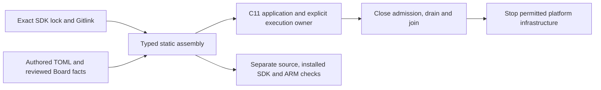

# Nexus Examples

本仓库维护 Nexus 的应用组合、独立起始工程和消费验证。平台公共机制位于
`external/nexus`；产品凭据、私有 PCB、协议策略和签名资料属于独立产品仓库。
当前 GitHub 仓库为公开仓库，示例源码与运行记录应遵循同一公开边界。

This public repository owns application composition, standalone starters and SDK
integration checks. Nexus owns reusable mechanisms. Proprietary product data and
credentials belong in separate product repositories.

## 目录与职责 / Layout and ownership

| 目录 / Directory | 职责 / Responsibility |
| --- | --- |
| `apps/` | C11 应用及明确标注的策略片段 / Applications and policy fragments |
| `configs/` | 主工程九份明确装配 / Nine authored main-build assemblies |
| `templates/` | 五个可独立复制的起始工程 / Five standalone starters |
| `tests/` | 应用合同、工具回归、installed SDK 消费和测试支撑 / Maintained tests and support |
| `scripts/` | 构建、身份验证、开发门禁与本地 CI / Build and validation commands |
| `dependencies/` | Nexus、GoogleTest 精确源码锁 / Exact source locks |
| `external/` | 两个受锁定的 Git 子模块 / The two pinned Git submodules |
| `docs/` | 当前构建、示例、板卡与验证 / Current development guides |



箭头表示当前配置与生命周期关系；图中的软件检查不代表实板验收。
The diagram describes current configuration and lifecycle relationships; software
checks do not establish physical qualification.

## 当前范围 / Current scope

主工程维护九个 preset：一个 Native，加四个精确 STM32F407 Board 的裸机／
FreeRTOS 两后端。五种模板为 Native、启明 V3.1、天空星青春版、启明核心板和
启明 V4.1。精确 SDK commit/tree 只由 `dependencies/nexus.lock.json` 与
`external/nexus` Gitlink 共同选定；兼容版本或历史结果不能替代它们。

The main build has one Native and eight F407 board/backend presets. Five
starters are indexed by `templates/manifest.json`. Each changed SDK pin needs its
own source and installed-SDK integration; a previous pass does not qualify it.

`platform_reference` 与 `uart_owner_runtime` 覆盖主矩阵；其余应用的 Native、
独立软件参考或策略片段范围见[示例指南](docs/examples.md)。Native 需要显式
`NEXUS_TEST_SUPPORT=ON`，模型控制目标也必须显式选择。固件为 C11，GoogleTest／
GoogleMock 只进入宿主测试。全部实板 HIL 目前为 **`not_executed`**。

The application catalogue distinguishes runnable examples, software fixtures and
fragments. Native controls are explicit test support; host frameworks do not
enter firmware. No physical board qualification is claimed.

## 从这里开始 / Start here

```sh
git submodule sync -- external/nexus external/googletest
git submodule update --init --depth 1 -- external/nexus
git submodule update --init --depth 2 -- external/googletest
python3 external/nexus/tools/dev/dev.py prepare --scope native --allow-network
python3 scripts/setup_dev_tools.py
.venv/bin/python -m pip install -r external/nexus/dependencies/environment-tools.txt
. .venv/bin/activate
python scripts/verify_sdk.py
python scripts/build.py --preset native-debug --test --parallel 2
```

依赖获取仅在显式准备阶段进行；普通构建和门禁离线。ARM 工具链与完整本地 CI
步骤见[构建指南](docs/build.md)。factory 只获取已有接口，Platform 管基础设施，
应用拥有任务、调度、借用存储和恢复决策。

Only explicit preparation obtains dependencies. Builds and gates stay offline.
Factory lookup has no hardware effects; applications own execution and recovery.

- [构建与 SDK 消费 / Build and SDK consumption](docs/build.md)
- [应用与起始工程 / Applications and starters](docs/examples.md)
- [板卡与外部 Board / Boards and external packages](docs/boards.md)
- [验证、交付与 HIL / Validation and delivery](docs/validation.md)
