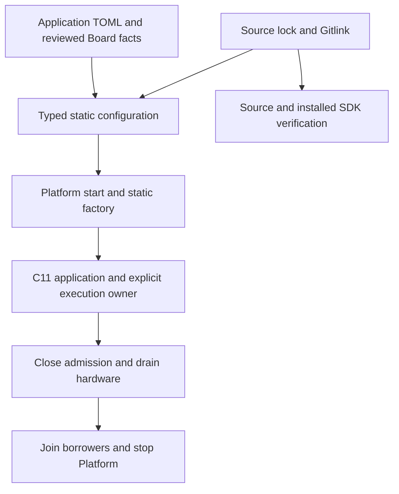

# Nexus Examples

本私有仓库维护应用组合、工程模板和平台消费验证。Nexus 主库只维护通用机制；
应用任务、协议、Flash 分区、产品恢复策略和 PCB 私有资料由应用或产品仓库维护。
源码、日志及归档不得随公共平台发布。精确平台身份由
[源码锁](dependencies/nexus.lock.json) 与 `external/nexus` Gitlink 一起确定。

This private repository owns application composition, starters and integration
checks. Nexus owns reusable mechanisms. Keep application source and evidence
inside this access boundary. The source lock and Gitlink select one exact SDK;
a version string or a successful older run never substitutes for that identity.



## 当前范围 / Current scope

生产 MCU 示例收敛为 STM32F4，目前只选择 F407VE／ZG。主工程维护 **9 个 preset**：
Native 加四个精确 Board 的裸机／FreeRTOS 两后端。模板清单维护 **5 个工程**：
Native、启明 V3.1、天空星青春版、启明核心板、启明 V4.1。对应原理图、引脚与
模块选择见[Board 说明](docs/boards.md)。ILI9341／XPT2046 型号已知并不自动
启用模块；最小工程明确要求未选模块断开，不能替代实际装配检查。

Production examples currently select F407VE/ZG through four exact Boards and
two backends: eight ARM presets plus one explicit Native test preset. The five
starters are indexed and hashed by `templates/manifest.json`. Board facts,
selected software modes and physical acceptance remain distinct.

H7、U5、F1、G4、GD32 的工程、preset 和专属测试退出当前入口；平台保留的 vendor
库存不因此删除。通用流借用、FIFO 消费、Flash 维护和失败恢复测试继续维护。
[固定历史源码](https://github.com/X-Gen-Lab/nexus-examples/tree/e48c442d78ddf438ed5be0b562e541dabc069b8f)
保留原工程和其原始身份；旧结果不授予新版本资格。

Retired SoC recipes and tests of their removed capabilities are available at
that fixed historical source. Generic contracts retain their real C tests.
No board is connected: physical HIL remains **`not_executed`**.

| 应用 / Application | 当前行为 / Current behavior |
| --- | --- |
| `platform_reference` | Native 有限执行；四板 GPIO／UART、裸机或静态 FreeRTOS / GPIO and UART composition |
| `uart_owner_runtime` | 多 producer、取消、排空、join 与启动失败责任 / Shared owner and explicit shutdown |
| `sensor_spi` | Native BMP280 参考数据及 SPI 端点 / Sensor calculation and endpoint contract |
| `journal` | 文件 Flash、关闭重开和恢复 / File-backed persistence recovery |
| `modbus_registers` | 授权、CRC、异常回复及 TX 完成 / Register policy and wire completion |
| `shared_spi_runtime` | 两任务、两端点；独立 F407 软件 fixture / Two tasks and endpoints, software wiring only |
| `stream_recovery` | 有限 Native 流、loss、借用及停止失败 / Stream ownership and backpressure |
| `industrial_control` | Native 采集、协议、持久化和健康组合 / Explicit industrial composition |
| `network_gateway` | Native lwIP、TLS、MQTT 与独立 peer / Explicit network composition |
| `usb_configuration` | 独立 Native USBControl 合同 / Standalone control-request application |

Native 模型仅在 `NEXUS_TEST_SUPPORT=ON` 时使用。固件为 C11；GoogleTest／
GoogleMock 只进入宿主合同。factory 返回已有只读接口，不分配、不初始化硬件。
`nx_platform_start/stop` 管基础设施，应用决定任务、调度、队列和恢复。

Native is explicit test support. Firmware stays C11; GoogleTest/GoogleMock are
host-only. Factory lookup has no hardware effects. Applications own execution,
borrowed storage and recovery, including storage retained after a failed drain.

## 开发与验证 / Development and verification

```sh
git submodule sync -- external/nexus
git submodule update --init --depth 1 -- external/nexus
python3 external/nexus/tools/dev/dev.py prepare --scope native --allow-network
python3 scripts/setup_dev_tools.py
.venv/bin/python -m pip install -r external/nexus/dependencies/environment-tools.txt
. .venv/bin/activate
python scripts/test_repository.py
python scripts/check_style.py --all
python scripts/build.py --preset native-debug --test --parallel 2
python scripts/build.py --preset stm32-qiming-baremetal --parallel 2
python scripts/build.py --preset stm32-qiming-core-freertos --parallel 2
```

仅显式准备阶段允许获取已锁定依赖；普通检查和构建离线运行，不递归下载未选库存。
ARM 使用 SDK 的 SHA-256 锁定工具链。每个 preset 有独立构建目录，平台参考与
UART owner 各产生一个 ELF，并分别检查实际 Flash／RAM 预算。

Only preparation downloads selected dependencies. Builds and ordinary checks
stay offline. ARM uses the SDK's locked GNU toolchain. Presets own separate
build roots; both firmware targets receive independent ELF budget checks.

完整本地 CI 见[本地指南](docs/local-ci.md)。GitHub Actions 额度不足时，以实际
本地记录为准，不把本地结果写成托管 CI。普通 commit hook 执行完整 Native／
Google 合同和工具测试，不能用部分目标结果替代。

The [local CI guide](docs/local-ci.md) reuses the maintained build graph and
complete ordinary gate. It also consumes a fresh installed SDK. Local execution
does not establish GitHub-hosted CI or physical qualification.

## 消费入口 / Consumer entry points

- [SDK 构建与身份 / SDK identity and build](docs/build-integration.md)
- [五种模板与应用生命周期 / Starters and lifecycle](docs/developer-recipes.md)
- [外部 Board / External Board](docs/external-board.md)
- [组件组合 / Component composition](docs/component-examples.md)
- [交付边界 / Delivery boundaries](docs/delivery.md)
- [验收准备 / Acceptance preparation](docs/delivery-preparation.md)
- [后续硬件工作 / Remaining hardware work](docs/examples-roadmap.md)
