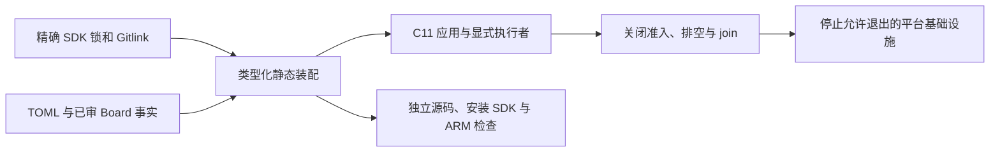

# Nexus 应用示例

本仓库维护 Nexus 的应用组合、独立起始工程和消费验证。通用平台机制位于
`external/nexus`；产品凭据、私有 PCB、协议策略和签名资料属于独立产品仓库。
本仓库公开，示例源码与运行记录遵循同一公开边界。

## 从任务开始

| 你要完成什么 | 入口 |
| --- | --- |
| 创建自己的最小 Native 应用 | [平台首次运行教程](https://github.com/X-Gen-Lab/nexus/blob/6a57d0af12c89a51c2aa31a9463690c981305c63/docs/tutorials/first-native.md) |
| 创建自己的 F407 工程 | [平台首次构建教程](https://github.com/X-Gen-Lab/nexus/blob/6a57d0af12c89a51c2aa31a9463690c981305c63/docs/tutorials/first-f407.md) |
| 选择应用组合、模板或软件参考 | [应用与起始工程](docs/examples.md) |
| 编译或维护本仓库全部示例 | [下面的维护准备](#维护本仓库)与[构建指南](docs/build.md) |
| 核对板卡、接线和验证范围 | [板卡说明](docs/boards.md)、[验证说明](docs/validation.md) |

最小工程教程使用自己的 TOML 选择依赖，无须先准备完整示例维护图。教程中的平台
与模板分别固定提交；切换所选 SDK 时使用对应源码中的教程和接口。

## 目录与职责

| 目录 | 责任 |
| --- | --- |
| `apps/` | C11 应用及明确标注的策略片段 |
| `recipes/` | 控制、存储、诊断、更新与 USB 交接的[应用层组合片段](recipes/README.md) |
| `configs/` | 主工程九份明确装配 |
| `templates/` | 五个可独立复制的起始工程 |
| `tests/` | 应用合同、工具回归、安装 SDK 消费和测试支撑 |
| `scripts/` | 构建、身份验证、开发门禁与本地 CI |
| `dependencies/` | Nexus、GoogleTest 精确源码锁 |
| `external/` | 两个受锁定的 Git 子模块 |
| `docs/` | 当前构建、示例、板卡与验证 |



箭头表示当前配置与生命周期关系；软件检查不代表实板验收。factory 只取得已有
接口，不分配或启动硬件；应用拥有任务、执行进度、借用存储和恢复决策。

## 当前范围

主工程维护九个 preset：一个 Native，加四个精确 STM32F407 Board 的裸机／
FreeRTOS 两后端。五种模板为 Native、启明 V3.1、天空星青春版、启明核心板和
启明 V4.1，由 `templates/manifest.json` 索引。

常用组件的软件参考包括控制算法、触摸校准、FlashDB／Settings、运行诊断、更新
准备和 USB MSC 交接。它们通过公开接口显式组合，具体范围与约束见 `recipes/`。

精确 SDK commit/tree 由 `dependencies/nexus.lock.json` 与 `external/nexus`
Gitlink 共同选定；每次更新须取得对应源码与安装 SDK 的实际集成结果。版本相同、
路径覆盖或历史通过都不能替代所选源码身份。

`platform_reference` 与 `uart_owner_runtime` 覆盖主矩阵；其余应用的可运行
Native、独立软件参考和策略片段范围见[示例指南](docs/examples.md)。Native 需要
显式 `NEXUS_TEST_SUPPORT=ON`，模型控制目标也必须显式选择。固件保持 C11，
GoogleTest／GoogleMock 只进入宿主测试。全部实板 HIL 目前为 **`not_executed`**。

## 维护本仓库

以下从完整检出根目录准备本仓库的维护测试图，需要主机编译器和构建工具。
`--scope native` 选择完整 Native 维护依赖；创建最小应用使用上面的教程。

```sh
git submodule sync -- external/nexus external/googletest
git submodule update --init --depth 1 -- external/nexus
git submodule update --init --depth 2 -- external/googletest
python3 external/nexus/tools/dev/dev.py prepare --scope native --allow-network
python3 scripts/setup_dev_tools.py
.venv/bin/python -m pip install -r external/nexus/dependencies/environment-tools.txt
. .venv/bin/activate
python scripts/verify_sdk.py
python scripts/build.py --preset native-debug --test --parallel 2
```

依赖只在显式准备阶段获取，普通构建和门禁离线。ARM 工具链、SDK 消费及完整本地
CI 步骤见[构建指南](docs/build.md)，各项检查与 HIL 边界见[验证说明](docs/validation.md)。
