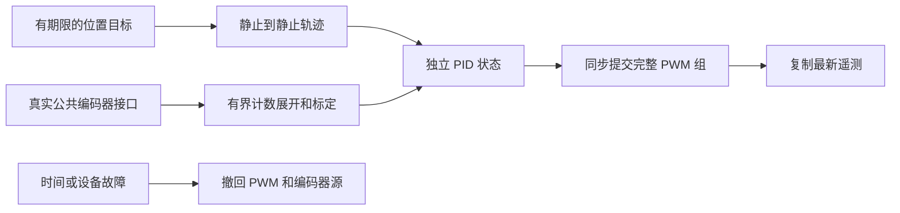

# 单轴位置控制软件参考

本目录提供可直接编译的 C11 应用组合：编码器读数、标定、有界计数展开、梯形轨迹、
PID 和两通道 PWM 组更新。它通过 Nexus 公共接口访问设备，不包含厂商 Handle、
功率板接线、隐式任务、动态对象池或硬件探测。

这是 **Thread 模式的软件参考**。当前 F4 编码器和 waveform 实现有任务上下文约束；
本例不能作为 IRQ 电流环、FOC、机械制动或实板电气验证结果。组合 PWM＋ADC 的
硬件快环属于独立 provider 模式，不由本例推导。

## 绑定与启动

应用从自己的静态 factory 取得独立编码器和 PWM 组。两者不能重复占用同一个 timer。
`example_axis_initialize` 只复制显式配置、初始化算法，不启动设备。

应用提供计数模数、最大单步位移、计数到弧度的标定、标定版本、PWM 周期与触发位置、
最大循环间隔、硬件身份、单调时钟 domain/epoch，以及整组参数。参数包含 PID、
位置范围、轨迹最大速度与加速度。示例和测试中的数值不作为产品默认值。

`example_axis_start` 启动编码器并建立当前参考，检查范围，暂存两个通道都为零的
完整组，然后才启用 PWM。正命令使用通道 0，负命令使用通道 1。实际 H 桥、方向
互锁、空闲电平、死区和电流保护由精确硬件 profile 决定；零占空不自动证明断能。

启动失败时分别尝试撤回已产生效果的源；失败标志保持在调用者状态中。

## 目标、周期与测量事实

`example_axis_command` 接纳弧度位置目标、递增 sequence、当前 epoch 和有限有效期。
旧代次、过期、越界和错误单位直接拒绝。一次逻辑会话结束并排空全部发布者后，
新会话应提供新的 epoch；不能通过重复初始化复用旧网络命令的身份。当前选择静止到静止的点到点 profile，移动
期间拒绝替换目标；轨迹完成表示命令计算完成，不表示机构已经达到目标或静止。

同一个已有执行者构造 `example_axis_cycle_t` 并调用 `example_axis_step`：

- release 是微秒单调域中的软件释放观察，不能解释为编码器边沿或 ADC 采样孔径。
- 连续的 cycle sequence、匹配的 epoch/domain 和标定版本用于检查当前消费链。
- 无效质量、漏期、时间倒退和过期目标会关闭控制准入，尝试停止两源。
- `nx_encoder_read` 返回独立的软件观察时间。计数速度与 PID 的 `dt` 使用相邻
  观察间隔；它不把软件读取速度解释为硬件边沿时间或精确机械速度。
- 最大位移预算必须由应用保证；计数器漏掉的完整圈数无法通过两次读数恢复。
- 每次成功提交两个通道的完整 duty 组。成功仅表示暂存，不证明电气输出已经更新。

## 参数完整切换与显式保存

`example_axis_stage_parameters` 校验完整的新 revision，并在独立副本中验证 PID
无扰切换。运行状态只在下一次循环边界同时切换参数和 PID 状态；不会逐字段改动
正在使用的配置。移动期间禁止修改运动边界；轨迹计算完成后仍在保持目标时，新位置范围必须同时包含
实际位置和保留目标。标定保持启动配置中的明确版本。

这里所有操作均由同一执行者串行完成。跨任务输入应通过应用已有 queue/guard 复制
后交给该执行者；普通结构体字段和双缓冲本身不构成跨 IRQ 的并发发布协议。

关闭两源后可调用 `example_axis_apply_parameters` 应用剩余候选，再显式保存。
`example_axis_save_parameters` 复用已有 Settings，保存固定小端 binary32 记录及
硬件／标定身份；它提交 Settings 中完整的已暂存快照。保存失败不回滚已生效参数，
也不更新 `persisted_revision`。实际 marker 可能已经写入，需要按 Storage 合同恢复。

加载只接受精确格式、身份、尺寸和合法边界。不存在、损坏、其他 schema 或身份不匹配
均返回错误，保留当前参数，不自动创建默认值、迁移或格式化介质。

F407 单 bank Flash 写擦可能停顿取指和中断，因此本例只在控制源关闭后保存。实际分区、
schema、迁移、授权、耐久和维护窗口属于外部产品。

## 遥测与退出

每轮成功只更新一个固定的复制快照。`example_axis_take_observation` 在同一执行者中
取走它，再由外层决定是否发送；控制路径不调用网络、日志或文件系统。未取走的旧副本
允许被覆盖，累计次数明确报告。快照包含目标序号、采样序号、参数与标定版本以及具有
来源／时间域的观测事实，不借用 I/O 数据。

任意故障锁存后，应用尝试分别停止 PWM 与编码器。停止失败保留对应 started 标志；
继续调用 `example_axis_stop` 直到退出。故障保持锁存，不自动重新使能。源退出成功
仍需外部使用者 join 和 Platform 的冷态关闭，之后才能重建状态或回收 provider。

## 软件验证

`axis_control_google` 执行真实 C 算法、公共 I/O 分发和 Settings/Storage。只有设备
操作和物理存储介质使用外部 fixture，测试不复制控制器、轨迹或持久化算法。

主机模型、ARM 编译和实板分别建立不同范围的证据。所有电气、控制对象、真实周期和
HIL 验证仍为 `not_executed`。
