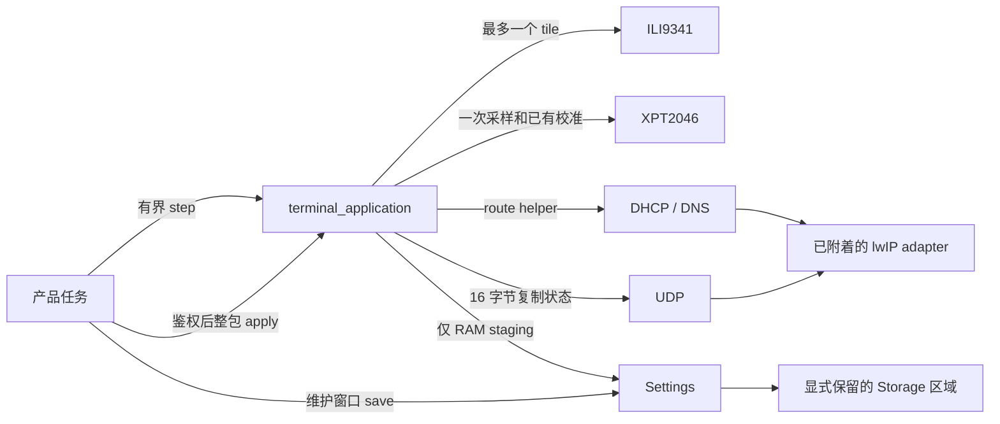

# 小缓冲联网终端

这是一个实际的 C11 应用组合：同一个调用任务推进 ILI9341 局部绘制、
XPT2046 校准触摸、托管 IPv4 路由、UDP 状态和 Settings 参数。它复用
`recipes/ui`、`recipes/control/touch_reference` 和 `recipes/network` 的
实现，不再复制网络状态机。这里交付的是软件参考，没有实板资格。



## 使用顺序

在产品 CMake 中先通过公共 `find_package` / `nexus_add_platform` 配置平台，
再 include 本目录的 `application.cmake`。链接
`connected_terminal_application`，由产品入口提供已初始化的显示、触摸、
Settings、已附着的托管网络适配器，以及冷态 DHCP、DNS、UDP 对象。
这些对象的真实存储按各公共 `*_storage.h` 查询分配；应用不创建隐式对象池。

1. 设置实测触摸校准、显示方向、静态 tile、16 字节 UDP RX 存储和有限路由
   总 deadline / turn budget。240 像素宽的两行 tile 占 960 字节，
   应用不另建整屏 framebuffer、LVGL arena、TLS、任务或 libc heap。
   lwIP 原 owner 的固定 heap／pool 和协议对象仍须单独计入网络预算；
   本例的小 tile 不代表整个组合只占 960 字节 RAM。
2. 调用 `example_terminal_start`。它读取 Settings RAM staging、校验精确
   12 字节产品格式并准备路由元数据；缺失 key 才采用显式 defaults。
   有损、未知格式或非法值不自动格式化、不静默替换。
3. 产品根据真实 PHY 观测先调用适配器的 link 接口，再调用
   `example_terminal_step(terminal, link_up, finite_deadline)`。
   每轮推进一次路由、一次触摸和最多一个 tile，最多发送一个状态报文。
   当前绘制中的矩形颜色保持不变；参数或联网状态变化排到下一矩形。
4. 从已经鉴权的产品控制入口调用 `example_terminal_apply`。它整包校验，
   将参数复制到 Settings RAM，成功后才发布新版本。`refresh_ms` 是状态
   报告间隔，范围 10..5000 ms；颜色使用 RGB565。版本不回绕。
5. 只有产品已经暂停危险实时工作、获得独占 Flash 维护窗口时，才调用
   `example_terminal_save(terminal, true)`。F407 片内单 bank 写擦可能暂停
   CPU，不能从普通 UI 周期、IRQ 或网络回调触发。这里的 bool 是产品明确
   授权事实，不是鉴权实现。保存失败保留活动 RAM 参数，不自动重试；
   重开 Storage、Settings 后检查实际持久版本再作决策。
6. 停机先 join 所有应用用户，再反复以有限清理预算调用
   `example_terminal_stop`。它按 UDP → DNS/DHCP → touch → display 顺序退出。
   任一步 BUSY/失败保留剩余 owner，不能释放对象或停止共享总线/平台。
   成功后由产品处理 Settings、适配器、物理总线和 Platform 的关闭。

路由失效、IP 改变、deadline 到期或 turn budget 耗尽会关闭新的网络准入，
记录 `network_error`，先退出 UDP，再 join DNS/DHCP。UI 继续可用；不会偷偷
续期或重连。恢复属于产品策略：完整停止后，以新的预算显式重新 start。
触摸或绘制失败则锁存 `ui_error`，停止新 UI 工作，交由产品清理设备 owner。
公开状态只在同一任务调用之间读取；这里没有跨任务发布或锁。

## 固定产品报文与存储

参数以一个 Settings key 保存，12 字节小端序：格式 `1`、保留字节 `0`、
`refresh_ms:u16`、离线颜色 `u16`、在线颜色 `u16`、非零版本 `u32`。
不保存 C struct 的 padding；底层 Storage 负责断电提交与 CRC。
该格式没有认证、机密性或自动迁移承诺。

状态 UDP 固定 16 字节：`NT`、格式 `1`、bit0 触摸有效标志、参数版本
`u32`、逻辑触摸 X/Y 各 `u16`、本次运行递增序号 `u32`，整数均为小端序。
触摸标志为零时坐标无效。SUCCESS 仅代表本地发送准入，不能视作对端送达；
没有重传、遥控、去重或 exactly-once 承诺。UDP RX 存储按底层接口提供，
本例不把接收报文当成未经鉴权的参数命令。

## 接入和验证边界

`application.cmake` 可被源码工程及 Source SDK 消费工程共同 include；
同一套 C 源码适用于提供所选公共接口的目标。整机内存预算按所选镜像核对。

| 数据 | 当前参考的预算依据 |
| --- | --- |
| 显示与 UDP | 两行 RGB565 tile 共 960 B，加 16 B 常驻 RX。每次发送暂用 16 B 栈缓冲，由 UDP 复制 |
| Settings／Storage | 单个 12 B value，另计 Settings image、Storage workspace、对齐和实际保留 Flash 区域 |
| lwIP | 当前默认复制配置声明 16 KiB lwIP heap 和 24 个 512 B payload 的 pbuf pool。另计对齐、元数据、其他池和 MAC buffers |
| 其余 SRAM | 按 `*_storage.h` 查询记录网络对象大小，并计入应用、显示、触摸、时钟与任务栈。整机以链接 map 和资源报告为准 |

Qiming Core 与 V4.1 的软件 Board 均声明 ILI9341 FSMC NE4 及 XPT2046 GPIO
触摸路线，需要明确选择相应模块。Core 没有本组合的网络路径。V4.1 的 P5
有 Ethernet 选项，但尚未准入 Ethernet binding。接线审查需确认 DP83848
时钟、PHY 地址和模式、MDIO 连通及 RX_DV／CRS_DV 兼容性。随后对同一 Board
核对显示、触摸、时钟、网络与独占 Settings Flash 区域，并验证实际链路与掉电。
LVGL、WM8978、OV2640 及 FreeRTOS STOP 桥接须另有产品需求和对应验收记录。

`tests/apps/connected_terminal` 使用真实应用 C、UI/路由 helper 和
Settings/Storage；在公开显示、触摸、lwIP 边界注入返回值，Flash 使用 RAM
介质模型。它证明组合与失败退出规则，不能证明真实网络报文、电气、显示
时序或掉电行为。物理 HIL 为 `not_executed`。

```sh
cmake --build build/native-debug --target connected_terminal_test
ctest --test-dir build/native-debug -R '^connected_terminal_google$' \
  --output-on-failure --no-tests=error
```
