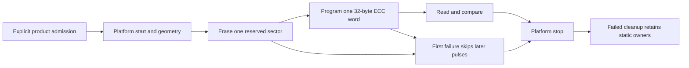

# H743 Flash/RAM maintenance / Flash 与 RAM 维护

This independent C11 application selects exact STM32H743ZIT6 revision V,
baremetal, HSI64 and Cache off. TOML selects the physical Flash provider; the
application reserves the final 128 KiB sector at physical offset `0x001e0000`.
That reservation belongs to this example, never to Nexus or another product.

本独立 C11 工程选择精确 STM32H743ZIT6 V 修订、裸机、HSI64 与 Cache off。
TOML 选择物理 Flash provider；应用自行保留物理偏移 `0x001e0000` 的最后一个
128 KiB 扇区。该保留属于本示例，不是平台分区，更不能推断其他产品允许使用。

The application owns a separate writable 32-byte `s_payload` in AXI RAM. It fills
that object before erase and passes that exact object to the Flash API. A C
`static const` marker in Flash is not valid input for this exact provider:
its alias guard excludes the entire physical Flash domain, even before RAM
staging. Host tests check the exact caller buffer; the ARM ELF/map establishes
its actual `.bss` address and size separately.
Before erase, the application additionally checks the complete payload span
against this reference's AXI RAM; a misplaced buffer rejects before a pulse.

应用在 AXI RAM 中单独拥有 32 字节可写 `s_payload`，擦除前填充，并把同一个对象
交给 Flash API。本 provider 不接受 Flash 中的 C `static const` marker：其 alias
guard 排除整个物理 Flash 域，即使内部后续会暂存到 RAM。宿主测试检查精确调用者
buffer；真实 ARM ELF／map 单独证明它的 `.bss` 地址与大小。
擦除前，应用还检查完整 payload 范围位于本参考配置的 AXI RAM；放置错误在脉冲前
就被拒绝。

## Build / 构建

From the examples repository, use the exact clean SDK selected by its Gitlink
and source lock. The independent CMake entry owns one local `assembly.toml`.

在示例仓库根目录使用 Gitlink 与源码锁选择的干净 SDK。独立 CMake 入口只有一份
本地 `assembly.toml`，不修改主项目 preset 或生成文件。

```sh
cmake -S apps/flash_maintenance/h743 -B build/flash-maintenance -G Ninja \
  -DNEXUS_SOURCE="$NEXUS_SOURCE" \
  -DCMAKE_TOOLCHAIN_FILE="$NEXUS_SOURCE/cmake/toolchains/arm-gcc.cmake" \
  -DCMAKE_BUILD_TYPE=Release
cmake --build build/flash-maintenance --target flash_maintenance --parallel 1
```

The selected SDK automatically audits the actual ELF's RAM execution closure,
CPU bridge, vector/MPU return gate and retained public Flash linkage. Preserve
`bin/flash_maintenance.h743-flash-ram.json` and the resource report with that ELF.
The 4096-byte main-stack budget is a link reservation, not a measured stack peak.

选定 SDK 自动审核真实 ELF 的 RAM 执行闭包、CPU bridge、vector/MPU 返回门和
保留的公共 Flash 链接。应把 `bin/flash_maintenance.h743-flash-ram.json`、资源报告
与同一个 ELF 保留。4096 字节主栈预算是链接保留，不是实测峰值。

## Explicit maintenance / 显式维护

Default execution returns before Platform start: `example_flash_authorization`
is zero. Only after reviewing the complete
[SDK maintenance contract](../../../external/nexus/docs/design/h743-flash-ram.md),
halt at `main` and set it to `0x4e58464d`. This debugger switch is deliberate
example admission, not authentication or a security capability. Do not enable
it on a product containing data in the selected sector.

默认 `example_flash_authorization` 为零，程序在 Platform start 前返回。完整审查
[SDK 维护合同](../../../external/nexus/docs/design/h743-flash-ram.md) 后，才可在
`main` 断点处把该值设置为 `0x4e58464d`。此调试开关只表达示例的显式准入，不是
认证或安全能力。若选定扇区包含产品数据，不得启用。

The boot/product owner must prove the exact revision, voltage/clock profile,
incoming stack extents, quiet Cache/MPU state and exclusion of every other
Flash user and bus master. Joining CPU tasks does not stop DMA, USB, Ethernet,
debug accesses or NMI/HardFault activity. The provider checks its actual linked
image, but cannot discover unrelated product data or another agent's lease.
Watchdog, power loss and a permanently busy controller need product policy.

Boot／产品 owner 必须证明精确修订、电压／时钟、入口栈范围、Cache／MPU 状态，
并停止及 join 其他 Flash 用户和总线 master。CPU 任务退出不等于 DMA、USB、
Ethernet、调试访问或 NMI／HardFault 已停止。provider 会检查实际链接镜像，却不能
发现其他产品数据或另一个 agent 的借用。watchdog、掉电及永久忙需要产品策略。



One invocation performs a successful sector erase before one marker pulse.
Failed erase never programs; failed programming never retries that ECC word or
reports verification. The same finite absolute Core deadline covers both calls.
Its expiry cannot cancel a physical pulse: synchronous maintenance may remain
in the SDK's RAM drain path indefinitely. A return proves pulse settlement;
it does not prove the product survived power loss or met interrupt latency.

每次执行先成功擦除一个扇区，再对一个 32 字节 ECC 单元编程。擦除失败不编程；
编程失败不重试该 ECC 单元，也不报告验证成功。两个调用使用同一个有限 Core
绝对 deadline。到期不能取消物理脉冲：同步维护可能永久留在 SDK 的 RAM 排空路径。
返回证明脉冲已结清，不证明产品掉电安全或满足中断时延。

Report flags mean successful API returns only. A false `erased` or `programmed`
does not prove unchanged Flash: an error may follow a completed pulse or partial
operation. The cycle provides no atomic update, rollback or automatic retry.

报告标志只表示 API 成功返回。`erased` 或 `programmed` 为 false 不证明 Flash
未变化：错误可能发生在已完成脉冲或部分操作之后。该闭环不提供原子更新、回滚或
自动重试。

Observe `example_flash_result` and `example_flash_report` with the debugger.
Cleanup performs at most 64 Platform-stop attempts without reading the old
Core clock; unfinished cleanup parks with every static owner retained.

调试器可读取 `example_flash_result` 和 `example_flash_report`。清理最多尝试
64 次 Platform stop，不再读取旧 Core 时钟；未完成则原地保留所有静态 owner。

## Verification / 验证

`flash_maintenance_test` executes the same application policy with the real
public region API and mocked external Flash operations. It checks zero-pulse
rejection, exact region boundaries, erase/program/read ordering, no ECC retry,
read errors and byte mismatch. The existing local CI includes this ARM consumer
in its H743 baremetal row. Tests and ELF audits establish software behavior;
all physical Flash, voltage, power-cut and timing checks remain `not_executed`.

`flash_maintenance_test` 使用真实公共 region API，mock 外部 Flash 操作，执行
同一应用策略，检查零脉冲拒绝、区域、擦写读取顺序、禁止 ECC 重试、读取错误及
字节不匹配。本地 CI 的 H743 裸机行包含该 ARM consumer。测试与 ELF 审核建立软件
行为证据；真实擦写、电压、掉电和时序验收仍全部为 `not_executed`。
