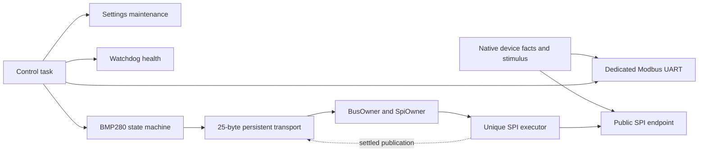

# Industrial control reference / 工业控制参考

This finite **Native** application composes BMP280, SPI owner, Modbus, Settings
and watchdog mechanisms. It demonstrates application-owned execution and
shutdown; it is not an MCU industrial product or a physical Board test.

这是有限执行的 **Native** 工业组合示例，演示应用拥有的任务、协议、存储、健康判断
和停机流程，不声明 MCU 工业产品或实板资格。

```text
main.c                       Dedicated file-NOR and finite command-line entry
industrial_application.c/.h  Control, register, health and persistence policy
industrial_spi.c/.h          Settled BMP280 transport through one SPI executor
native/model.c/.h            Bosch register facts and finite Modbus stimulus
```

The Native model owns its register, RX and TX observation storage. It injects
requests and checks actual replies through public model ports. The control task
owns protocol callbacks and useful work; a separate task exclusively executes
SPI. Model controls are an explicit `Nexus::NativeModel` target dependency.

Native 模块拥有模拟寄存器、RX 和 TX 观测存储，通过公开模型端口注入请求并检查
真实回复。控制任务拥有协议回调和业务进展，另一个任务唯一执行 SPI；模型控制由
`Nexus::NativeModel` 显式选入，不增加注册表、隐藏 worker 或第二套产品框架。

From the repository root / 从仓库根目录执行：

```sh
python scripts/build.py --preset native-debug --parallel 2
ctest --test-dir build/native-debug \
  -R '^industrial_control_(reference|google)$' --output-on-failure
build/native-debug/bin/industrial_control /tmp/dedicated-industrial-model.dat
```

Use one dedicated file-NOR path. Focused CTest is development feedback; final
qualification uses the exact SDK lock and the complete ordinary gate. The
installed SDK entry at `tests/integration/installed_sdk` reuses this same
`firmware.cmake` and runs `installed_industrial_control` without adding a Google
framework to the firmware SDK.

使用一个专用文件 NOR 路径。定向 CTest 仅提供开发反馈；最终验收需要精确 SDK 锁和
完整普通门禁。`tests/integration/installed_sdk` 复用同一 `firmware.cmake`，运行
本 CLI 的 installed 测试，不把 Google 框架放进固件 SDK。



| Budget / 预算 | Value / 取值 |
| --- | --- |
| Sampling / 采样 | CLI: 100 ms, three samples / 默认三次 |
| Period / 周期 | 50..1000 ms, integral milliseconds, operation budget + 50 ms minimum |
| SPI operation / 操作 | Default 30 ms absolute deadline, one owner slot |
| Modbus | 115200, 8N1, ten bits/character; TX 30 ms, abort 2 ms |
| Shutdown / 停机 | Default 500 ms; expiry never revokes a loan |
| Watchdog / 健康 | Default 1 s; actual minimum must cover two periods + 100 ms |
| Native storage / 存储 | 64 KiB worker stack, 25-byte TX/RX, 32 RX events, 64-byte Settings image |

The BMP280 shim copies at most 25 bytes into persistent storage before
admission. Only SETTLED permits reuse and RX copy-back. Timeout closes new
transactions and retains the slot; cancellation cannot undo an executed polling
transfer. Join every request, worker and notification publisher before destroying
storage. Each SPI turn performs at most two service steps before waiting;
periodic readiness cannot extend an operation deadline.

BMP280 shim 在准入前将最多 25 字节复制到持久存储；只有 SETTLED 才允许复用与
拷回。超时关闭新事务并保留槽，取消不能撤销已执行的轮询传输。回收前必须 join
请求、worker 和所有通知发布者。SPI 每轮至多推进两步；周期到期不延长操作期限。

Registers 0..3 expose temperature, pressure and sample generation. Register 4
stages a bounded period; 5 is dirty; 6/7 are read-only zero. The fixture performs
one read, one authorized write and one rejected write in separate turns, checking
bytes, CRC and TC. Requested periods must satisfy both operation and actual
watchdog limits. Modbus RTU does not authenticate peers.

寄存器 0..3 表示温度、气压和采样序号，4 暂存合法周期，5 为 dirty，6/7 为只读零。
模型分轮执行读、授权写和拒绝写，检查字节、CRC 和 TC。周期同时受操作预算和实际
watchdog 窗口约束；Modbus RTU 不提供对端认证。

Schema 1, key 1 stores the period in four little-endian bytes. Only missing data
uses defaults; unknown schemas and corruption fail closed. Commit follows
protocol stop, request settlement and executor join. Failed commit requires
reopening Storage/Settings to discover the surviving generation. Unconfirmed I/O
join retains static I/O storage and rejects another invocation. Shutdown starts
one configured budget for device drain in platform time and for kernel join in
host monotonic time. An unsuccessful join returns its original status. The
irreversible watchdog stays active through Platform stop. The model explicitly
starts a new boot only after the previous invocation quiesces.

schema 1、key 1 使用四字节小端周期值；只有数据缺失才采用默认值，未知 schema 或
损坏记录失败关闭。协议停止、请求 settled、executor join 后才 commit。提交失败需
重开 Storage/Settings 确认存活版本。I/O join 未确认时保留静态存储并拒绝再次运行。
关闭开始时，用同一配置时长分别在平台时钟域和宿主单调时钟域计算排空与 join 的
绝对时限。join 失败返回原始状态。
平台停止不关闭不可逆 watchdog；模型只在前次静默后显式模拟下一次 boot。

[Google contracts](../../tests/apps/industrial_control/industrial_control_test.cpp)
execute the actual C application and SPI executor, including deadline, cold-start
and join failures. They establish no sensor wiring, RS485 electrical behavior,
physical Flash, IRQ timing or watchdog qualification. Physical HIL remains
`not_executed`.

[Google 合同](../../tests/apps/industrial_control/industrial_control_test.cpp)
运行真实 C 应用和 SPI executor，覆盖时限、冷启动与 join 故障；不推断传感器接线、
RS485 电气、物理 Flash、中断时序或真实 watchdog 资格。实板 HIL 为 `not_executed`。
