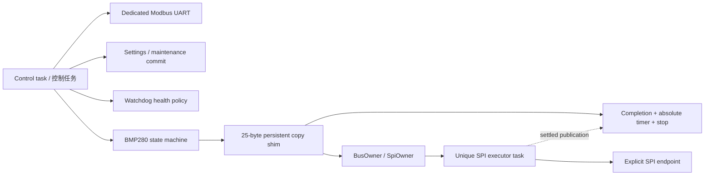

# Industrial control reference / 工业控制参考

This finite Native application composes the existing sensor, owner, protocol,
Settings and watchdog mechanisms. Google contracts run the same C11 application
and real SPI executor. Final repository qualification requires the clean SDK pin
and complete ordinary gate for that snapshot. Physical HIL is `not_executed`.

此有限 Native 应用组合现有传感器、owner、协议、Settings 和 watchdog。
Google 合同运行同一份 C11 应用与真实 SPI executor；最终资格仍需对应快照的干净
SDK pin 和完整普通门禁。物理 HIL 保持 `not_executed`。

```sh
python scripts/build.py --preset native-debug --parallel 1
ctest --test-dir build/native-debug \
  -R '^industrial_control_(reference|google)$' --output-on-failure
build/native-debug/bin/industrial_control /tmp/dedicated-industrial-model.dat
```

Use one dedicated file-NOR path. Reopening restores committed configuration;
unknown schema and damaged records fail closed without automatic formatting.
The sixteen other main presets retain their MCU references. This application
uses the existing Native preset and its explicit product-owned software Board.

只使用一个专用文件 NOR 路径。重开后恢复配置，未知 schema 或损坏记录失败关闭，
不会自动格式化。其余十六个主 preset 保持原 MCU 参考；本应用使用现有 Native
preset 和显式产品 software Board。

The existing installed-SDK `reproduction` entry includes the same
`firmware.cmake`; its `installed_industrial_control` test runs this CLI against
the installed firmware SDK. No host Google framework is added to the SDK.

现有 installed-SDK `reproduction` 入口复用同一 `firmware.cmake`，其
`installed_industrial_control` 测试实际运行本 CLI，不向固件 SDK 添加 Google 框架。



The control task exclusively owns UART/Modbus, BMP280 scheduling, register
policy, Settings and health decisions. A separate task exclusively executes SPI.
There is no service registry, timer daemon or second product framework.

控制任务独占 UART/Modbus、BMP280 调度、寄存器策略、Settings 和健康判断；
独立任务唯一执行 SPI。不增加服务注册表、计时守护任务或第二套产品框架。

BMP280 requires a synchronous settled transport. The shim copies at most 25
bytes into persistent product TX/RX storage before admission. Only SETTLED
permits reuse and copy-back. Timeout retains the persistent slot, closes new
transactions and never retains a driver stack pointer. Cancellation does not
undo an already executed polling transfer. The owner continues drain while the
control task waits; publication and every publisher must be joined before
notification or task storage is destroyed.

BMP280 transport 要求同步 settled。shim 在准入前将最多 25 字节复制到持久产品
TX/RX，只有 SETTLED 才允许复用与拷回。超时保留持久槽并拒绝新事务，不保留驱动
栈指针。取消不能撤销已发生的轮询传输。控制任务等待时 owner 继续排空；销毁通知
或任务存储之前，必须确认发布过程及所有发布者已经 join。

The real wait port combines completion, absolute periodic readiness and stop.
Timer handling advances the schedule with bounded arithmetic and never reenters
BMP280 or Modbus. An independent operation-deadline check prevents continuously
ready timers from extending the transport budget. Notification counts do not
authorize request or buffer reuse.

真实 wait port 组合完成、绝对周期到期和 stop。到期处理通过有界运算推进计划，
不会重入 BMP280 或 Modbus。独立的操作期限检查防止持续 ready 的 timer 延长预算。
通知次数不能授权请求或缓冲复用。

| Budget / 预算 | Value / 明确取值 |
| --- | --- |
| Sampling / 采样 | CLI: 100 ms, 3 samples / CLI 默认三次 |
| Period constraints / 周期约束 | 50..1000 ms, integral milliseconds; at least operation budget + 50 ms / 整毫秒且覆盖操作预算＋50 ms |
| SPI / 操作 | Default 30 ms absolute deadline, one owner slot / 默认 30 ms 绝对期限、一个 owner 槽 |
| Modbus / 协议 | 115200 baud, 11 bits/character, TX 30 ms, abort 2 ms |
| Shutdown / 停机 | Default 500 ms; expiry does not revoke loans / 默认 500 ms，到期不撤销借用 |
| Watchdog / 健康窗口 | Default 1 s request; returned minimum must cover 2 periods + 100 ms / 以返回的实际最小值验算 |
| Native static memory / 主机静态存储 | 64 KiB executor stack, 25-byte TX/RX, 32 RX events, 64-byte Settings image / 均显式提供 |

Each control turn schedules at most one synchronous Modbus response. The three
finite fixture requests run in separate turns. Sampling latency,
RX capacity, watchdog and stop budgets include TX, abort and callback cost.
The Native UART model checks TC and ownership; it does not simulate actual wire
throughput. Host scheduling proves neither MCU deadline nor IRQ latency.

每个控制轮最多同步发送一帧，三个有限 fixture 请求分轮执行。采样迟到、RX 容量、
watchdog 与停机预算均
计入 TX、abort 和回调成本。Native UART 检查 TC 和所有权，不模拟真实线速；主机
调度不证明 MCU 时限或 IRQ 延迟。

The register snapshot uses 0 for signed centi-Celsius, 1/2 for pressure high/low,
3 for sample generation, 4 for writable period milliseconds, 5 for dirty, and
6/7 for reserved read-only zero. The finite fixture performs a real read,
authorized write and rejected write through Native UART, checking bytes, CRC
and TC. A ±10 ms adjustment must satisfy both operation and actual watchdog
bounds; otherwise the valid existing period is retained. RTU does not
authenticate peers.

寄存器 0 为百分之一摄氏度有符号温度，1/2 为气压高低字，3 为采样序号，4 为
可写周期毫秒值，5 为 dirty，6/7 为只读保留零。有限 fixture 经 Native UART
执行真实读、授权写及拒绝写，检查字节、CRC 和 TC。±10 ms 调整同时满足操作及
实际 watchdog 约束；否则保留当前合法周期。RTU 不提供对端认证。

Product schema `1`, key `1` stores the period as four little-endian bytes.
Defaults apply only to missing data. Modbus writes stage bounded RAM values;
commit follows protocol stop, request settlement and executor join in an
explicit maintenance window. Failed commit requires reopening Storage and
Settings to determine the surviving generation. Slow settled maintenance can
fail watchdog health while retaining the actual successful-commit fact.

产品 schema `1`、key `1` 用四字节小端值保存周期。只有缺失数据才采用默认值。
Modbus 写只更新有界 RAM；协议停止、请求 settled 和 executor join 后才进入维护
窗口 commit。提交失败后必须重开 Storage 与 Settings 确认存活版本。缓慢但已经
settled 的维护操作可能触发健康失败，同时保留实际提交成功事实。

The control task alone feeds the watchdog after useful bounded progress.
Platform stop does not disable its irreversible effect. Each finite Native run
explicitly models a new boot after the previous run quiesced; this is no MCU
watchdog-disable procedure. Cold-start cleanup errors retain their original
primary/cleanup/effect facts. Unconfirmed I/O join retains static I/O state and
rejects another invocation, while pure Settings close releases the caller's
unrelated Storage metadata loan.

只有控制任务根据有用且有界的进展喂狗。平台停止不会关闭不可逆 watchdog。每次
有限 Native run 在前一次静默后显式模拟新 boot，不能用于 MCU 关狗。冷启动清理
错误保留原始 primary/cleanup/effect；I/O join 未确认时保留静态 I/O 状态并拒绝
再次运行，同时通过纯 metadata 的 Settings close 释放无关的调用者 Storage 借用。

The [Google contracts](../../tests/industrial_control_test.cpp) combine actual
Native SPI/notification execution with clearly bounded GMock deadline and
cold/join failure models. These models are software evidence. No sensor wiring,
RS485 transceiver, MCU Flash partition, electrical timing, brownout or physical
watchdog qualification is inferred.

[Google 合同](../../tests/industrial_control_test.cpp) 组合实际 Native SPI/通知执行
和明确有界的 GMock 时限、冷启动/join 故障模型。模型只提供软件证据，不推断传感器
接线、RS485 收发器、MCU Flash 分区、电气时序、掉电或物理 watchdog 资格。
