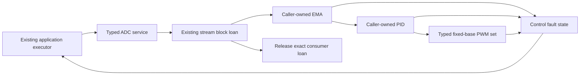

# ADC stream control fragment

`control_loop.c/.h` is a small caller-owned C11 composition of the selected
Nexus algorithms and runtime components. It is separate from the existing
BMP280/SPI/Modbus CLI: the current Native Board does not declare an ADC or PWM
route, and this fragment does not invent one.

The caller supplies live readonly ADC/PWM faces, the existing stream, explicit
sampling interval, raw full-scale count, filter coefficient, normalized setpoint,
PID gains/limits and selected PWM period. There are no physical default gains,
pin selections, tasks, implicit clock reads, queues or automatic recovery.
The existing executor serializes ADC service, consumer processing and PWM writes.

The selected profile processes exactly one native `uint16_t` channel result per
block. Raw counts are divided by the caller's full-scale count; this is a declared
normalization, not a voltage or sensor calibration. EMA runs before PID. The PID
sampling interval is the declared acquisition interval, not the time at which a
task receives the block or an IRQ observation timestamp. The caller must choose
an acquisition/queue budget that makes that assumption valid.

A successful step releases its consumer loan and returns a copied measurement,
normalized command, staged duty count and saturating sample count. It cannot
prove the PWM's electrical update has occurred. An empty stream advances no
algorithm state and does not replay an old sample. ADC service BUSY may coexist
with a previously completed block, which is still eligible for processing.

Loss/error blocks, invalid counts, numeric errors and PWM failures move only the
control FSM into FAULT. Faulting does not stop the ADC session, revoke producer
borrows, join a task or establish a safe physical output. The existing owner
applies its explicit shutdown policy and retains every live port and buffer.
Each acquired block is released even after a processing/PWM error when possible;
a failed release retains the exact consumer loan in the loop. A staged PWM update
may already exist when a later release fails.

After the caller stops and joins the actual I/O owners,
`example_control_loop_finish` retries only an outstanding consumer release and
marks the control STOPPED. The caller separately drains READY blocks and finishes
the stream's producer/consumer lifecycle before reclaiming storage. This fragment
does not wrap or replace the application's full lifecycle.

`industrial_control_loop_google` executes the real C composition, typed I/O
dispatch, stream ownership, EMA, PID and FSM. Only external ADC/PWM provider
operations are mocked. It checks the data path, empty input, PWM failure,
acquisition loss and invalid profiles. There is no test-local replacement filter,
controller, stream or state machine.

An explicitly selected dirty development SDK can provide focused nonpublishable
feedback. Those results do not pass the formal SDK Gitlink/lock/clean checks and
must not be reported as pinned SDK qualification. After the final SDK pin update,
run the normal examples gate and installed SDK consumer separately. Physical
ADC aperture, delivery latency, PWM timing, actual plant tuning and Board HIL
remain `not_executed` until measured on the selected hardware.
