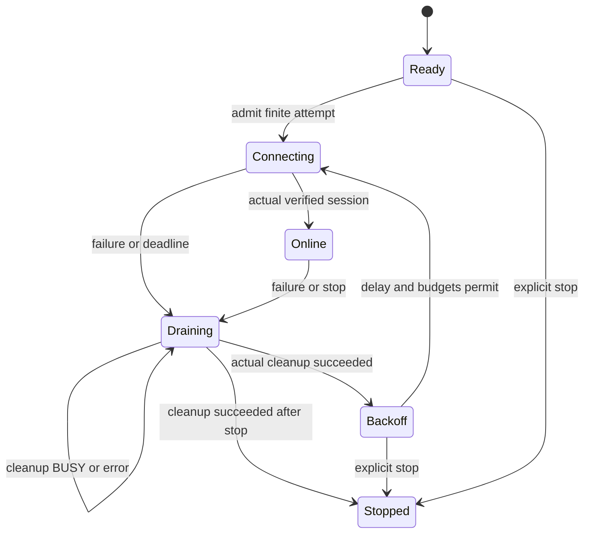
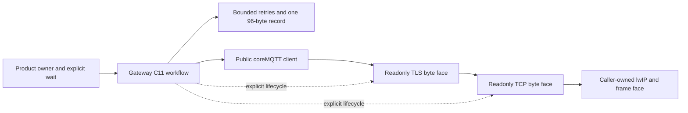

# Bounded network gateway / 有界联网网关

The C11 Native entry point composes the product retry/telemetry policy, bounded
frame substrate and public TCP/TLS/MQTT implementation. Its explicit child
process owns an independent raw-lwIP stack and an opaque loopback TCP relay to
the broker. The two TCP hops are a host fixture. Focused real-broker execution
covers clean delivery, 17-byte backpressure with an actual pause, RESET and
reconnect, blackhole deadline and missing-client-certificate refusal. Complete
pinned source and installed-SDK admission require their separate fresh gates;
this example establishes no PHY or physical network qualification.

C11 Native 入口组合产品自己的重试／遥测保留策略、有界 frame 接口，以及公共
TCP／TLS／MQTT 实现。显式子进程拥有独立 raw-lwIP 协议栈，并通过不解析密文的
loopback TCP relay 连接 broker。两个 TCP hop 属于主机 fixture。定向真实 broker
执行覆盖正常交付、17 字节背压与实际暂停、RESET 后重连、blackhole 期限，以及
缺少客户端证书时的拒绝。完整固定源码与已安装 SDK 准入分别需要新鲜门禁；
本示例不建立 PHY 或实物网络资格。

One task owns the policy, every network session and its clock domain. The
policy creates no worker, mutex, callback registry, timer or heap allocation.
The product gives each run one fixed absolute deadline, a per-attempt budget,
a retry delay and an attempt limit of one through eight. Each admitted attempt
uses the earlier of its local deadline and the unchanged overall deadline.
Repeated ready events cannot extend either deadline.

一个任务独占策略、所有网络会话以及其时钟域。策略不创建 worker、互斥锁、回调
注册表、定时器或堆分配。产品明确给定本轮绝对期限、单次尝试预算、重试间隔和
一至八次尝试上限。每次尝试选择局部期限与本轮固定期限中较早者；持续 ready
事件不会延长期限。

The cleanup barrier represents actual joined MQTT/TLS/TCP session cleanup.
Timeout and cancellation never substitute for settlement. Any BUSY or failed
cleanup retains session admission and blocks reconnect. The concrete product
must separately retain the MAC, network storage and unchanged lwIP timer clock
through detached FIN/TIME_WAIT state; local session cleanup is not global
stack or hardware withdrawal. Reversed time closes retry admission, but does
not undo already observed successful cleanup.

清理屏障代表已经完成的 MQTT／TLS／TCP 会话排空与 join。超时与取消不能替代
settlement；清理 BUSY 或失败时，仍保留会话准入并阻止重连。具体产品还必须
在分离的 FIN／TIME_WAIT 存续期间保留 MAC、网络存储以及不变的 lwIP 定时
时钟。局部会话清理不等于整个协议栈或硬件退出。时间逆行关闭重试准入，但不会
撤销已经观察到的成功清理事实。

Exactly one telemetry slot copies one through 96 bytes. Local QoS1 publish
success retains those bytes. Only a matching nonzero packet ID and current
session ID in a PUBACK release the record. Stale ACKs and a new publish cannot
overwrite it. After actual failed-session cleanup, the next session may send
the same record with a new MQTT packet ID. This is an explicit at-least-once
retry policy: a broker may already have delivered the previous publication.
The payload must carry a stable product message ID, and its consumer must
deduplicate or apply an idempotent operation. There is no exactly-once,
persistent-session or power-loss persistence promise.

唯一遥测槽复制一至 96 字节。QoS1 本地发送成功后仍保留这些字节，只有当前
session ID 与非零 packet ID 均匹配的 PUBACK 才释放。过期 ACK 或新发送不能
覆盖记录。失败会话实际清理后，下一会话可以使用新的 MQTT packet ID 重新发送
同一记录。这是明确的至少一次重试策略：broker 可能已经交付过上一次消息。
payload 必须携带稳定的产品消息 ID，消费端负责去重或采用幂等操作。策略不承诺
恰好一次、持久会话或掉电持久化。

Stop closes new admission and preserves an unacknowledged record. Only after
all session users and observers joined may the product explicitly dispose it
by starting a new run from STOPPED storage. A live policy cannot be rebound.
Configuration and input bytes are copied; no caller data pointer is retained.
The returned attempt and event metadata do not authorize concurrent access.

stop 关闭新准入并保留未确认记录。只有所有会话使用者及观察者均已 join，产品才
能从 STOPPED 存储显式开始新一轮并决定处置旧记录。存活策略不能重新绑定。
配置及输入字节均复制，不保留调用者的数据指针。返回的尝试身份和事件元数据不
授权并发访问。

The Google contracts execute the real C policy using the pinned SDK's host
GoogleTest framework. They exercise cleanup failures, bounded retries, QoS1
retention, stale acknowledgment, time reversal, overflow and independent
instances. Focused compiler-context runs are development evidence; the ordinary
complete-index example gate and real network/ARM/HIL evidence remain separate.

Google 合同使用固定 SDK 的主机 GoogleTest 执行真实 C 策略，覆盖清理失败、
有界重试、QoS1 保留、旧确认、时间逆行、溢出及实例隔离。定向编译上下文执行
属于开发证据；普通完整索引门禁、真实网络、ARM 链接与 HIL 证据分别记录。

The Native frame substrate borrows an explicitly supplied connected nonblocking
UNIX datagram descriptor. It creates no socket or worker and never closes the
descriptor. The kernel copies each admitted TX before SETTLED; every valid RX
loan protects one persistent 1514-byte buffer until exact release. Stop with a
held loan remains BUSY. Rebinding a stopped instance preserves its RX epoch, so
an old token cannot release a later frame. Acquisition time is explicitly a
software observation; hardware timestamps remain UNKNOWN. There is no PHY,
DMA, FCS, real MAC wire completion or electrical qualification.

Native frame 接口借用明确提供的、已连接且非阻塞的 UNIX datagram fd，不创建
socket 或 worker，也不关闭该 fd。每个已准入 TX 均在内核复制后才发布 SETTLED；
每个有效 RX loan 在精确释放前保护持久 1514 字节缓冲。持有 loan 时 stop 仍为
BUSY。已停止实例重新绑定仍保留 RX epoch，旧 token 不能释放新帧。获取时间明确
标记为软件观察，硬件时间戳保持 UNKNOWN；不模拟 PHY、DMA、FCS、真实 MAC 线上
完成，也不建立电气资格。

## Application ownership / 应用所有权

The C11 application calls public Nexus TCP, TLS and MQTT operations directly.
It creates no additional transport forwarding layer. The caller supplies exact
TCP/TLS/MQTT storage, an already live netif and crypto domain, explicit trust and
credentials, clock and bounded wait/stop ports. The application verifies
connection state, completes TLS, sends clean-session MQTT CONNECT, subscribes,
publishes the one retained record, observes PUBACK/echo, unsubscribes and sends
DISCONNECT. Interface lookup alone never establishes readiness.

C11 应用直接调用 Nexus TCP、TLS、MQTT 公共操作，不增加只做转发的 transport
层。调用者提供精确 TCP／TLS／MQTT 存储、已经启动的 netif 与 crypto domain、
明确的信任／凭据、时钟以及有界 wait／stop 端口。应用观察连接状态、完成 TLS、
发送 clean-session CONNECT、订阅、发送保留记录、观察 PUBACK／echo、取消订阅并
发送 DISCONNECT；获得接口指针本身不代表连接就绪。

This is the application dependency diagram. Its unit contracts use real
coreMQTT and substitute TCP/TLS dependencies. Separate peer and Main contracts
exercise actual processes and descriptors; the broker fixture executes the
complete public implementation. Each evidence set retains its own scope.

该图描述应用依赖。应用单元合同执行真实 coreMQTT，并替代 TCP／TLS 依赖。
独立 peer 与 Main 合同执行实际进程及描述符；broker fixture 执行完整公共实现。
各组证据分别保留其执行范围。

Cleanup follows MQTT deinit, TLS close/abort, then TCP close/abort. Any failed
upper cleanup retains its own storage and every lower transport it still
references. A BUSY admission refusal can create no new session, while BUSY
cleanup can retain a session; `local_sessions_released` distinguishes these
outcomes. The outer product separately owns netif/MAC, global FIN/TIME_WAIT,
PSA domain and clock lifetime. A local session result never withdraws them.

清理依次执行 MQTT deinit、TLS close／abort、TCP close／abort。上层清理失败时，
保留自身存储和它仍引用的所有下层 transport。BUSY 准入拒绝可以没有新会话，
BUSY 清理则可能保留会话；通过 `local_sessions_released` 区分。外层产品分别拥有
netif／MAC、全局 FIN／TIME_WAIT、PSA domain 和时钟生命周期，局部会话结果不会
撤销这些资源。

One unchanged monotonic domain is a caller precondition. Deadline checks include
phase-baseline regression, but are not a comprehensive per-read rollback/epoch
monitor. The finite whole-job progress-turn budget independently bounds stalled
clocks and continuously ready waits. Optional watchdog admission requires an
enabled source with a known minimum covering the job and cleanup; useful PUBACK
progress may feed it. A watchdog error or later echo/cleanup failure never
erases an already observed delivery fact. TLS diagnosis is copied before abort
and grants no ownership or permission to operate.

不变的单调时钟域是调用者前提。期限检查包含阶段基线逆行检查，但不是完整的逐次
读取回退／epoch 监控器。整轮有限 progress-turn 预算独立限制停滞时钟和持续 ready
等待。可选 watchdog 必须已启用，其已知最小窗口覆盖工作与清理预算；有用的 PUBACK
进展可以触发喂狗。watchdog 错误或之后的 echo／清理失败，不会抹掉已经观察到的
交付事实。TLS 诊断在 abort 之前复制，不授予资源所有权或操作许可。

Continuity is within one finite job and its settled reconnects. A subsequent
valid run, after all local users joined, is an explicit new job and disposes
the previous in-RAM record. Durable outbox, product message-ID persistence and
consumer idempotence remain external policy.

连续性只覆盖同一有限工作及其已经排空的重连。所有局部使用者 join 后，再次有效
调用 run 表示显式开始新工作，并处置上一轮 RAM 记录。持久 outbox、产品消息 ID
持久化与消费端幂等仍由外部产品决定。

## Native composition / Native 组合

The command is `network_gateway <broker-port> <case> <credential-directory>`.
Cases are `clean`, `backpressure`, `fault`, `deadline` and `missing-client`.
The directory supplies public DER inputs `ca.der`, `client.der` and
`client.key.der`; the refusal case reads only the CA. The hostname is the
fixture's `server.test`. The Native policy explicitly trusts host UTC for
certificate validity and uses kernel `getrandom` entropy without a fallback.
Fork occurs before either stack or crypto domain starts. All session, stack,
arena and frame storage remains static through process exit.

命令为 `network_gateway <broker-port> <case> <credential-directory>`，case
包含 `clean`、`backpressure`、`fault`、`deadline` 和 `missing-client`。目录提供
公开 DER 输入 `ca.der`、`client.der` 与 `client.key.der`；拒绝用例只读取 CA。
主机名固定为 fixture 的 `server.test`。Native 策略明确信任主机 UTC 以验证证书
有效期，并使用无回退的内核 `getrandom` 熵源。fork 发生在任一协议栈或 crypto
domain 启动之前。所有会话、协议栈、arena 与 frame 存储保留至进程退出。

The peer preserves each TCP direction independently. Broker EOF admits a
send-only raw-TCP shutdown; client bytes arriving after that EOF still reach
the broker until the client's own EOF and drain. STOP is an explicit local
withdrawal command. Before fork, the standalone program establishes default
SIGCHLD handling with automatic reaping disabled. It admits one child owner,
no concurrent waiter or SIGCHLD handler, until join. A nonzero reaped child
remains a failure and is never signaled again; ECHILD also ends PID ownership
without claiming successful child exit. Failed lower network withdrawal retains its borrowed frame
descriptor until process exit. No timeout revokes a borrow.

peer 独立保留两个 TCP 方向。broker EOF 只触发 raw-TCP 发送方向关闭；此后到达
的客户端字节仍转交 broker，直到客户端自身 EOF 且缓冲排空。STOP 是显式本地
退出命令。独立程序在 fork 前建立默认 SIGCHLD 策略，禁用自动回收；直到 join
为止只允许一个子进程所有者，不允许并发 waiter 或 SIGCHLD handler。已回收
子进程的非零退出仍保留失败事实，不再次向该 PID 发送信号；ECHILD 也终止
PID 所有权，但不声称子进程成功退出。
下层网络退出失败时，其借用的 frame 描述符保留至进程退出；超时不撤销借用。

For broker orchestration, build `network_gateway`, set `NEXUS_GATEWAY_BINARY`
to its executable and `NEXUS_GATEWAY_INTEROP_OUTPUT` to a fresh private evidence
directory, then run the pinned SDK's `tools/testing/mqtt_tls_interop.py` with
`--transport external-client --client apps/network_gateway/broker_client.py`
and a fresh `--output-root`. The adapter maps the three fixture bundles to five
actual C process executions and preserves each ordinary process exit. The
public fixture owns the pinned Mosquitto image, CA generation and withdrawal;
its external-client receipt alone does not assess this application's transport
or authentication. Keep private application output in this private repository.

运行 broker 编排前，构建 `network_gateway`，将 `NEXUS_GATEWAY_BINARY` 指向其
可执行文件，将 `NEXUS_GATEWAY_INTEROP_OUTPUT` 指向新的私有证据目录，再运行
固定 SDK 的 `tools/testing/mqtt_tls_interop.py`，指定
`--transport external-client --client apps/network_gateway/broker_client.py`
和新的 `--output-root`。adapter 将三个 fixture bundle 映射为五次真实 C 进程
执行，保留每次普通进程退出。公共 fixture 负责固定 Mosquitto 镜像、CA 生成与
退出；单独的 external-client 收据不评估本应用的 transport 或认证。私有应用
输出始终保存在本私有仓库。
