# U575 retained time and Stop2 / 保留时间与 Stop2

This independent C11 application selects exact STM32U575ZIT6Q, TZEN0,
baremetal and MSIS4, with no factory RTC/AlarmA owner. It explicitly links
`Nexus::U575Stop2`, constructs a separate retained-clock owner and enrolls its
empty Platform as one RUN consumer. It does not replace `nx_time_now_us()`.

本独立 C11 工程选择精确 STM32U575ZIT6Q、TZEN0、裸机与 MSIS4，不选择 factory
RTC／AlarmA owner。应用显式链接 `Nexus::U575Stop2`，构造独立保留时钟，并把
所选空 Platform 作为一个 RUN consumer 注册。它不替换 `nx_time_now_us()`。

## Build / 构建

Use the exact clean SDK selected by this repository's Gitlink and source lock.
No additional preset, vendor header or copied implementation is required.

使用本仓库 Gitlink 与源码锁选择的干净 SDK，不增加 preset，不包含厂商头文件，
也不复制平台实现。

```sh
cmake -S apps/retained_stop2/u575 -B build/retained-stop2 -G Ninja \
  -DNEXUS_SOURCE="$NEXUS_SOURCE" \
  -DCMAKE_TOOLCHAIN_FILE="$NEXUS_SOURCE/cmake/toolchains/arm-gcc.cmake" \
  -DCMAKE_BUILD_TYPE=Release
cmake --build build/retained-stop2 --target retained_stop2 --parallel 1
```

## Prepared boot and opt-in / Boot 准备与显式启用

Default execution returns before constructing clocks or starting Platform.
Only after reviewing the exact
[retained-time and Stop2 contract](../../../external/nexus/docs/design/u575-retained-time.md)
may a debugger halt at `main` and set `example_stop2_authorization=0x4e585332`.
This example switch is not security authorization. It does not prepare the RTC,
select a crystal, configure a calendar or prove physical electrical facts.

默认执行在构造时钟或启动 Platform 前返回。完整审查精确
[保留时间与 Stop2 合同](../../../external/nexus/docs/design/u575-retained-time.md)
后，才可在 `main` 断点设置 `example_stop2_authorization=0x4e585332`。此示例开关
不是安全授权，也不准备 RTC、不选晶振、不配置日历，更不证明实物电气事实。

External boot owns LSE32768 crystal mode, the valid exclusive BCD24h calendar,
PRER127/255, BYPSHAD, conservative drive, access gates and DBP. Board/boot owners
exclude PC13 transitions and review the exact silicon errata. Entry requires
privileged MSP Thread, no scheduler ever started, the selected MSIS4/Range4
supply profile, retained SRAM, quiet peripherals/interrupts and exclusion of
watchdogs, other masters, debugger and NMI/HardFault activity. Linkage or zero
register fields cannot prove those external obligations.

外部 boot 拥有 LSE32768 晶体模式、有效且独占的 BCD24h 日历、PRER127/255、
BYPSHAD、保守 drive、访问门及 DBP。Board／boot owner 排除 PC13 跳变，审查精确
硅片勘误。入口要求特权 MSP Thread、调度器从未启动、选定 MSIS4／Range4 电源配置、
SRAM 保留、其他外设／中断静止，并排除 watchdog、其他 master、调试器及
NMI／HardFault 活动。链接成功或寄存器读零都不能证明这些外部义务。

## One explicit cycle / 一次显式闭环

```mermaid
flowchart LR
  A[Prepared retained RTC] --> B[Clock and Stop2 owner]
  B --> C[Acquire RUN lease and Platform start]
  C --> D[Close RUN admission]
  D --> E[Platform stop and exact lease release]
  E --> F[Quiescent barrier]
  F --> G[Save mask and enter once]
  G --> H[Recover retained effects without WFI]
  H --> I[Restore incoming mask after actual drain]
  G --> I
  I --> J[Reopen and acquire new RUN lease]
  J --> K[Fresh Platform start then stop and release]
  K --> L[Join retained clock]
```



`stop2_application.c` performs one lifecycle operation per progress call and
keeps the exact lease, closed barrier, transition and saved mask in static
application storage. Failed stop never releases the RUN lease. Quiescence
checks every explicitly enrolled consumer; it does not enroll foreign agents.
The selected WUT request is 2048 nominal RTC/16 ticks. One WFI may wait forever
if physical wake fails; `poll_limit=10000` is a per-phase observation budget,
not a wall-time timeout. RTC snapshots resolve 3906.25 microseconds.

`stop2_application.c` 每次 progress 推进一个生命周期操作，把精确 lease、关闭
barrier、转换结果及原始 mask 保留在静态应用存储中。stop 失败绝不释放 RUN lease。
quiescence 只检查显式注册的 consumer，不会注册外部 agent。选定 WUT 请求为
2048 个标称 RTC/16 tick。物理唤醒失败时，一次 WFI 可能永不返回；
`poll_limit=10000` 是每阶段观察预算，不是墙钟超时。RTC 快照分辨率为
3906.25 微秒。

While effects remain, the application retains PRIMASK and retries only
`recover`, never another WFI. Fully drained failed transitions finish without
restarting. Only a successful drained transition restores the incoming mask,
reopens RUN, acquires a new exact lease, starts a fresh Platform/Core epoch and
finally stops/releases it again. An initial or restarted partial startup also
passes through actual stop before lease release. No old Core deadline crosses
that boundary, and the retained clock remains a distinct domain.

只要仍有 effects，应用就保留 PRIMASK，仅重试 `recover`，不再次 WFI。排空后的
失败转换结束且不重启。成功且完全排空后，应用恢复原始 mask、重开 RUN、获取
新精确 lease、启动新的 Platform／Core epoch，最后再次 stop／release。初次或
重启时的部分失败，也必须真正 stop 后才释放 lease。旧 Core deadline 不跨越该
边界，保留时钟始终属于另一时间域。

A drained failure leaves RUN admission closed and does not resume Platform.
That is this application's explicit failure policy; only after wake effects,
leases and clock users are joined does it stop the retained clock and return.

排空后的失败会保持 RUN admission 关闭且不重启 Platform，这是本应用的显式失败
策略。只有 wake effects、lease 与时钟用户全部 join 后，才停止保留时钟并返回。

`main` makes at most 64 progress attempts. A non-DONE phase parks with static
storage and any retained mask/loans. That attempt count cannot revoke ownership
or guarantee bounded physical sleep/drain. After DONE, all clock users have
joined and explicit retained-clock stop must succeed before return.

`main` 最多调用 progress 64 次。未达 DONE 就原地保留静态存储及仍持有的 mask／
借用。尝试次数不能撤销所有权，也不能保证物理睡眠／排空有界。达到 DONE 后，
全部时钟用户已 join，显式 retained-clock stop 仍须成功才返回。

Observe `example_stop2_result`, `example_stop2_phase`,
`example_stop2_restarted` and `example_retained_elapsed_us`. The elapsed value
comes only from same-generation successful retained snapshots; a failed
transition does not publish a plausible duration. `wait_executed` means WFI
executed, never proven Stop2 residency, retention or power savings.

可观察 `example_stop2_result`、`example_stop2_phase`、
`example_stop2_restarted` 和 `example_retained_elapsed_us`。elapsed 仅来自
同 generation 的成功保留快照，失败转换不发布看似有效的时长。
`wait_executed` 只表示执行过 WFI，不证明真正驻留 Stop2、数据保留或节能。

## Verification / 验证

`retained_stop2_test` executes this same C11 policy with GoogleMock at the
external SDK/Platform/Arch boundaries. It checks retained leases on failed
stop/release, enrolled-consumer blocking, exactly one entry, recovery without
mask restoration while effects remain, incoming masked-state preservation,
new-lease restart and cleanup of partial startup. The existing local CI runs
the standalone ARM consumer in the U575 baremetal row. Physical RTC, wake,
retention, current and timing checks all remain `not_executed`.

`retained_stop2_test` 在外部 SDK／Platform／Arch 边界使用 GoogleMock，执行同一
C11 策略。覆盖失败 stop／release 的 lease 保留、注册 consumer 阻挡、只进入一次、
仍有 effects 时只恢复且不还原 mask、原始屏蔽状态保留、新 lease 重启及部分启动
失败清理。本地 CI 的 U575 裸机行包含该独立 ARM consumer。真实 RTC、唤醒、
保留、电流和时序验收仍全部为 `not_executed`。

The other maintained finite Stop2 selections are the independent
[SRAM4 copy](../u575_copy/README.md) and
[LPTIM1 tuple](../u575_lptim1/README.md) projects. Their compile-time compound
hooks add an accepted-request and receiver JOIN before restoring the mask.
The WUT-only build keeps its direct SDK entry without those hooks or a receiver.

其余当前维护的有限 Stop2 模式见独立 [SRAM4 copy](../u575_copy/README.md) 和
[LPTIM1 tuple](../u575_lptim1/README.md) 工程。两者用编译时 compound hook，
在恢复 mask 前增加 accepted request 与 receiver JOIN。WUT-only 构建仍直接调用
SDK entry，不连接这些 hook，也不拥有 receiver。
