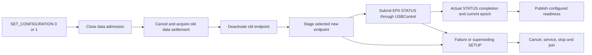

# USB configuration recipe / USB 配置消费示例

This application owns one vendor-specific configuration and one bulk IN endpoint.
It uses the public `USBControl`, descriptor validation, activation and packet
interfaces. One caller explicitly pumps progress; there is no worker, queue,
allocator or USB class stack. The same C11 application runs in GoogleTest against
external public-port facts and links into an F407 software-reference firmware.

本应用拥有一个厂商自定义 configuration 和一个 bulk IN endpoint，复用公开的
`USBControl`、描述符校验、activation 与 packet 接口。唯一调用者显式推进，
没有 worker、队列、分配器或 USB 类栈。同一份 C11 应用在 GoogleTest 中连接
公开端口的外部事实，并链接成 F407 软件参考固件。



The supported standard-request subset is device/configuration descriptors,
SET_ADDRESS, GET_CONFIGURATION, SET_CONFIGURATION 0/1 and device GET_STATUS.
Other requests are explicitly stalled. Configuration is staged before STATUS;
readiness follows the real ACK and a fresh matching epoch. A failed or superseded
staged transaction closes the controller. This does not claim a complete Chapter 9
implementation, alternate settings, CDC/HID, remote wake, HS, ISO or enumeration
qualification. The reference VID/PID, power attributes and bytes must be replaced
by a product's actual USB identity and electrical contract before device use.

支持的标准请求子集为 device/configuration 描述符、SET_ADDRESS、
GET_CONFIGURATION、SET_CONFIGURATION 0/1 与设备 GET_STATUS，其余请求显式
STALL。先 staging，再发送 STATUS；只有实际 ACK 且当前 epoch 一致才发布 ready。
已 staging 的事务失败或被新 SETUP 覆盖时关闭控制器。这不代表完整 Chapter 9、
alternate setting、CDC/HID、remote wake、HS、ISO 或物理枚举资格。实物使用前必须
把参考 VID/PID、电源属性和描述符替换为产品真实的 USB 身份及电气合同。

Calls use one serialized privileged task with interrupts unmasked and one
unchanged monotonic clock. SET_CONFIGURATION first drains the existing data loan;
neither cancellation nor timeout releases storage. `example_usb_close` returns
success only after provider stop and the control adapter's final observation.
BUSY/IO retain the entire application, profile, faces and outer Platform leases.
Call it again to progress. Stop Platform only after application join; explicitly
restart Platform and join external observers before reinitializing the application.
The eight-byte sample is copied into one fixed application request, with no TX
queue or automatic retry. A stale reset/SETUP observation closes data admission.

所有调用使用唯一、串行化的特权任务，保持中断未屏蔽和同一单调时钟。
SET_CONFIGURATION 先排空旧数据借用；cancel 或 timeout 均不释放 storage。
`example_usb_close` 只在 provider stop 与 control adapter 最后一次观察完成后成功。
BUSY/IO 保留整个应用、profile、face 和外层 Platform 租约，调用者需继续推进。
应用 join 后才 stop Platform；重新初始化前须显式 restart Platform 并 join 外部
观察者。八字节 sample 复制到一个固定应用 request，没有 TX 队列或自动重发。
发现陈旧 reset/SETUP 观察时关闭数据准入。

Focused host execution / 定向主机执行：

```sh
cmake -S apps/usb_configuration -B build/usb-configuration -G Ninja \
  -DCMAKE_BUILD_TYPE=Debug
cmake --build build/usb-configuration --target usb_configuration_test --parallel 2
ctest --test-dir build/usb-configuration --output-on-failure
```

F407 source build / F407 源码构建：

```sh
cmake -S apps/usb_configuration -B build/usb-configuration-f407 -G Ninja \
  -DCMAKE_TOOLCHAIN_FILE="$PWD/external/nexus/cmake/toolchains/arm-gcc.cmake" \
  -DNEXUS_ASSEMBLY_FILE="$PWD/apps/usb_configuration/assembly.toml" \
  -DCMAKE_BUILD_TYPE=Release
cmake --build build/usb-configuration-f407 --target usb_configuration --parallel 2
```

Default consumption uses the exact `external/nexus` gitlink and matching lock.
An explicit `NEXUS_SOURCE` is a development selector, not permission to bypass
source identity or clean-checkout requirements. Updated platform integration
needs its own fresh evidence and a coordinated pin/lock update. The software
Board owns only reviewed silicon pads, with PCB revision and wiring unknown.
Physical USB timing, reset, attach/detach and HIL remain **not executed**.

默认使用精确的 `external/nexus` gitlink 与匹配 lock。显式 `NEXUS_SOURCE` 只选择
开发来源，不绕过源码身份及 clean-checkout 要求。平台更新必须单独验证并同步更新
pin/lock。软件 Board 只声明经审阅的芯片引脚，PCB 修订与接线仍未知。
USB 物理时序、reset、attach/detach 与 HIL 均为**未执行**。
