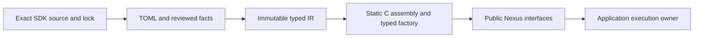

# SDK 集成 / SDK integration

`external/nexus` Gitlink 与 `dependencies/nexus.lock.json` 是平台版本的共同权威：
完整 commit、tree、干净源码和已选依赖必须一致。`scripts/test_repository.py`
复用 SDK 的离线 Native 准备校验与官方 STM32F4 HAL／CMSIS 配对检查，不复制厂商
来源目录。它不建立实板或完整软件候选资格。

The Gitlink and lock select one exact source. The verifier checks the clean SDK,
selected dependency closure and official F4 pairing. Source admission does not
establish software qualification or physical acceptance. Candidate validation
requires an explicit full commit SHA and never rewrites the formal lock.

主工程用 `add_subdirectory`，独立安装消费者用 `find_package(Nexus)`。配置唯一
输入为 TOML schema 2：精确 Board 事实经过验证和不可变 typed IR，生成静态实例、
强类型 factory、链接和预算。运行期硬件算法、生命周期与回滚都由 C 实现。

The two consumption paths share the same public interfaces. Central host tools
validate facts and emit static assembly; C owns firmware behavior. Native models
require explicit `NEXUS_TEST_SUPPORT=ON`, including installed consumers.



`Nexus::Core`、`Nexus::Arch`、`Nexus::IO`、`Nexus::Platform` 和显式组件 target
决定实际链接图。应用不复制 provider 或 HAL 类型。联网组合显式调用
`nexus_add_lwip()`、`nexus_add_tls()`、`nexus_add_coremqtt()`；只有静态存储装配
处链接相应 `Storage` 接口，普通业务仍使用 Nexus 类型。

Targets own dependencies. Network composition explicitly selects its helpers;
backend storage headers stay at composition sites. Selecting a component never
creates workers, discovers hardware or starts a scheduler.

## 源码与安装包 / Source and installed packages

```sh
python scripts/build.py --preset native-debug --test --parallel 2
python scripts/build.py --preset stm32-qiming-v41-freertos --parallel 2

python external/nexus/cmake/package/package_source_sdk.py   --source "$PWD/external/nexus" --output /path/to/native-sdk   --host-support --component network --component tls --component mqtt
cmake -S reproduction -B build/installed-native -G Ninja   -DNexus_DIR=/path/to/native-sdk/lib/cmake/Nexus   -DNEXUS_EXPECTED_SOURCE_REVISION=<full-commit>   -DNEXUS_ASSEMBLY_FILE="$PWD/reproduction/assemblies/native.toml"   -DNEXUS_TEST_SUPPORT=ON -DNEXUS_ENABLE_SANITIZERS=ON
cmake --build build/installed-native --parallel 2
ctest --test-dir build/installed-native --output-on-failure --no-tests=error
```

安装包按用途选择 `--host-support`、`--backend` 和 `--component`；Native 联网示例
需要上述三个组件。MCU 包只携带选择的运行期依赖，不携带 GoogleTest。普通构建
不获取依赖。执行 SDK 工具前核对组织批准的来源及归档身份，内部 manifest 校验内容
一致性，不替代外部信任。完整离线消费和新鲜报告由[本地 CI](local-ci.md)负责。

Profiles select payloads rather than shipping all retained inventory. The
installed consumer has no source-tree fallback and verifies the expected source
revision. Local CI validates the entire package again after consumer execution;
bytecode or other payload mutations invalidate that run.

## 生命周期 / Lifecycle

factory 只返回已有静态接口。启动成功后应用才启动任务或进入主循环。停止时先关闭
准入，再推进取消与硬件排空，acquire 观察 SETTLED 后 join 全部使用者，最后停止
Platform。失败时保留借用和恢复责任，时间到期不授权释放。

Factory lookup allocates nothing and has no hardware effects. Startup does not
start the scheduler. Failed drain retains storage, callbacks and recovery duties;
timeout alone never returns ownership.

可选 `nx_platform_start_diagnosed/stop_diagnosed` 使用调用者存储。诊断中的
`controller_index` 是同一 `resolved.json` 的零基 controller 下标，不是 factory
ID；`SIZE_MAX` 表示无 controller。primary／cleanup 和 remaining effects 仍是
行为依据，诊断不能成为释放 buffer 的许可。

Optional diagnostics copy stage information without owning recovery. ABI flags
must agree between application and provider; this is a source SDK rebuilt for
each configuration, not a promise of binary ABI compatibility.
