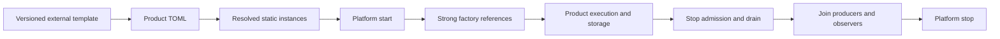
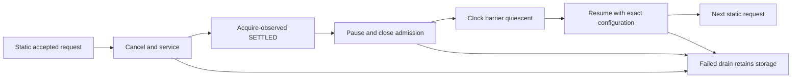

# 工程入口与三条应用路径 / Project entry and application recipes

本页描述外部应用如何消费通用平台。客户产品、私有协议、PCB 与恢复决策仍属于产品
仓库。模板和示例不创建隐式任务，不把工厂获取变成初始化。
This page describes external composition of the common platform. Product data,
protocols, PCB facts and recovery policy remain in the product repository.
Factory lookup obtains a static interface; it does not initialize hardware.



## 固定身份创建 / Reproducible creation

`templates/manifest.json` 版本 1 是模板的唯一目录清单。每个工程恰有 CMake、
TOML、C11 入口和双语说明，全部绑定 SHA-256；配置仅在 TOML 编写一次。
Version 1 is the sole template catalogue. It binds each CMake/TOML/C11/README
file by SHA-256. The authored TOML is the only hardware composition.

| Template ID | Exact Board / 精确板卡 |
| --- | --- |
| `native` | Native |
| `qiming` | Qiming F407ZG V3.1 / 启明 F407ZG V3.1 |
| `qiming-core` | `stm32f407zg_qiming_core` / 启明 F407ZGT6 核心板 |
| `qiming-v41` | `stm32f407zg_qiming_v41` / 启明 F407 高配版 V4.1 |
| `sky` | Sky F407VE Youth / 天空星 F407VE 青春版 |
| `liangshan` | Liangshan F470 / 梁山派 F470 |

GPIO 统一逻辑别名 `status`，UART 为 `console`；硬件绑定来自精确 Board。
两个新启明模板复用同一 C11 应用，显式声明 SWD 和全部 hardware 选项，最小配置
要求可选模块未连接、共享接口断开；这不是 DNP 或装配检测。模块的已知型号不会
自动启用屏幕、触摸、媒体或网络。旧 V3.1 模板保留。参阅各模板的使用前提。
Logical aliases remain `status` and `console`. The two new Qiming templates
reuse the established application, explicitly select SWD and all hardware
choices, and require optional modules absent/shared connectors disconnected for
this minimal profile. Known module models do not enable display, touch, media
or network behavior. V3.1 remains separate. See each template's setup conditions.

新模板需依赖锁包含对应新 Board，并完成源码和安装 SDK 两条消费验收。配置可解析
不等于 ARM 已链接或实板已验证；当前实板 HIL 仍为 `not_executed`。
The new templates require a pinned SDK containing those Boards and separate
source/installed consumption evidence. Resolver success does not prove ARM
linking or hardware execution. Physical HIL remains `not_executed`.

本次锁定 SDK 的两板源码与安装消费 ARM 结果、配置与产物摘要见
[集成索引](qiming-board-integration-results.json)。普通 host/Google 验收由实际提交
hooks 独立执行；本索引不预报其结果，也不证明物理行为。
The [integration index](qiming-board-integration-results.json) binds this locked
SDK, four actual ARM consumers and their artifact hashes. Normal commit hooks
separately execute fresh host/Google contracts; the index does not predict their
result or establish physical behavior.

使用平台的 `tools/dev/dev.py create`，显式传入本仓库检出和完整 40 位提交。该提交中的
源码锁给出期望 SDK 身份；创建时实际 resolver 的输入身份另行记录。创建工具读取提交对象，拒绝脏模板、覆盖及链接逃逸；不联网
下载平台，也不复制 `.git` 或 SDK 树。`.nexus-template.json` 记录来源身份和摘要。
Use the platform's `tools/dev/dev.py create` with this checkout and an exact 40-character
examples revision. Its committed platform lock records the expected SDK identity; validation
records the actual resolver and input identities separately.
Creation reads committed objects, rejects dirty templates, overwrite and path
escapes, and records provenance in `.nexus-template.json`. It never downloads a
platform or copies Git metadata or SDK source. See the pinned platform CLI help
for the exact invocation; the delivery record binds the platform and examples
commits without embedding future commit IDs into either source tree.

```sh
python "$NEXUS_SOURCE/tools/dev/dev.py" create \
  --templates "$NEXUS_EXAMPLES_SOURCE" \
  --revision "$NEXUS_EXAMPLES_REVISION" \
  --template native --output /path/to/new-product
```

复制后的独立 Native 工程：
Build the independently copied Native project:

```sh
cmake -S /path/to/product -B /path/to/build -G Ninja \
  -DNexus_DIR=/path/to/source-sdk/lib/cmake/Nexus
cmake --build /path/to/build --parallel 1
ctest --test-dir /path/to/build --output-on-failure --no-tests=error
```

联合开发可用 `-DNEXUS_SOURCE=/absolute/nexus`；这只改变位置，不替代正式 SDK
锁定、清洁检出或交付资格。MCU 需额外设置 SDK 的 `cmake/toolchains/arm-gcc.cmake`。
Development may use `-DNEXUS_SOURCE=/absolute/nexus`. This selects a location;
it does not replace source-lock checks or establish publishable qualification.
MCU templates additionally require the SDK's `cmake/toolchains/arm-gcc.cmake`.

## 路径一：裸机独占 UART / Exclusive baremetal UART

模板是最短使用路径：显式 start → strong factory → 翻转 GPIO 一次 → prepare/submit
静态 TX → service 至 SETTLED → 检查实际结果与字节数 → stop。绝对 deadline 与平台
时钟同域；ACCEPTED 后描述符和数据保持有效，超时或取消都不释放借用。排空失败时
静态存储继续保留，产品必须选择经过审查的恢复策略。
The starter starts infrastructure, obtains strong references, toggles GPIO once,
submits static UART storage, services until SETTLED, checks the actual result
and count, then stops. Deadlines share the platform clock domain. Accepted
storage remains live through timeout/cancellation and quarantine. A product
must supply its reviewed recovery policy if draining cannot finish.

Native 预期输出 `Nexus starter: transfer settled; platform stopped`。MCU 预期
115200 波特率输出 `Nexus starter ready`。此模板不是后台串口服务或持续闪灯任务。
Native prints `Nexus starter: transfer settled; platform stopped`; MCU sends
`Nexus starter ready` at 115200 baud. This is a finite foreground application.

## 路径二：两端点共享 SPI / Two endpoints sharing SPI

代码：[`shared_spi_runtime`](../apps/shared_spi_runtime/)。两个真实 producer 各自拥有
静态任务、request、operation 和 buffer；一个 executor 独占 service。第一轮两个
端点完成，队列满时第三次提交被拒绝且 request 保持 READY；第二轮取消排队的第二
端点。结束时关闭 admission、排空、join 所有 producer。Native 随后停止平台；MCU FreeRTOS 保留时钟/Tick 和静态
keeper，因为 producer 退出不等于 scheduler 已停止。
Two real producer tasks own independent static requests, operations and buffers.
One executor alone calls service. The first round completes both endpoints and
checks zero-borrow rejection of a third full-queue submission. The second round
cancels the queued second endpoint. Shutdown closes admission, drains accepted
work, joins all producers, then stops the Native platform. MCU FreeRTOS retains
clocks/Tick and a static keeper: producer joins do not prove scheduler teardown.

Native 模型给两端点设置不同寄存器值，并核对各自结果，不仅检查“编译成功”。
`shared_spi_real_freertos` 使用 SDK 现有 POSIX 测试接缝和真实固定 FreeRTOS 内核，
验证相同 C11 应用的任务回收；Native Platform 本身仍选择 native 后端。目标 MCU
独立工程使用 FreeRTOS、SPI1 PA5/PA6/PA7、PE4/PE3 两个低有效 CS 的 **F407ZG
硅片软件 fixture**。它不代表启明、天空星或梁山派实际存在这些接线及外部设备。
Native gives the endpoints distinct register contents and checks their values.
`shared_spi_real_freertos` reuses the SDK POSIX fixture and the actual pinned
FreeRTOS kernel. The Native Platform still selects its native backend. The MCU
standalone project selects FreeRTOS and an explicit **F407ZG silicon software
fixture**: SPI1 PA5/PA6/PA7 and active-low PE4/PE3 CS. It claims no physical
wiring or attached device on any of the three real Boards.

```sh
cmake -S apps/shared_spi_runtime -B build/spi-recipe -G Ninja \
  -DNEXUS_SOURCE="$NEXUS_SOURCE" \
  -DCMAKE_TOOLCHAIN_FILE="$NEXUS_SOURCE/cmake/toolchains/arm-gcc.cmake" \
  -DCMAKE_BUILD_TYPE=Release
cmake --build build/spi-recipe --parallel 1
```

应用有意采用 short-poll 小事务，明确独占 executor。它不是 DMA 性能证明，也不
承诺设备真实返回数据；实物传感器协议由对应产品实现。
The recipe deliberately uses small short-poll transactions and one executor.
It does not establish DMA performance or implement a physical sensor protocol.

producer 等待、owner drain 和 FreeRTOS `join(NEVER)` 不保证应用级有限退出。
H743 接收窗口为 200 ms，关闭最多尝试 64 次 service/drain；若仍 BUSY 或释放失败，
应用停止推进并保留静态借用。有限尝试不等于硬件保证有界停机。实际产品必须声明 watchdog、恢复或维护策略，
不能为满足截止时间而释放仍被硬件、任务或 observer 访问的数据。
Producer waits, owner drain and FreeRTOS `join(NEVER)` do not promise bounded
application exit. H743 bounds its receive window to 200 ms and shutdown to 64
service/drain attempts. BUSY or a failed release parks with all static loans
retained; finite attempts do not prove bounded hardware shutdown. A real product must declare its watchdog, recovery or maintenance
policy and cannot release live hardware/task/observer storage to meet a deadline.


## 路径三：慢消费者、停止和恢复 / Slow consumer, stop and recovery

[`stream_recovery`](../apps/stream_recovery/) 的 Native 路径通过公开模型显式注入
字节/IDLE，保留两块消费者借用，制造容量不足，确认旧数据不变、后续块带 LOSS，
stop 返回 BUSY 且停止新生产。释放借用后 stop 成功，再次 start 并验证新数据。
`nx_io_diagnose` 仅解释复制的事实：STOPPING、STREAM_OUTSTANDING、STREAM_LOSS；
loss 在溢出时取快照，stop 单独取快照；发布后的 pending loss 会清零，块内
`lost_blocks` 才保存该次发布携带的丢失事实。不推断未提供的服务频率，不用诊断释放任何数据。Native 证明所有权行为，不证明 DMA。
The Native recipe injects bytes/IDLE through public model controls, retains two
consumer loans, exhausts capacity, checks unchanged data and later LOSS, then
observes BUSY stop with production closed. After release, stop succeeds and a
new start receives fresh data. `nx_io_diagnose` explains only supplied snapshots;
loss is copied immediately after overflow, while stop uses a separate snapshot.
Pending loss resets on publication; the block retains its published loss count.
Diagnostics never infer an unknown service cadence or authorize reclamation. Native
execution establishes ownership behavior, not DMA.

[`stream_recovery/h743`](../apps/stream_recovery/h743/) 单独选择当前实际支持的
H743 `rx-dma-continuous`、HSI64、Cache off、USART3。四个 128 字节、32 字节对齐
静态 reservation 位于该精确链接配置的 DMA 可达 AXI SRAM。第一窗口故意延迟释放
首块，随后 stop/drain/release；第二窗口重启。是否收到数据及是否出现 loss 依赖真实
外部流量，不能从有限运行或 ELF 推断。每个错误路径均尝试关闭生产、释放消费者借用
和停止平台；清理未完成则原地保留静态存储，不返回。失败的 release 保留精确 token，
下一次 acquire 前先重试归还。产品恢复责任仍在。结束或保留时调试器可读取 `example_received_blocks`、
`example_loss_reports`、`example_restarts`、`example_result`。
The separate H743 project selects the supported `rx-dma-continuous` mode, HSI64,
Cache off and USART3. Four independent 128-byte, 32-byte-aligned reservations
live in the exact linker's DMA-visible AXI SRAM. The first receive window delays
release, then stops/drains/releases; the second restarts. Actual traffic and
loss depend on equipment. Every failure attempts producer drain, consumer
release and Platform stop; unfinished cleanup parks without returning or
discarding static storage. A failed release keeps its exact token and prevents
a new acquire until retry succeeds. Product recovery remains required. Counters
are copied for debugger observation on completion or retained shutdown; a linked
ELF does not prove reception, loss, timing, Cache safety or physical qualification.

```sh
cmake -S apps/stream_recovery/h743 -B build/stream-recipe -G Ninja \
  -DNEXUS_SOURCE="$NEXUS_SOURCE" \
  -DCMAKE_TOOLCHAIN_FILE="$NEXUS_SOURCE/cmake/toolchains/arm-gcc.cmake" \
  -DCMAKE_BUILD_TYPE=Release
cmake --build build/stream-recipe --parallel 1
```

没有接入探针或串口，全部实板项目为 **`not_executed`**。接收窗口有时间边界；硬件
排空仍可能保留所有权，代码不会在达到时间后销毁静态存储。启用 Cache、切换 RAM、
改用其他 SoC、接传感器或现场协议均需要重新审查配置和实际验证。
No probe/serial station is connected: all physical acceptance remains
**`not_executed`**. Receive windows are bounded; hardware drain may retain
ownership, and time expiry never destroys static storage. Cache, RAM, SoC,
external wiring and product protocols require their own review and evidence.

## 高级路径：Cache 与运行时边界 / Advanced Cache and runtime boundaries

[`h743_cache_on`](../apps/stream_recovery/h743_cache_on/) 与 Cache-off 工程共用
相同 C11 接收应用和借用策略，唯一 TOML 显式选择 `hsi64-fixed-cache-on`。四个
128 字节 reservation 均按 32 字节对齐且占完整 cache line，metadata/token 独立。
精确 linker 把 `.bss` 放入 DMA 可达 AXI SRAM；由选定 provider 维护 cache，应用
只在 acquire 与成功 release 之间读 payload。不能把这组规则直接套用到 DTCM、
其他 DMA 控制器或其他芯片。该工程通过链接不代表 Cache 一致性已实板验证。
The Cache-on recipe shares the same C11 application and loan policy with
Cache-off; its sole TOML explicitly selects `hsi64-fixed-cache-on`. Each aligned
128-byte reservation owns whole 32-byte cache lines, separate from metadata and
tokens. The exact linker places `.bss` in DMA-visible AXI SRAM. The selected
provider performs cache maintenance; application access lies between acquire
and successful release. This contract does not generalize to DTCM, another DMA
controller or another SoC. Linkage does not establish physical Cache coherence.

[`runtime_pause/h743`](../apps/runtime_pause/h743/) 选择独立 SPI4 DMA 软件参考，
HSI64/Cache off、裸机、`fixed-run` 和唯一 `bus4` 控制器。应用用两个静态 request
依次提交、取消并 service；每次只在 acquire-observed SETTLED 后读取结果。随后
pause → clock-domain close/barrier → quiescent → resume，再执行第二次提交。
这是时钟不变的维护边界，不进入 Stop/Standby，不允许任意改 PLL。外部 SPI 设备
和引脚属于软件 fixture，未证明真实开发板有接线、从设备或有效返回数据。
The independent SPI4 DMA recipe selects baremetal HSI64/Cache off, `fixed-run`
and only controller `bus4`. Two static requests submit/cancel/service in turn;
results are read only after acquire-observed SETTLED. Between submissions it
performs pause → domain close/barrier → quiescent → resume. This is a fixed-clock
maintenance boundary, not Stop/Standby or arbitrary PLL reconfiguration. SPI
wiring and the slave are software-fixture facts, without physical Board claims.



两条路径使用现有独立 CMake 入口，正式本地 CI 在 H743 裸机行自动执行；没有新增
第二份 preset 或硬件配置。手动构建分别选定工程和独立输出目录：
The existing local CI's H743 baremetal row runs both standalone consumers.
They introduce no second preset matrix or duplicate configuration authority.

```sh
cmake -S apps/stream_recovery/h743_cache_on -B build/cache-on-recipe -G Ninja \
  -DNEXUS_SOURCE="$NEXUS_SOURCE" \
  -DCMAKE_TOOLCHAIN_FILE="$NEXUS_SOURCE/cmake/toolchains/arm-gcc.cmake" \
  -DCMAKE_BUILD_TYPE=Release
cmake --build build/cache-on-recipe --parallel 1
cmake -S apps/runtime_pause/h743 -B build/pause-recipe -G Ninja \
  -DNEXUS_SOURCE="$NEXUS_SOURCE" \
  -DCMAKE_TOOLCHAIN_FILE="$NEXUS_SOURCE/cmake/toolchains/arm-gcc.cmake" \
  -DCMAKE_BUILD_TYPE=Release
cmake --build build/pause-recipe --parallel 1
```

## 高级路径：显式 Flash 与 Stop2 / Explicit Flash and Stop2

[`flash_maintenance/h743`](../apps/flash_maintenance/h743/README.md) 是独立
HSI64／Cache off／V 修订工程。应用拥有最后一个 128 KiB 扇区；显式启用后按
erase → 一个 32 字节 ECC program → readback 顺序执行。每次都先成功擦除，不重试
失败的编程单元。SDK 在实际 ELF 上审核 RAM 执行／VTOR／MPU 返回闭包。默认调试
开关为零，Platform start 前就返回；审查电压、镜像、其他 master 和产品数据后才可
启用。公共 provider 的镜像保护不能发现其他产品数据。

The independent H743 project selects HSI64, Cache off and revision V. The
application owns the last 128 KiB sector. Explicit opt-in performs erase → one
32-byte ECC program → readback, without retrying a failed word. The SDK audits
the actual ELF's RAM/VTOR/MPU return closure. The debugger switch defaults to
zero and returns before Platform start. Enabling it requires review of voltage,
image, other masters and product data; provider image guards cannot discover
unrelated data.

[`retained_stop2/u575`](../apps/retained_stop2/u575/README.md) 是独立 TZEN0／
MSIS4 裸机工程，不选 factory RTC／AlarmA。应用显式构造保留时钟、注册 RUN lease，
关闭 admission 后真正 stop／release／quiesce，再保存 mask、进入一次 WFI。
仍有 effects 时保留 mask 和静态存储，只调用 recover；排空成功后重开 RUN、获取
新 lease、启动新 Core epoch，最后再次 stop／release 并 join 保留时钟。外部 boot
仍须提供准备好的 LSE／RTC／日历、电源及 quiet-master 条件。默认开关也为零，
不会自动配置 RTC 或进入低功耗。

The independent U575 TZEN0/MSIS4 project selects no factory RTC/AlarmA. It
constructs retained time, enrolls a RUN lease, closes admission and actually
stops/releases/quiesces before saving the mask and executing one WFI. Remaining
effects retain the mask and static storage, permitting only recovery. Successful
drain reopens RUN, acquires a new lease and starts a fresh Core epoch before
final stop/release and retained-clock join. External boot still supplies the
prepared LSE/RTC/calendar, power and quiet-master premises. Its default switch
is also zero; the example does not automatically configure RTC or sleep.

两者都有共享同一 C11 应用策略的 GoogleTest／GoogleMock 失败路径测试，并接入
现有本地 CI 的 H743／U575 裸机行，不新增 preset 或配置权威。64 次清理／推进上限
不能取消物理 Flash 脉冲或保证 WFI、硬件排空有界；未结清就保留对象。实板 HIL、
功耗、时序及掉电仍全部 `not_executed`。

Both share their C11 application policy with GoogleTest/GoogleMock failure-path
tests and join the existing H743/U575 baremetal CI rows without new presets.
The 64-attempt software bound cannot cancel a Flash pulse or bound physical
WFI/drain. Unfinished responsibility retains storage. All physical HIL, power,
timing and power-cut checks remain `not_executed`.

### 完整有限低功耗路径 / All maintained finite low-power paths

U575 的三个独立 Stop2 工程覆盖当前维护的有限模式；每个镜像只链接一个具体
Stop2 owner。它们共用应用侧 RUN 关闭／join／重启机制，通用平台和 typed factory
无需变化。新增模式通过 `EXAMPLE_STOP2_COMPOUND=1` 在编译时连接两个直接 C
hook，不引入运行时 registry、操作表、worker 或动态分配。

The three independent U575 projects cover the maintained finite Stop2 modes.
Each image links exactly one concrete Stop2 owner. They share application RUN
closure/join/restart without changing the common platform or typed factory.
`EXAMPLE_STOP2_COMPOUND=1` connects two direct C hooks at compile time; there is
no runtime registry, operations table, worker or allocation.

| 独立工程 / Project | 有限操作与责任 / Finite operation and ownership |
| --- | --- |
| [WUT-only](../apps/retained_stop2/u575/README.md) | 独立 retained RTC、显式 WUT、无 factory AlarmA；不包含 DMA receiver / Independent retained RTC and WUT, without a factory AlarmA or DMA receiver |
| [SRAM4 copy](../apps/retained_stop2/u575_copy/README.md) | 显式 AlarmA-copy delegation、17 字节 SRAM4 复制、生成 workspace 与 WUT escape；只链接 `Nexus::U575Stop2Copy` / Explicit AlarmA-copy delegation, 17-byte SRAM4 copy, generated workspace and WUT escape; only `Nexus::U575Stop2Copy` |
| [LPTIM1 tuple](../apps/retained_stop2/u575_lptim1/README.md) | SRAM4 的单组 12 字节 CCR1／RCR／ARR，经 LPDMA1 channel0 写入独占 LPTIM1；公共 start／stop 管理 access，只有 `Nexus::U575Stop2Lptim1` / One 12-byte SRAM4 CCR1/RCR/ARR tuple through LPDMA1 channel0 to exclusive LPTIM1; public start/stop owns access, with only `Nexus::U575Stop2Lptim1` |

两个 compound 工程只在 accepted 后 acquire-observe request result；拒绝的 READY
request 没有借用，也不能要求 SETTLED。只有 request 已结清、最终结果／长度正确，
copy 数据或原始 wake／clock 观察通过检查，且 receiver 的公共 stop 真正释放全部
access effects，JOIN 才允许恢复 mask 并重开 RUN。cleanup 与 operation 结果分开：
cleanup BUSY 保留 mask 和同一个 phase；终态 operation BUSY 是失败，不能伪装成
成功进度。初始部分启动失败跳过 WFI，但仍须完成 receiver JOIN。静态 request、
数据及 workspace 不因 64 次尝试耗尽或 deadline 到期而归还。

The compound projects acquire a request result only after acceptance; a rejected
READY request has no loan and must not be required to settle. JOIN permits mask
restoration and RUN reopen only after the request settles, final result/count,
copy bytes or original wake/clock observations are valid, and public receiver
stop actually joins all access effects. Cleanup and operation results remain
separate: cleanup BUSY retains the mask and phase, while terminal operation BUSY
is a failure. Partial initial startup skips WFI but still joins the receiver.
Neither the 64-attempt limit nor a deadline revokes static request, data or
workspace ownership.

所有工程仍要求外部 boot／Board 提供精确 RTC、供电、静止 master 与保留条件。
选入 SRAM4 时，reset startup 会在 `main` 前准备 SRAM4／LPDMA 并初始化 DATA／
BSS；运行时 opt-in 为零不能取消这些已选择的启动动作。NOINIT workspace 不读取
旧内容。两个新工程均接入 U575 裸机 CI 行，主项目仍维持原有 17 个 preset。
有限 copy／tuple 不等于通用 LPBAM、重复波形或 GPIO／实物输出资格。

External boot/Board owners still supply exact RTC, supply, quiet-master and
retention premises. Selected SRAM4 reset startup prepares SRAM4/LPDMA and
initializes DATA/BSS before `main`; a zero runtime opt-in does not cancel that
selected startup. NOINIT workspace is not read before initialization. Both new
projects join the U575 baremetal CI row; the main matrix retains 17 presets.
Finite copy/tuple execution is not general LPBAM, repeated waveform or physical
GPIO/output qualification.

## 新用户练习及迁移 / Newcomer exercise and migration

1. 固定 examples 完整提交及同提交 SDK 锁，创建 Native 模板到含空格的新目录。
   Pin the examples revision and its SDK lock; create Native into a new path.
2. 配置、编译、实际运行并记录命令/退出码；检查 strong refs 与生成资源预算。
   Configure, build and run; retain commands/exits and inspect generated budgets.
3. 换选三板模板之一，只改产品 TOML 的逻辑选择；不要复制生成文件或推断外设接线。
   Select one Board template; edit authored TOML, never generated files or wiring.
4. 先在 Native 跑共享 SPI 和流恢复，再做 ARM 链接与预算检查。
   Run both host recipes before ARM linkage and resource checks.
5. 把 MCU 流量、电气、时序验收保留为待执行；实板结果只追加到精确源码身份。
   Keep electrical/timing/traffic acceptance pending until real equipment runs.

升级时先完成平台提交 P，再把 examples 的 `external/nexus` Gitlink 与
`dependencies/nexus.lock.json` 同时更新为 P 并记录 tree；完整普通 gate 通过后提交
examples 得到 E。发布索引关联 P、E、模板 manifest 摘要及实际 CI/产物，避免两仓
相互引用未来提交。`interface_epoch=1`、`assembly_schema=2` 是兼容声明，不能替代
精确源身份。旧结果不自动证明新 pin。
Freeze platform P first. Update the examples Gitlink and lock to P with its
actual tree, pass ordinary gates, then commit examples E. Delivery records bind
P, E, manifest digest and actual CI/artifacts. Epoch/schema compatibility never
replaces exact identities, and historical results never qualify a new pin.


已存在的干净 SDK 可显式复用，无需复制第二份依赖树：
Reuse an existing clean SDK without copying another dependency tree:

```sh
NEXUS_SOURCE=/absolute/clean/nexus NEXUS_BUILD_JOBS=1 \
  python scripts/tdd_gate.py --all
```

该入口仍检查同一正式 lock、index Gitlink、tree、源码洁净与厂商身份；不能用路径
覆盖变成 candidate 验证或绕过依赖验收。
The same formal lock, staged Gitlink, tree, clean-source and vendor checks still
apply. Selecting a location never changes this into candidate validation or
bypasses dependency qualification.

## 工业组合 / Industrial composition

[工业控制参考](../apps/industrial_control/README.md) 将专有 Modbus UART 控制任务与
独立 SPI owner 组合，使用 25 字节持久复制适配 BMP280 的同步 settled 合同。
completion、绝对 timer 与 stop 使用真实 wait_select；Settings 仅在维护窗口提交，
watchdog 根据实际最小超时与有用进展判断。使用现有 Native preset，资源、寄存器、
关闭和故障边界以该应用说明和同一 C11 源的 Google 合同为准。

The [industrial reference](../apps/industrial_control/README.md) combines a
dedicated Modbus UART control task with a separate SPI owner. Its 25-byte
persistent copy bridge preserves BMP280's synchronous settled contract. Real
wait_select combines completion, absolute timer and stop. Settings commit only
in maintenance, and watchdog policy uses observed minimum timeout and useful
progress. It consumes the existing Native preset; see the application contract
for budgets, registers, teardown and fault boundaries.
