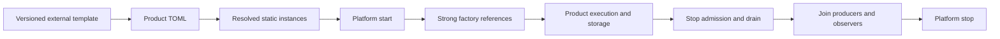

# 工程入口与三条应用路径 / Project entry and application recipes

本页描述外部应用如何消费通用平台。客户产品、私有协议、PCB 与恢复决策仍属于产品
仓库。模板和示例不创建隐式任务，不把工厂获取变成初始化。
This page describes external composition of the common platform. Product data,
protocols, PCB facts and recovery policy remain in the product repository.
Factory lookup obtains a static interface; it does not initialize hardware.



## 固定身份创建 / Reproducible creation

`templates/manifest.json` 版本 1 是模板的唯一目录清单。每个工程恰有 CMake、
TOML、C11 入口和双语说明，全部绑定 SHA-256；配置仅在 TOML 编写一次。
Version 1 is the sole template catalogue. It binds each CMake/TOML/C11/README
file by SHA-256. The authored TOML is the only hardware composition.

| Template ID | Exact Board / 精确板卡 |
| --- | --- |
| `native` | Native |
| `qiming` | Qiming F407ZG V3.1 / 启明 F407ZG V3.1 |
| `qiming-core` | `stm32f407zg_qiming_core` / 启明 F407ZGT6 核心板 |
| `qiming-v41` | `stm32f407zg_qiming_v41` / 启明 F407 高配版 V4.1 |
| `sky` | Sky F407VE Youth / 天空星 F407VE 青春版 |

GPIO 统一逻辑别名 `status`，UART 为 `console`；硬件绑定来自精确 Board。
两个新启明模板复用同一 C11 应用，显式声明 SWD 和全部 hardware 选项，最小配置
要求可选模块未连接、共享接口断开；这不是 DNP 或装配检测。模块的已知型号不会
自动启用屏幕、触摸、媒体或网络。旧 V3.1 模板保留。参阅各模板的使用前提。
Logical aliases remain `status` and `console`. The two new Qiming templates
reuse the established application, explicitly select SWD and all hardware
choices, and require optional modules absent/shared connectors disconnected for
this minimal profile. Known module models do not enable display, touch, media
or network behavior. V3.1 remains separate. See each template's setup conditions.

新模板需依赖锁包含对应新 Board，并完成源码和安装 SDK 两条消费验收。配置可解析
不等于 ARM 已链接或实板已验证；当前实板 HIL 仍为 `not_executed`。
The new templates require a pinned SDK containing those Boards and separate
source/installed consumption evidence. Resolver success does not prove ARM
linking or hardware execution. Physical HIL remains `not_executed`.

历史两板源码与安装消费 ARM 结果、配置与产物摘要见
[集成索引](qiming-board-integration-results.json)。普通 host/Google 验收由实际提交
hooks 独立执行；本索引不预报其结果，也不证明物理行为。
The historical [integration index](qiming-board-integration-results.json) binds
its original SDK and four actual ARM consumers and their artifact hashes. Normal commit hooks
separately execute fresh host/Google contracts; the index does not predict their
result or establish physical behavior.

使用平台的 `tools/dev/dev.py create`，显式传入本仓库检出和完整 40 位提交。该提交中的
源码锁给出期望 SDK 身份；创建时实际 resolver 的输入身份另行记录。创建工具读取提交对象，拒绝脏模板、覆盖及链接逃逸；不联网
下载平台，也不复制 `.git` 或 SDK 树。`.nexus-template.json` 记录来源身份和摘要。
Use the platform's `tools/dev/dev.py create` with this checkout and an exact 40-character
examples revision. Its committed platform lock records the expected SDK identity; validation
records the actual resolver and input identities separately.
Creation reads committed objects, rejects dirty templates, overwrite and path
escapes, and records provenance in `.nexus-template.json`. It never downloads a
platform or copies Git metadata or SDK source. See the pinned platform CLI help
for the exact invocation; the delivery record binds the platform and examples
commits without embedding future commit IDs into either source tree.

```sh
python "$NEXUS_SOURCE/tools/dev/dev.py" create \
  --templates "$NEXUS_EXAMPLES_SOURCE" \
  --revision "$NEXUS_EXAMPLES_REVISION" \
  --template native --output /path/to/new-product
```

复制后的独立 Native 工程：
Build the independently copied Native project:

```sh
cmake -S /path/to/product -B /path/to/build -G Ninja \
  -DNexus_DIR=/path/to/source-sdk/lib/cmake/Nexus
cmake --build /path/to/build --parallel 1
ctest --test-dir /path/to/build --output-on-failure --no-tests=error
```

联合开发可用 `-DNEXUS_SOURCE=/absolute/nexus`；这只改变位置，不替代正式 SDK
锁定、清洁检出或交付资格。MCU 需额外设置 SDK 的 `cmake/toolchains/arm-gcc.cmake`。
Development may use `-DNEXUS_SOURCE=/absolute/nexus`. This selects a location;
it does not replace source-lock checks or establish publishable qualification.
MCU templates additionally require the SDK's `cmake/toolchains/arm-gcc.cmake`.

## 路径一：裸机独占 UART / Exclusive baremetal UART

模板是最短使用路径：显式 start → strong factory → 翻转 GPIO 一次 → prepare/submit
静态 TX → service 至 SETTLED → 检查实际结果与字节数 → stop。绝对 deadline 与平台
时钟同域；ACCEPTED 后描述符和数据保持有效，超时或取消都不释放借用。排空失败时
静态存储继续保留，产品必须选择经过审查的恢复策略。
The starter starts infrastructure, obtains strong references, toggles GPIO once,
submits static UART storage, services until SETTLED, checks the actual result
and count, then stops. Deadlines share the platform clock domain. Accepted
storage remains live through timeout/cancellation and quarantine. A product
must supply its reviewed recovery policy if draining cannot finish.

Native 预期输出 `Nexus starter: transfer settled; platform stopped`。MCU 预期
115200 波特率输出 `Nexus starter ready`。此模板不是后台串口服务或持续闪灯任务。
Native prints `Nexus starter: transfer settled; platform stopped`; MCU sends
`Nexus starter ready` at 115200 baud. This is a finite foreground application.

## 路径二：两端点共享 SPI / Two endpoints sharing SPI

代码：[`shared_spi_runtime`](../apps/shared_spi_runtime/)。两个真实 producer 各自拥有
静态任务、request、operation 和 buffer；一个 executor 独占 service。第一轮两个
端点完成，队列满时第三次提交被拒绝且 request 保持 READY；第二轮取消排队的第二
端点。结束时关闭 admission、排空、join 所有 producer。Native 随后停止平台；MCU FreeRTOS 保留时钟/Tick 和静态
keeper，因为 producer 退出不等于 scheduler 已停止。
Two real producer tasks own independent static requests, operations and buffers.
One executor alone calls service. The first round completes both endpoints and
checks zero-borrow rejection of a third full-queue submission. The second round
cancels the queued second endpoint. Shutdown closes admission, drains accepted
work, joins all producers, then stops the Native platform. MCU FreeRTOS retains
clocks/Tick and a static keeper: producer joins do not prove scheduler teardown.

Native 模型给两端点设置不同寄存器值，并核对各自结果，不仅检查“编译成功”。
显式开启 `NEXUS_EXAMPLES_FREERTOS_POSIX_TESTS` 后，`shared_spi_real_freertos`
使用完整平台源码的 POSIX 测试接缝和真实固定 FreeRTOS 内核，
验证相同 C11 应用的任务回收；Native Platform 本身仍选择 native 后端。目标 MCU
独立工程使用 FreeRTOS、SPI1 PA5/PA6/PA7、PE4/PE3 两个低有效 CS 的 **F407ZG
硅片软件 fixture**。它不代表启明、天空星开发板实际存在这些接线及外部设备。
Native gives the endpoints distinct register contents and checks their values.
Opt-in `NEXUS_EXAMPLES_FREERTOS_POSIX_TESTS` reuses the development source POSIX
fixture and the actual pinned FreeRTOS kernel for `shared_spi_real_freertos`.
It is excluded from default installed-SDK acceptance; an explicit request without
the development harness fails. The Native Platform still selects its native backend. The MCU
standalone project selects FreeRTOS and an explicit **F407ZG silicon software
fixture**: SPI1 PA5/PA6/PA7 and active-low PE4/PE3 CS. It claims no physical
wiring or attached device on any of the four real Boards.

```sh
cmake -S apps/shared_spi_runtime -B build/spi-recipe -G Ninja \
  -DNEXUS_SOURCE="$NEXUS_SOURCE" \
  -DCMAKE_TOOLCHAIN_FILE="$NEXUS_SOURCE/cmake/toolchains/arm-gcc.cmake" \
  -DCMAKE_BUILD_TYPE=Release
cmake --build build/spi-recipe --parallel 1
```

应用有意采用 short-poll 小事务，明确独占 executor。它不是 DMA 性能证明，也不
承诺设备真实返回数据；实物传感器协议由对应产品实现。
The recipe deliberately uses small short-poll transactions and one executor.
It does not establish DMA performance or implement a physical sensor protocol.

producer 等待、owner drain 和 FreeRTOS `join(NEVER)` 不保证应用级有限退出。
## 路径三：慢消费者、停止和恢复 / Slow consumer, stop and recovery

[`stream_recovery`](../apps/stream_recovery/) 的 Native 路径通过公开模型显式注入
字节/IDLE，保留两块消费者借用，制造容量不足，确认旧数据不变、后续块带 LOSS，
stop 返回 BUSY 且停止新生产。释放借用后 stop 成功，再次 start 并验证新数据。
`nx_io_diagnose` 仅解释复制的事实：STOPPING、STREAM_OUTSTANDING、STREAM_LOSS；
loss 在溢出时取快照，stop 单独取快照；发布后的 pending loss 会清零，块内
`lost_blocks` 才保存该次发布携带的丢失事实。不推断未提供的服务频率，不用诊断释放任何数据。Native 证明所有权行为，不证明 DMA。
The Native recipe injects bytes/IDLE through public model controls, retains two
consumer loans, exhausts capacity, checks unchanged data and later LOSS, then
observes BUSY stop with production closed. After release, stop succeeds and a
new start receives fresh data. `nx_io_diagnose` explains only supplied snapshots;
loss is copied immediately after overflow, while stop uses a separate snapshot.
Pending loss resets on publication; the block retains its published loss count.
Diagnostics never infer an unknown service cadence or authorize reclamation. Native
execution establishes ownership behavior, not DMA.

## 通用维护与退役路径 / Generic maintenance and retired recipes

`apps/stream_recovery/receive_application.c` 保留与具体芯片无关的有限接收、借用、
失败 release 重试和关闭策略，由现有 Google 合同执行。FIFO workload 也保留真实
C 源与失败测试。H743 Cache／pause、U575 Stop2、GD32 等专属硬件工程退出当前
维护面，其历史内容保留在 README 指向的固定源码。

Generic stream and FIFO policies retain real C coverage. Retired SoC-specific
recipes no longer claim current mode support or contribute current HIL plans.

Flash 维护策略保留在 `apps/flash_maintenance/flash_application.c`：显式授权、
一个完整的应用保留 sector、32 字节 RAM payload，编程单位必须整除 payload。
F407 的 4 字节单位不应被 H743 的 32 字节假设拒绝。erase／program／read 失败
按实际进度返回，不自动重试，不声称掉电原子性，也不自动选择 MCU Flash 分区。

The generic maintenance policy accepts compatible programming units while
preserving whole-sector admission, one erase/program sequence and readback.
Failure retains truthful progress; it never invents atomicity or an erase region.

所有物理时序、流量、精度和掉电验收均为 **`not_executed`**。源码/SDK 编译只证明
所选软件上下文，不证明 Cache、DMA、引脚或模块实际工作。

## 新用户练习及迁移 / Newcomer exercise and migration

1. 固定 examples 完整提交及同提交 SDK 锁，创建 Native 模板到含空格的新目录。
   Pin the examples revision and its SDK lock; create Native into a new path.
2. 配置、编译、实际运行并记录命令/退出码；检查 strong refs 与生成资源预算。
   Configure, build and run; retain commands/exits and inspect generated budgets.
3. 换选四种 Board 模板之一，只改产品 TOML 的逻辑选择；不要复制生成文件或推断外设接线。
   Select one of the four Board templates; edit authored TOML, never generated files or wiring.
4. 先在 Native 跑共享 SPI 和流恢复，再做 ARM 链接与预算检查。
   Run both host recipes before ARM linkage and resource checks.
5. 把 MCU 流量、电气、时序验收保留为待执行；实板结果只追加到精确源码身份。
   Keep electrical/timing/traffic acceptance pending until real equipment runs.

升级时先完成平台提交 P，再把 examples 的 `external/nexus` Gitlink 与
`dependencies/nexus.lock.json` 同时更新为 P 并记录 tree；完整普通 gate 通过后提交
examples 得到 E。发布索引关联 P、E、模板 manifest 摘要及实际 CI/产物，避免两仓
相互引用未来提交。当前五种模板声明 `interface_epoch=5`、`assembly_schema=2`；历史模板仅在固定
历史快照中恢复。兼容声明不能替代精确源身份，旧结果不自动证明新 pin。
Freeze platform P first. Update the examples Gitlink and lock to P with its
actual tree, pass ordinary gates, then commit examples E. Delivery records bind
P, E, manifest digest and actual CI/artifacts. Epoch/schema compatibility never
replaces exact identities, and historical results never qualify a new pin.


已存在的干净 SDK 可显式复用，无需复制第二份依赖树：
Reuse an existing clean SDK without copying another dependency tree:

```sh
NEXUS_SOURCE=/absolute/clean/nexus NEXUS_BUILD_JOBS=1 \
  python scripts/tdd_gate.py --all
```

该入口仍检查同一正式 lock、index Gitlink、tree、源码洁净与厂商身份；不能用路径
覆盖变成 candidate 验证或绕过依赖验收。
The same formal lock, staged Gitlink, tree, clean-source and vendor checks still
apply. Selecting a location never changes this into candidate validation or
bypasses dependency qualification.

## 工业组合 / Industrial composition

[工业控制参考](../apps/industrial_control/README.md) 将专有 Modbus UART 控制任务与
独立 SPI owner 组合，使用 25 字节持久复制适配 BMP280 的同步 settled 合同。
completion、绝对 timer 与 stop 使用真实 wait_select；Settings 仅在维护窗口提交，
watchdog 根据实际最小超时与有用进展判断。使用现有 Native preset，资源、寄存器、
关闭和故障边界以该应用说明和同一 C11 源的 Google 合同为准。

The [industrial reference](../apps/industrial_control/README.md) combines a
dedicated Modbus UART control task with a separate SPI owner. Its 25-byte
persistent copy bridge preserves BMP280's synchronous settled contract. Real
wait_select combines completion, absolute timer and stop. Settings commit only
in maintenance, and watchdog policy uses observed minimum timeout and useful
progress. It consumes the existing Native preset; see the application contract
for budgets, registers, teardown and fault boundaries.
