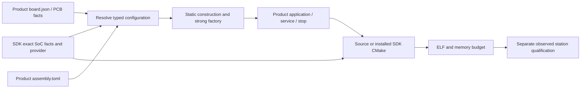

# Product-owned Board packages / 产品仓库自有板级包

The reusable platform owns CPU/SoC/provider implementation. A product owns its
PCB facts, authored assembly, application storage, task/service progress and
recovery policy. Use `apps/shared_spi_runtime` as the complete external Board
example: `software-board/board.json` binds exact STM32F407ZGT6 silicon routes,
`assembly.toml` selects two endpoints, and the application owns producers and the
SPI owner lifecycle. It is a **software fixture**, with no fitted PCB or device
asserted. Do not copy its CS pins into a real product without reviewed schematics.

平台维护 CPU、SoC 和 provider；产品仓库维护 PCB 事实、装配 TOML、应用存储、
任务/service 推进及恢复策略。完整外部板级范例是 `apps/shared_spi_runtime`：
板包给出精确 F407ZG 的已审核硅片路由，TOML 选择两个端点，应用拥有 producer
及 SPI owner 生命周期。它明确是**软件工装**，没有宣称实物 PCB/外接器件；
真实产品不能未经原理图审核直接照抄 CS 引脚。



## Start with reviewed facts / 从已审核事实开始

The following exercise copies only the small software Board manifest. It does
not copy vendor drivers, duplicate a provider, or create a claimed physical PCB.
Run from this repository with the exact SDK selected by the lock. Keep your real
product directory under its own version control.

以下练习仅复制已有软件 Board 描述，不复制厂商实现、不另造 provider，也不声称
发现了实物 PCB。在本例库中使用锁定 SDK；实际产品目录应独立版本管理。

```sh
NEXUS_SOURCE="$PWD/external/nexus"
PRODUCT_DIR="$PWD/build/private-product-exercise"
mkdir -p "$PRODUCT_DIR/boards/software-fixture"
cp apps/shared_spi_runtime/software-board/board.json \
  "$PRODUCT_DIR/boards/software-fixture/board.json"

python "$NEXUS_SOURCE/tools/configure/configure.py" init \
  --board-package "$PRODUCT_DIR/boards/software-fixture" \
  --backend baremetal --clock hse8-pll168 \
  --profile gpio --binding primary-cs --instance select \
  --output "$PRODUCT_DIR/platform.toml"
python "$NEXUS_SOURCE/tools/configure/configure.py" provider-check \
  --assembly "$PRODUCT_DIR/platform.toml" \
  --expect-family stm32f4 --expect-part STM32F407ZGT6 --json
python "$NEXUS_SOURCE/tools/configure/configure.py" explain \
  --assembly "$PRODUCT_DIR/platform.toml" --json
python "$NEXUS_SOURCE/tools/configure/configure.py" list-bindings \
  --assembly "$PRODUCT_DIR/platform.toml" --json
```

The generated TOML contains `board_package = "boards/software-fixture"`, relative
to that TOML, so the product directory can move together. A Board package selects
reviewed routes of an existing exact part; it does not add new controller hardware
or grant unsupported modes. `provider-check` validates typed resolution and
static construction and reports the exact part, selected implementation and input
hashes. It explicitly does **not** establish compilation or physical support.
A new SoC/provider requires the platform's implementation and maintained tests;
changing a Board string cannot provide that implementation.

生成的 board_package 相对 TOML 所在目录，可随产品目录一起移动。Board 只选择
精确料号已有、已审核的路由，不凭空增加控制器或模式。provider-check 检查定型
解析与静态构造，记录实现选择和输入哈希，明确不等同于编译或实板资格。新 SoC/
provider 必须在平台中实现并测试，改板包字符串不能生成缺失的硬件支持。

## Review configuration changes / 审核配置变化

```sh
# Keep the before/after TOML beside the same Board package.
python "$NEXUS_SOURCE/tools/configure/configure.py" diff \
  --assembly "$PRODUCT_DIR/platform.toml" \
  --against "$PRODUCT_DIR/proposed.toml" --json
python "$NEXUS_SOURCE/tools/configure/configure.py" check \
  --assembly "$PRODUCT_DIR/proposed.toml" --diagnostics-json
```

Create `proposed.toml` as the actual proposed edit before running these commands.
The diff explains factory/face changes, caller storage, transfer units and
service/DMA/cache/stop obligations. Declared capacity is not a measured saving.
`explain` records routes, DMA topology, IRQ/trigger/resource ownership and their
source identities. On rejection, `--diagnostics-json` gives the offending source
and key/context or conflicting resource claims. Correct the authored input; do
not edit generated `resolved.json`, silently fall back to another route, or use
a diagnostic as permission to release a borrowed request.

先将实际拟议改动保存为 proposed.toml，再运行 diff/check。差异解释 factory/接口、
调用者存储、传输单位及 service、DMA、Cache、stop 责任；配置容量不是测量收益。
explain 提供路由、DMA、IRQ/触发/资源归属及其事实来源。诊断会指向输入文件、
未知键或冲突双方，应修正唯一 TOML/板包源，不改生成文件、不静默换路由，
也不把诊断当作释放仍被借用 request 的授权。

## Build the complete example / 构建完整范例

The GPIO exercise above is a configuration exercise. The existing two-endpoint
application supplies the complete construction/build/lifecycle example:

以上 GPIO 练习检查配置；已有双端点应用提供完整的构造、构建及生命周期示例：

```sh
cmake -S apps/shared_spi_runtime -B build/private-board-source -G Ninja \
  -DCMAKE_TOOLCHAIN_FILE="$NEXUS_SOURCE/cmake/toolchains/arm-gcc.cmake" \
  -DNEXUS_SOURCE="$NEXUS_SOURCE" -DCMAKE_BUILD_TYPE=Release
cmake --build build/private-board-source --target shared_spi_runtime --parallel 1

# NEXUS_SDK is a complete publishable package of the same locked commit.
NEXUS_EXPECTED_REVISION="$(python -c 'import json; print(json.load(open("dependencies/nexus.lock.json"))["commit"])')"
cmake -S apps/shared_spi_runtime -B build/private-board-installed -G Ninja \
  -DCMAKE_TOOLCHAIN_FILE="$NEXUS_SDK/share/nexus/src/cmake/toolchains/arm-gcc.cmake" \
  -DNexus_DIR="$NEXUS_SDK/lib/cmake/Nexus" \
  -DNEXUS_EXPECTED_SOURCE_REVISION="$NEXUS_EXPECTED_REVISION" -DCMAKE_BUILD_TYPE=Release
cmake --build build/private-board-installed --target shared_spi_runtime --parallel 1
```

Keep source and installed builds in separate directories. Both consume the same
application and authored assembly; the installed form verifies the package and
expected revision through `find_package`. Linking does not observe SPI wires or
timing. The real Native and FreeRTOS host executions test application behavior;
the F407 ELF is a software fixture. Producers, owner drain and `join(NEVER)` do
not promise bounded shutdown: static borrowed storage remains live while the
product chooses a watchdog/recovery policy. See [developer recipes](developer-recipes.md).

源码/安装包使用不同构建目录，消费同一应用与 TOML；安装包经 find_package 验证
完整性和预期 revision。链接不是 SPI 接线或时序实测。Native 与真实 FreeRTOS
宿主执行验证应用行为，F407 ELF 仍是软件工装。producer 等待、owner 排空及
join(NEVER) 不保证有限停机；借用的静态存储继续保留，产品须制定 watchdog/
恢复策略。详见[开发配方](developer-recipes.md)。
