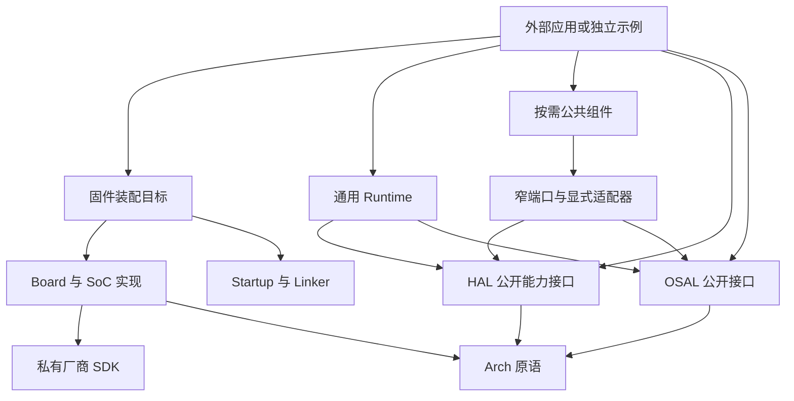

# Nexus 通用嵌入式平台重构与独立示例交付计划

本计划以 Nexus 源码 `069dcf14f9cb1cd6fc4a869d87bf9827b91ce306` 为分析基线，适用于约 10 人团队、3–6 个月交付周期。目标是把 Nexus 维护为可复用的通用嵌入式平台，把示例装配与实际产品放到独立仓库，通过公开接口和固定依赖版本协作。

**本文是实施计划，不是完成报告。** 除明确列为“基线已实现”或“基线已确认缺陷”的事实外，本文的目录、目标名称、API 草案、扩展入口和阶段门槛均待实施或待验收。历史 Native 测试、交叉构建和线上检查只能证明其绑定的历史源码；本次重构必须产生新的执行证据。当前没有本计划对应的实板 HIL 结果。

分析基线：[Nexus `069dcf14`](https://github.com/X-Gen-Lab/nexus/tree/069dcf14f9cb1cd6fc4a869d87bf9827b91ce306)。既有任务和 ADR 应在 Nexus 的 `docs/strategy/` 中更新；本文列出的 `RF-*` 是本轮重构任务 ID，不覆盖既有任务完成状态。

## 1. 仓库职责与交付边界

| 仓库或目录 | 拥有的内容 | 不承担的内容 |
|---|---|---|
| `nexus` | Arch、SoC、内置参考 Board、HAL、OSAL、通用 Runtime、可选公共组件、平台契约测试、源码 SDK、平台支持矩阵 | 产品 SKU、业务任务拓扑、现场工艺流程、产品安全状态机、客户协议变体、默认产品 Flash 分区、产品发布政策 |
| `nexus-examples` | 固定 Nexus revision、外部工程装配、各板最小示例、可选组件使用示例、可执行教程、公开接口集成测试、示例专用配置和布局、示例 HIL 清单 | 复制 Nexus 实现、替代平台契约测试、声称具有量产资格、将演示控制算法反向内置为平台策略 |
| 外部产品仓库 | SKU/版本、产品 Board 或扩展 Board、任务和预算、服务组合、Flash layout、业务健康、更新及回滚策略、制造和现场要求 | 修改平台内部全局变量、直接借用私有 driver instance、通过公开依赖获得厂商 SDK 类型 |
| 平台依赖锁 | CMSIS、厂商 SDK、FreeRTOS、可选受维护依赖、许可证和源码身份 | 企业签名秘密、产品密钥、制造凭据 |

内置 Board 是公开参考 BSP；企业自有 PCB 可以放在外部仓库。Board 描述上电初始电平、连接与电气约束，不能替外部应用决定紧急停机、容错等级、控制恢复和看门狗喂养政策。公共协议、存储、安全验证、更新流程等可以作为可选库留在 Nexus，但其产品端口和产品政策由外部调用者提供。

控制域与管理域是平台使用合同：平台提供 task/ISR、阻塞、deadline、队列、内存和设备所有权约束；外部应用决定是否划域、创建多少任务、使用何种优先级和故障政策。Nexus 不自动创建固定的“控制任务”或“管理任务”。

首发软件与硬件组合：

| SoC | Board | 后端 | 本轮目标 |
|---|---|---|---|
| STM32F407ZGT6 | 启明欣欣高配 V3.1 | 裸机、FreeRTOS | 公开接口构建、引脚/时钟/IRQ/串口/SPI/Flash 验证 |
| STM32F407VET6 | 天空星青春版 | 裸机、FreeRTOS | 实际密度与板卡接线独立验证 |
| GD32F470ZGT6 | 梁山派 | 裸机、FreeRTOS | F470 专属 SDK、启动、IRQ、外设及 Flash 验证 |
| STM32F407VGT6 | Discovery 参考 | 裸机、FreeRTOS | 保留可重复参考，不能替代三块首发板验收 |
| Native | 宿主参考 | Native，适用的裸机模型 | 契约、错误和集成验证；不证明电气和 ARM IRQ 时序 |

GD32F303 已由用户明确替换为 GD32F470，不进入本轮新增平台范围。所有板卡都必须记录实物 PCB revision、装配差异、供电、probe 和主机串口连接；文档型号不等于实物确认。

## 2. 基线能力与必须关闭的问题

### 2.1 基线已实现，应迁移和保护的能力

- 独立 Arch 保存/恢复中断状态；FreeRTOS 运行中的 syscall 临界区保持内核端口语义。
- 类型化设备 discovery、owner/generation、GPIO/UART/SPI 操作及 UART buffer lease；取消必须结清硬件和回调所有权。
- Native、裸机、FreeRTOS OSAL；FreeRTOS 六类对象使用有界静态 kernel storage，生命周期 token 与 kernel slot 区分。
- 每个 build root 一份有效配置；头文件、CMake 和 linker 输入来自同一次解析；厂商 SDK 保持实现目标私有。
- 显式注入平台 OBJECT、真实 startup、IRQ 和注册条目；源码 SDK 的父工程上下文已由 `Nexus::Config` 传递。
- `products/` 中的 HAL→OSAL 单 owner bootstrap、失败回滚、关闭前检查和失败时保留所有权。应迁移通用部分，不以删除 Product 身份为由删除这些保障。

### 2.2 基线已确认缺陷

以下是 `069dcf14` 的问题，不表示对应默认板卡流程全部已触发。每项必须有独立行为回归，不能只比对源码文本。

| ID | 问题与触发条件 | 基线源码 | 修复与回归要求 |
|---|---|---|---|
| `RF-FIX-01` | STM32F4 ISR 表容量为 82，但索引使用 `irq + 16`，使合法外部 IRQ 66–81 被拒绝。已用生产 manager、真实 Release 配置和 NVIC 替身复现；当前仅 USART1–3 的 UART 流程未触发高 IRQ | `platforms/stm32/src/interrupt/stm32_isr_manager.c:62,124,132` | 明确外部 IRQ 编号与 exception/vector 索引；验证最高合法 IRQ、越界、注册/派发/注销、重注册与优先级。使用真实 SDK 枚举，不仅扩大数组后宣称完成 |
| `RF-FIX-02` | GPIO effective config 支持 AF 0–15，但配置宏将 `.alternate` 固定为 0，AF5/AF7 等配置丢失；默认 LED 不受影响 | `platforms/stm32/src/hal/gpio/stm32_gpio_device.c:115,122`；GPIO lifecycle 消费该字段 | 从唯一有效配置传递 AF；实际初始化输出保留 AF5/AF7，覆盖普通 GPIO 与非法 AF 配置；ARM 构建和实板引脚复用分开验收 |
| `RF-FIX-03` | Native/裸机查询 `event_bits_mask=UINT32_MAX`，实际 set/wait 拒绝高 8 位，能力声明与行为矛盾 | `osal/adapters/native/osal_native.c:349`、`osal_native_event.inc:80,102`；`osal/adapters/baremetal/osal_baremetal.c:103`、`osal_baremetal_optional.inc:15,23` | 收敛所有后端的 mask 与实现；枚举每个广告可用位，验证 set/wait/clear，验证保留位明确失败；不要把能力查询改对却保留跨后端行为漂移 |
| `RF-FIX-04` | Shell UART deinit 忽略 driver 的 BUSY/失败，清空指针并返回成功，失去后续 teardown 重试入口 | `framework/shell/src/shell_uart_backend.c:149–162` | 迁移类型化引用；BUSY/硬件清理失败保留引用和状态；成功后才清空。验证 TX 活跃、失败重试和最终释放 |
| `RF-FIX-05` | Log callback 声明在 logger lock 下必须短且非阻塞，内置 UART sink 却进行默认 1000 ms 的同步发送 | `framework/log/include/log/log_backend.h:83–86`；`framework/log/src/log_backend_uart.c:36,80–88` | 通用 core 与 UART sink 分离；不得持全局 logger 锁等待线速或 UART。验证阻塞/故障 sink、并行 producer、队列满、flush/shutdown 及明确的丢失报告 |
| `RF-FIX-06` | `LOG_USE_STATIC_ALLOC=1` 声明不调用 malloc/free，UART backend 创建/销毁仍无条件使用它们；该模式不是当前默认配置 | `framework/log/include/log/log_def.h:133–148`；`framework/log/src/log_backend_uart.c:145,152,183,187` | caller-owned context 或显式静态池；通过 allocator 失败/调用拦截证明静态模式不分配，验证池耗尽和重复销毁，不扩大为全程序无 malloc 承诺 |

另设 `RF-HAL-05` 处理违约 provider 返回成功但 UART ticket 为 0 的隔离与恢复：基线防御路径会持有租约且缺少可达恢复入口。这是 provider 违约时的防御缺口；正常 STM32/GD32 provider 未观察到零 ticket，优先级低于上述实际配置/API 缺陷。修复不得因异常 ticket 而提前释放仍可能被硬件访问的 buffer。

以下是边界或能力缺口，不能直接归类为“已确认当前实现 bug”：legacy factory 借出的裸指针没有 owner/generation；类型化 I2C 和其余设备类别尚未全覆盖；完整资源拓扑校验、MCU 运行中全局 shutdown、installed binary SDK 尚未建立；真实 HIL 未执行。legacy 与 typed 混用存在文档化限制，本轮应迁移调用者并缩减暴露面。

### 2.3 市面方案的架构对照与取舍

下面依据各方案的通行架构进行比较，用于确定本轮边界，不是最新版本、全部芯片支持或性能的实测调研。正式引入某个组件或更换底座前，仍需锁定具体版本、许可证、资源成本和首发板执行证据。

| 方案 | 通行架构及可借鉴内容 | Nexus 本轮取舍 |
|---|---|---|
| Zephyr / Nordic NCS | Zephyr 把内核、device model、驱动、Kconfig、Devicetree、CMake 和 west 依赖组织结合；NCS 基于其构建 Nordic 软件生态。硬件资源描述、初始化阶段和多仓依赖有成熟做法 | 借鉴硬件与软件配置分离、资源生成和依赖锁；本轮保留现有有效代码与明确 ownership 契约，不同时迁移全部 kernel/device/build model。若后续网络、复杂驱动和 SoC 范围使现有适配成本持续增加，应独立评估采用 Zephyr 底座 |
| ESP-IDF | 以 Espressif SoC 为中心的组件化 SDK，CMake/Kconfig 与 `idf.py` 组织构建，SDK 提供驱动和系统设施 | 借鉴组件目标、公开/私有接口和统一命令入口；其硬件生态不直接作为 STM32/GD32 双厂商底座。Nexus 的 SoC 实现保持各 SDK 私有，外部工程消费统一平台接口 |
| STM32Cube + FreeRTOS | CMSIS、startup、HAL/LL、CubeMX 板级配置与 FreeRTOS 组合；适合接近硬件的开发，应用通常自行组织跨层生命周期、资源和构建 | 沿用真实 SDK 和已验证 FreeRTOS，补齐 Arch/SoC/Board 分界、typed lease、配置一致性与跨仓工作流；生成工具不成为唯一可重复构建来源，也不将 STM32 模型直接套到 GD32 |
| RT-Thread | 内核 IPC、device framework、BSP、软件包和 Kconfig，常见构建体系使用 SCons；提供较完整的 RTOS 与组件生态 | 借鉴 device 生命周期、BSP/包分离和静态资源做法；首期不为获得目录结构同时更换 OS、构建工具和驱动模型。需要其生态时按公开端口评估后端或组件适配，验证实际契约和维护成本 |

优先薄 HAL/OSAL 与 source CMake SDK，是因为当前范围是两类 MCU、三首发板、10 人和 3–6 个月，且已有设备 ownership、静态 OSAL 和真实 SDK 构建基础。先把跨厂商公开合同、错误和外部装配做正确，能在有限容量内形成可交付结果。这个选择不代表完整 RTOS 平台整体较差，也不表示 Nexus 已具有它们全部资源描述、网络或包管理能力。

资源描述首先使用可审核 Board manifest、窄 C 资源结构、Kconfig 和标准 CMake，并校验 pin/AF/clock/IRQ/DMA/Flash 冲突。当新增外部 Board 反复复制映射、controller/DMA/clock 组合明显增多，或出现无法由现有校验防止的资源冲突时，进入 `RF-BRD-01/02` 的资源描述升级评审。可评估采用标准 Devicetree 或明确的编译期生成输入；选一种硬件描述机制，与 Kconfig 的软件选择分别负责，不再增加平行配置 DSL。生成代码、配置 hash 与真实构建输入必须一致，公开 HAL API 不随描述工具选择而暴露 vendor 类型。

## 3. 目标依赖图与公共契约



箭头表示依赖方向，不能理解为平台自动初始化所有下层对象。HAL facade 与 driver provider 通过公开契约连接；provider 的 SDK 依赖私有。Mock/Fake 只属于测试目标；Native 模拟 provider 应显式报告模拟能力，不进入 MCU production 组成。

| 层 | 拥有的资源和初始化职责 | 对外约束 |
|---|---|---|
| Arch | CPU 异常上下文、保存恢复 token、屏障、必要 cache/MPU 原语 | 不依赖 HAL/OSAL/framework；不宣称未实现的 MPU 隔离 |
| SoC | 时钟树、IRQ 控制器、DMA、controller、时间源、内存域、内部 Flash 几何、芯片身份 | SDK/寄存器类型私有；控制器资源由实例描述，不包含产品分区 |
| Board | PCB revision、晶振、电源、引脚、外部器件、CS/DE、初始电平与绑定 | 狭窄资源端口；不公开可变完整 driver instance；不决定业务安全策略 |
| HAL core/facade | 常量描述、能力、open/close/recover、owner/generation、操作 ticket、buffer lease | 发现不启动；任务/ISR 分开；失败保留必要所有权；无隐藏堆分配和任务 |
| OSAL | 后端选择、任务/同步/时钟、预算和 capability、对象生命周期 | 调度前/后规则明确；不伪造跨后端相同能力；不强删仍在使用的对象 |
| Runtime | HAL/OSAL bootstrap 与 rollback、通用有界等待/派发适配 | 不拥有业务任务；组件 worker 可由调用者显式创建或驱动；deadline 覆盖排队和操作 |
| 公共组件 | parser/state machine/格式/有界数据结构，以及窄端口适配 | core 不依赖具体 Board/SDK；创建、配置、shutdown 的 owner 明确；产品配置由外部输入 |
| 外部应用 | composition、版本、任务、优先级、预算、组件顺序、分区、政策 | 不绕过平台私有状态；遵守 ISR、lease 和维护窗口合同 |

### 3.1 去 Product 身份的 bootstrap

计划公开 `Nexus::Runtime` 和 `Nexus::Firmware`，保留有价值的 `Nexus::HAL`、`Nexus::OSAL` 与可选组件目标。`Nexus::Firmware` 只组成所选 Board/SoC、startup/linker、HAL/OSAL 和通用 bootstrap，不自动链接所有组件。名称最终以 ADR 和外部消费验证为准。

删除内部 `products/Kconfig` 的身份选择，也删除平台根对示例业务 `applications/Kconfig` 的强制引用。现有 `APP_STACK_SIZE` 实际是 linker 的 CPU main/exception stack 保留，`APP_HEAP_SIZE` 是 C runtime heap 保留；应迁移到含义明确的固件资源输入，不随示例目录删除。MSP、libc heap、post-build artifact 选项属于通用构建能力，示例目标和业务配置由外部仓库提供。

目标 API 草案，**尚未实现**：

```c
const nx_platform_info_t* nx_platform_get_info(void);
nx_status_t nx_runtime_bootstrap(nx_boot_report_t* report);
nx_status_t nx_runtime_shutdown(nx_boot_report_t* report);
nx_runtime_state_t nx_runtime_get_state(void);
```

`nx_platform_info_t` 提供 Arch/SoC/Board/backend、内存区域和有效能力，查询不启动硬件，不包含产品 SKU 或业务 firmware version。`nx_runtime_get_state()` 表示基础设施状态，不表示产品健康。外部 firmware version 属于应用目标，例如现有 helper 的 `NEXUS_APP_VERSION`。

bootstrap 保持串行单 owner：已有其他 owner 的 HAL/OSAL 初始化明确拒绝；失败回滚报告原始失败和回滚失败；部分成功但未结清时保留所有权。shutdown 必须先结清引用/操作/对象；FreeRTOS scheduler 运行期间明确 BUSY，不宣称停 kernel 后可再次启动。

初始化顺序：

1. 外部 `main()` 调用通用 bootstrap，取得失败报告。
2. FreeRTOS 构造外部应用自己的 bootstrap task，显式调用 `osal_start()`；需要 operational mutex/queue 的组件在受调度任务内初始化。
3. 组件由应用指定配置和端口，不由平台硬编码默认服务顺序。
4. 裸机由外部应用拥有事件循环或显式 pump；不以空 task/timer 模拟不支持能力。
5. 设备租约、组件停止和业务恢复由对应外部 owner 结清；平台只按合同报告状态和错误。

旧 `nx_startup()` 的 weak board/OS hook、自动 main 包装和隐含 RTOS 分支应逐个调用者迁移后收敛。不能把未检查 init 失败、忽略 task 创建失败或递归调用 `main()` 的入口继续作为推荐 SDK 路径，也不能把未启用的旧宏分支描述为当前默认启动缺陷。

### 3.2 HAL、OSAL 与运行时边界

- HAL metadata/core 只拥有身份、注册、owner/generation 和基本生命周期；GPIO/UART/SPI/I2C facade 可分别组成，避免 core 编译单元依赖全部设备类别和 legacy factory。
- provider 保持硬件状态与 buffer settlement；timeout/cancel 的结果区分“等待超时”“取消已结清”“取消失败仍持有租约”。完成、错误和取消仅交付一次终态。
- task-only facade 不伪装成 ISR-safe。ISR fast path 在确有需求时单独提供窄能力接口；不让 ISR 经 OSAL 阻塞锁或 framework callback 进入管理路径。
- UART memory completion 与 wire TC 分开，RS485 adapter 的 DE 结清依赖 wire completion；transceiver 接线和业务帧策略由外部配置。
- 通用 runtime adapter 可以实现有界队列、deadline 和完成派发；构造时由调用者提供队列/存储或预算，显式声明 callback 上下文和 worker 所有权。
- OSAL 时间继续提供单调 ms、32 位回绕及有限预算 `< 2^31 ms`；微秒级总线时序使用明确 SoC 时间源，不能用伪时钟/循环计数替代。
- 静态 kernel slot 释放后可复用；lifetime token 不复用以拒绝 stale handle。32 位编码的累计身份预算必须文档化和可诊断，不误写为删除一次就永久损失一个 pool slot。
- MSP/exception stack、OSAL task stack pool、libc heap、FreeRTOS management heap、queue payload、idle/daemon stack、driver buffer 分别报告。OSAL heap seal 仅覆盖 OSAL allocator。

### 3.3 外部 Board 扩展

采用一条简单、可校验的源码入口，复用现有 CMake/Kconfig，不增加第二个配置引擎或模块注册 DSL。拟支持显式 `NEXUS_BOARD_DIR` 或等价单一路径参数；名称为设计候选，当前不可当作可用参数执行。

外部 Board 包含：可版本化 manifest、配置输入、CMake 目标、窄资源绑定、引脚/晶振/初始电平、真实 linker/startup 选择依据及 HIL fixture 声明。一次 build 只选择一个 Board/backend/effective config。manifest 身份、真实输入文件 hash 与最终目标配置绑定。

扩展验收必须证明：外部 Board 路径不依赖 Nexus 源码根布局；冲突/缺失/非法 clock/pin/AF/DMA/IRQ 配置被拒；普通应用的 include/compile interface 不泄漏 SDK；Board 实现可显式依赖 private SoC resource API；startup/IRQ/注册对象实际进入 ELF。板卡 package 只能为已验证 SoC 扩展接线，不能绕过新增 SoC 的 SDK/启动/几何验证。

## 4. Flash 几何、区域和外部 layout

SoC 负责完整物理 Flash 的地址、擦除 block、program alignment、容量探测、读写保护与执行限制；平台不默认把末尾两块交给某个产品配置系统。

目标 API 草案，**尚未实现**：

```c
nx_status_t nx_flash_query_geometry(nx_device_ref_t flash,
                                   nx_flash_geometry_t* geometry);
nx_status_t nx_flash_query_block(nx_device_ref_t flash, uint32_t address,
                                nx_flash_block_t* block);
nx_status_t nx_flash_region_init(nx_flash_region_t* region,
                                nx_device_ref_t flash,
                                uint32_t offset, uint32_t length);
```

实际 API 需与类型化 Flash 设备评审一起确定。HAL 不依赖 `services/storage` 的 `nx_flash_port_t`；转换成现有存储窄端口由独立 adapter 完成。region 保存明确借用/拥有引用及有效期，不能通过复制 struct 获得另一份可独立关闭的设备 owner。

外部 layout 可以定义 app、bootloader、状态、参数、OTA slot 等区域，但名称和选择属于示例/产品。构建时从同一 layout 输入生成 linker 和 adapter 配置，验证：

- 物理探测容量、SoC geometry 与 linker 声明一致；不默认把 STM32F407ZG/VG 的容量用于 VE。
- 分区不溢出、不重叠，不跨禁止区域；整数加法/乘法溢出明确失败。
- 擦除区域包含完整实际 block。STM32F407 是非均匀 sector，GD32F470 是系列专属 4 KiB page；不能用一个通用 `erase_size` 错误覆盖整颗芯片。
- linker 的 load segment、vectors、rodata、初始化数据镜像不能落入保留区；stack/heap 不与 RAM 保留区重叠。
- 多个 region 对同一 controller 的并发擦写有序；读/执行冲突、最坏暂停时间和维护窗口由外部应用承担并验证。
- 示例双 bank 存储、更新候选布局显式标注为 demonstration；真实 bootloader、防回放、key vault、镜像安装和安全计数器未接入时返回不支持或拒绝准入。

已有现场持久化格式和产品数据即使平台 API 可以破坏性重构，也必须单独规划备份、迁移、失败回滚和可恢复格式版本，不能静默擦除或假装自动兼容。

## 5. 组件 core、adapter 与测试替身拆分

| 组件 | core | 显式 adapter | 外部应用责任 |
|---|---|---|---|
| Log | 格式、级别过滤、有界记录和丢失统计 | runtime queue、UART、console、file、存储 sink | 选择 sink、队列、deadline、限流和 worker；定义业务可接受丢失 |
| Shell | parser、编辑/历史、命令表与输出端口 | typed UART、stdio、runtime eventloop | 注册命令、权限/维护政策、缓冲预算和设备 owner |
| Config | namespace/schema、格式、事务和串行管理合同 | storage、crypto provider | 参数定义、默认值、迁移、key/vault 和维护 owner |
| Storage | 有界提交/恢复、CRC/generation 格式 | generic flash region、file flash | region/layout、写频率、寿命、维护窗口和格式迁移 |
| 协议 | 有界 parser/state machine、CRC 与明确端口 | typed UART/RS485、网络 transport | 地址/寄存器映射、轮询/重连政策、优先级和收发线程 |
| Security/Update | 维护中的 provider 端口、清单校验和通用状态机 | OpenSSL 或 MCU provider、安装/计数/信任端口 | 熵源、key lifecycle、bootloader、产品健康与确认政策 |

core 的能力按组件实际需要定义，不为了拆目录而复制 API。OS-independent core 不默认依赖 OSAL；适配器依赖关系明确出现在目标图中。Mock/Fake 与故障注入单独编译为测试目标，不能成为 production 的隐式 fallback。

调用者提供 context/storage 与显式 init/deinit 是优先形态；确有便利 singleton 的场景必须清楚限定 single owner，不能让裸指针寿命超出组件注册期。异步 worker 是明确可选 adapter，创建失败必须报告，shutdown 超时保留仍在使用的 callback/context。

## 6. 多仓 SDK 与可核验集成

### 6.1 源码 SDK 首先完成

`nexus-examples` 固定 Nexus commit，通过 Git submodule 或审核锁文件选一种机制，不跟踪 floating branch。README 给出干净 clone、依赖获取、工具链固定、configure/build/run 的真实路径。平台公共入口保持标准 CMake target 和公开 header，不要求外部应用手工 include `platforms/.../src`。

一次构建记录：examples SHA、Nexus SHA、外部 Board/package SHA、有效配置 hash、layout hash、工具链身份、SDK/Git 依赖身份、ELF/map/bin/hex 摘要、执行测试枚举与退出码。工作树 dirty、缺失/漂移依赖、空测试、目标身份不符必须阻断候选证据。配置文件路径不是身份，必须摘要实际内容。

公共 API 变更由两个关联提交/PR 完成：先在平台提交中验证外部最小消费 fixture，再在独立示例中更新固定 revision 与调用者。示例旧 revision 保持可重复，不要求所有仓库同步跟随 master；release/candidate 报告必须包含准确的一对 SHA。Git 写入、创建仓库和推送依照当前用户授权由维护流程执行，本文不代表这些动作已完成。

### 6.2 厂商与内核依赖接入

- STM32/CMSIS/FreeRTOS 保留真实版本锁，检查完整 checkout；GD32 官方源码导入保留 archive、逐文件长度/hash、许可证和来源，不能伪造 vendor commit。
- SDK include/definitions 不传播到普通应用，显式 direct SDK bring-up 示例必须声明独立依赖并标明不属于稳定 HAL 消费路径。
- vendor 升级单独提交，先运行 header/signature、startup/vector、IRQ、clock、geometry 和驱动契约验证，再更新 examples pin；不混入广泛 API 重构。
- 工具链入口保持官方 archive/hash 与 CI 本地一致；第三方包缺失时明确阻断，不用自写 stub 冒充真实 ARM 构建。

### 6.3 installed SDK 是后续独立交付

先证明 source SDK 的纯 C/C++ 父工程、非 Nexus 工程根、路径含空格、独立 output、public/private 边界和配置隔离。再评估 `install/export`：CMake package、组件与配置身份、可重定位路径、Board 扩展、startup/linker/注册对象打包和 ABI/toolchain 限制。不能仅生成 `NexusConfig.cmake` 就宣布完成 binary SDK。

### 6.4 跨平台构建与验证入口收敛

`RF-BLD-01` 以 CMake preset/effective config 为唯一构建模型，Linux/macOS/Windows 的受支持入口共享参数含义和退出码。保留的 Python/PowerShell/shell wrapper 只能转发到维护入口，不能再独立解析平台别名、重写配置、选择另一套 output 或吞掉失败。审查 `scripts/nexus.ps1`、`scripts/building/build.ps1`、`scripts/setup/quick-start.py` 等历史入口；可修成薄 wrapper 的同步更新帮助和教程，不能满足合同的移除。quickstart 不再使用已失效的 `--platform/--type` 构建路径，也不默认把 MCU 编译称作完成测试。具体 OS/toolchain 支持由实际执行矩阵声明，不从入口可运行推断跨平台已验证。

`RF-CI-01` 承接现有平台验证入口，而非另建旁路：`scripts/ci/ci_build.py` 调用 CMake/CTest preset，当前 Native test 使用 `--no-tests=error` 和 JUnit；`scripts/ci/ci_build.ps1` 已转发到同一 Python 实现。`.github/workflows/build-matrix.yml` 分别执行 Native CTest 与 `scripts/ci/validate_firmware_elf.py` 的 ARM 静态检查，CI helper 自检为 `python -m unittest discover -s scripts/ci -p 'test_*.py'`。这些既有保护应保留；不能笼统写成当前主链没有零测试门禁，也不能将 ARM checker 视作目标机测试。

独立 `scripts/validation/` 等历史验证入口必须收敛到相同 preset、实际测试枚举和结构化报告合同，审查并治理忽略 subprocess 非零退出码、标签匹配零测试、文本解析得到空结果却成功、缺失/空/全 skipped 报告、旧报告残留等假通过路径。必需 suite 零执行或结果不可解析时明确失败；只允许显式配置并可审核的 optional suite skip。Native JUnit 的用例/执行计数与退出码交叉核验，ARM 报告绑定实际 ELF/config，失败时不能留下可被误用的旧成功报告。使用故障 runner 和损坏/缺失报告建立拒绝回归；线上聚合仍要求所有必需 job success，合法条件 skip 单独解释。此处是本轮入口治理任务，不声称所有历史工具缺陷已修复。

## 7. 10 人责任配置

| 角色 | 人数 | 本轮主要责任 |
|---|---:|---|
| 技术负责人 `TL` | 1 | 通用边界、ADR、优先级、跨层 API 和阶段验收；对外支持范围 |
| 内核接口 `K1/K2` | 2 | HAL ownership、OSAL、Runtime、组件 core/adapter 契约及静态预算 |
| BSP `B1/B2` | 2 | B1 主 STM32，B2 主 GD32；交叉 reviewer；SoC/Board/Flash/IRQ/SDK |
| 集成与示例 `I1/I2` | 2 | 独立示例、外部应用消费、公共组件接入、文档；业务示例代码只在外部仓库 |
| QA/HIL `Q1/Q2` | 2 | 行为回归、故障注入、跨后端矩阵、实物板卡与波形/资源测量 |
| 构建发布 `R1` | 1 | 简化目标图、配置、固定依赖、跨仓 CI、工件及候选证据 |

每个关键模块必须有主 owner 和另一岗位 reviewer；岗位表不冒充实际 GitHub 账号绑定。跨仓公共接口由 TL 与 K/BSP 至少一人评审，QA 评审可执行验收。安全、制造、现场接口在真实产品仓库指派，不由平台自行决定客户发布或现场操作。

## 8. 分解任务与前置依赖

状态统一为：`待实施 → 实现中 → 软件验证通过 → HIL通过（适用项）→ 对应范围可交付`。文档/API 草案不进入“软件验证通过”。每项在实际 issue 中填写主/副 owner、预计成本、执行证据和剩余条件。

| ID | 优先级 | 交付物 | 前置依赖 | 主责 / reviewer | 可观察验收 |
|---|---|---|---|---|---|
| `RF-ARC-01` | P0 | 更新通用平台/外部应用 ADR 与支持声明 | 无 | TL / K1、I1 | 平台内部无产品身份、固定业务任务和产品 layout 的新增设计；源文档与本计划一致 |
| `RF-EX-01` | P0 | 独立 examples 仓库、固定源码 SDK revision、构建说明 | ARC-01 | I1、R1 / Q1 | 干净 checkout 能通过当前公开入口构建最小应用；准确记录平台/示例 SHA |
| `RF-BAS-01` | P0 | 基线 configure/build/test 与缺陷重现证据 | EX-01 | Q1、R1 / B1 | 非零测试、完整源码/配置/工具链身份；明确未执行组合和 HIL |
| `RF-FIX-01` | P0 | STM32 IRQ 编号/表容量修复 | BAS-01 | B1 / K1、Q1 | 合法高 IRQ 可 connect/dispatch/disconnect；非法 IRQ 被拒 |
| `RF-FIX-02` | P0 | GPIO AF effective config 贯通 | BAS-01 | B1 / B2、Q1 | AF5/7 到实际 GPIO 初始化，默认 GPIO 行为保持且非法值拒绝 |
| `RF-FIX-03` | P0 | OSAL event mask 与操作一致 | BAS-01 | K2 / Q1 | 所有后端广告位逐位可用，保留位失败，ISR/调度门禁不回退 |
| `RF-FIX-04` | P0 | Shell UART teardown 失败状态 | BAS-01、HAL-02 | I2、K1 / Q1 | BUSY/清理失败不清引用，重试成功后释放，stale handle 拒绝 |
| `RF-FIX-05` | P0 | Log 非阻塞 sink 与 logger lock 合同 | BAS-01、CMP-01 | K2、I2 / Q1 | 故障/慢 sink 不持全局锁等待；有界背压、丢失和 flush 结果可观察 |
| `RF-FIX-06` | P1 | Log 静态模式所有 UART context 分配 | BAS-01、CMP-01 | K2 / Q1 | 静态配置 allocator 拦截零调用；容量耗尽明确失败 |
| `RF-BOOT-01` | P0 | Runtime bootstrap 与中性 platform info | ARC-01、BAS-01 | K1 / TL、Q1 | owner/回滚/部分失败/重试、READY 语义、ISR 拒绝和查询无副作用 |
| `RF-BOOT-02` | P0 | 移除 Product Kconfig、身份和调用者依赖 | BOOT-01、EX-01 | R1、I1 / K1 | Board/backend 单一选择，外部 main 使用中性 API；平台不强制业务 application choice；通用固件预算保留 |
| `RF-BOOT-03` | P1 | 收敛 legacy startup/main wrapper | BOOT-02 | K2、I1 / Q1 | init/worker 创建失败不进入业务；调度前后规则明确；无主入口递归 |
| `RF-HAL-01` | P0 | HAL core/facade/provider/runtime 目标拆分 | ARC-01、BAS-01 | K1 / B1、R1 | core 不含 vendor/Board/framework；只选所需 facade；错误与租约回归 |
| `RF-HAL-02` | P0 | 生产 Log/Shell 等调用者迁移 typed ownership | HAL-01、BOOT-01 | K1、I2 / B1、Q1 | discovery 不 init；close/cancel 不绕过 owner；legacy 暴露面收缩 |
| `RF-HAL-03` | P1 | typed I2C 与明确 device capability | HAL-01 | K1、B2 / Q1 | 双设备/地址、deadline、取消、复用、unsupported、两 MCU 真实构建 |
| `RF-HAL-04` | P1 | 有界 runtime deadline/完成派发 adapter | HAL-02、OS-01 | K2 / Q1 | 排队+锁+操作共用 budget；调用者拥有 worker；取消只交付一次终态 |
| `RF-HAL-05` | P1 | 零 ticket provider 违约隔离/恢复 | HAL-01 | K1 / Q1 | 不释放活跃 buffer，故障可诊断且存在明确可达结清/恢复路径 |
| `RF-OS-01` | P0 | backend capability、启动/ISR/删除契约统一 | FIX-03 | K2 / B1、Q1 | 启动前 FromISR 被拒；真实 kernel 删除/等待/时钟回绕符合查询 |
| `RF-OS-02` | P1 | 静态资源与累计 token 预算诊断 | OS-01 | K2 / Q1、R1 | slot 重复创建/删除可复用；旧 token 不重定向；耗尽明确失败；报告完整预算 |
| `RF-BRD-01` | P0 | Board 窄资源接口与 manifest 约束 | ARC-01、FIX-01、FIX-02 | B1、B2 / K1 | controller/引脚/AF/clock/IRQ/DMA 绑定可校验，应用不能访问内部 instance |
| `RF-BRD-02` | P1 | 单一路径外部 Board 扩展 | BRD-01、BOOT-02 | B2、R1 / I1、Q1 | 外部 fixture 构建/运行；路径与配置隔离；冲突/缺失明确拒绝 |
| `RF-SDK-01` | P0 | SDK/工具链固定与私有 compile interface | BAS-01、BRD-01 | R1、B1、B2 / Q1 | 真实 ARM 编译链接，漂移/缺文件拒绝；public header 无 vendor 类型 |
| `RF-FLS-01` | P0 | 全物理 Flash geometry 与类型化 region | HAL-01、SDK-01 | B1、B2 / K1、Q1 | 非均匀 STM sector、GD 4 KiB page、实际密度、边界/溢出/错误验证 |
| `RF-FLS-02` | P0 | 外部 layout→linker/region 单输入 | FLS-01、BRD-02 | R1、I1 / B1、Q1 | 重叠/跨 block/镜像占保留区拒绝；layout identity 绑定 ELF |
| `RF-FLS-03` | P1 | storage adapter 与掉电故障验证 | FLS-02、CMP-01 | K1、B2 / Q2 | 原/新完整状态恢复；无跨 region 擦除；维护窗口与物理掉电分开报告 |
| `RF-CMP-01` | P0 | Log/Shell core、adapter、test fake 拆分 | ARC-01、HAL-01 | K2、I2 / Q1、R1 | core 最小依赖构建；fake 不进入生产；context/worker 生命周期明确 |
| `RF-CMP-02` | P1 | Config/Storage/协议窄端口与外部装配 | CMP-01、FLS-02 | I1、I2 / K1、Q1 | 无默认产品分区/命令表；组件可独立选择；回调及错误流可验证 |
| `RF-CMP-03` | P1 | Security/Update 明确 provider 与 policy 边界 | CMP-02 | K1、I2 / TL、Q1 | 无 MCU provider 时明确不支持；无内置产品信任/健康/回滚政策 |
| `RF-BLD-01` | P0 | 简洁目标图、`Nexus::Firmware` 装配与统一跨平台入口 | BOOT-02、HAL-01 | R1 / B1、I1 | OBJECT/startup/强 IRQ/注册段实际保留；旧 PowerShell/quickstart 等入口收敛或移除；wrapper 参数/退出码一致 |
| `RF-BLD-02` | P0 | 外部应用 helper 与 artifact 资源配置 | BLD-01、FLS-02 | R1、I1 / Q1 | C/C++ 父工程、独立输出、MSP/heap/task 预算分离、8 ARM 组合 |
| `RF-EX-02` | P0 | 最小 GPIO/UART/SPI/组件示例迁出平台 | BOOT-02、BLD-02、CMP-01 | I1、I2 / Q1 | 仅公开 target/header；Nexus 自身独立契约测试不依赖 examples 源码 |
| `RF-CI-01` | P0 | 当前平台验证入口收敛与多仓契约 CI | EX-02、SDK-01 | R1、Q1 / TL | 复用 preset/CTest/ELF/helper 门禁；治理历史入口零测试/空或旧报告/非零退出码假通过；固定 SHA pair 与真实枚举 |
| `RF-HIL-01` | P0 | 三首发板 fixture 与板卡租约 | BRD-01、SDK-01 | Q2、B1、B2 / Q1 | 实物身份、刷写读回、复位、串口、供电/探针，证据绑定镜像 |
| `RF-HIL-02` | P0 | IRQ/AF/UART wire/SPI/DMA/Flash 实板资格 | HIL-01、FIX-01、FIX-02、FLS-03 | Q2、B1、B2 / Q1 | 抢占/优先级、引脚复用、TC/取消、CS 波形、掉电恢复真实测量 |
| `RF-HIL-03` | P1 | 最坏负载、资源和长期生命周期 | HIL-02、OS-02、FIX-05 | Q1、Q2 / K2、TL | 冻结测试 workload/预算，记录 jitter/高水位/丢失/恢复；真实长时间循环 |
| `RF-SDK-02` | P2 | 可重定位 install/export package | BLD-02、CI-01 | R1 / I1、Q1 | 离开源码树 clean consumer 构建；对象/linker/配置/ABI 身份完整 |
| `RF-REL-01` | P1 | 平台候选与双仓示例证据包 | CI-01、HIL-02 | R1、Q1 / TL | 同工件摘要、源码/依赖/配置身份、许可范围、已执行/未执行矩阵 |
| `RF-REL-02` | P1 | 版本与持续维护合同 | REL-01、HIL-03 | TL、R1 / K1、B1 | 公开变更记录、源码 SDK 兼容范围、补丁 reviewer/回归责任；不自动承诺 LTS |

表中缩写依赖如 `ARC-01` 指完整 ID `RF-ARC-01`。暂缓无明确需求的 CAN/CANopen、Ethernet/MQTT、额外 MCU、完整 RTOS 热重启和 binary SDK 优先投入；不能用新增功能覆盖已有 P0 生命周期与 BSP 缺陷。

## 9. 逐批提交与实际回归

下表是执行要求。只有列出的回归真实运行且通过后，对应批次才能标为完成和产生可推送提交。修复应先建立失败用例，再改生产路径；临时红测试不单独推入主分支。大任务可以有多个小 commit，但每个 commit 保持其声明范围可构建、可验证。

平台公共接口变更必须原子更新该仓调用者、契约测试和文档；外部 examples 使用固定旧 revision 直到其 pin/caller 提交验证成功。不得为了过渡保留被用户允许删除的坏设计。每批记录执行命令、退出码、用例枚举、源码/配置和产物身份，不把“定义了 CI job”计作运行。

| 批次 | 建议提交与范围 | 每批实际回归和退出条件 |
|---|---|---|
| C01 | examples：`build: add pinned external Nexus consumer`；仅外部仓库骨架、锁和最小公开接口消费 | clean parent-project configure/build；Native 实际启动/退出；依赖身份记录；平台工作树独立干净 |
| C02 | platform：`fix(stm32): cover full external IRQ range` | 生产 ISR manager 的高/低/非法 IRQ、派发和注销行为；真实 ARM STM32 Release 链接及向量/强 handler 检查 |
| C03 | platform：`fix(stm32): preserve configured GPIO alternate function` | 使用真实 effective config 生成的 AF5/7/普通 GPIO 初始化行为；配置拒绝用例；STM32 裸机/FreeRTOS 构建 |
| C04 | platform：`fix(osal): align event capability masks` | Native/裸机/真实 pinned FreeRTOS 每个广告位 set/wait/clear；保留位拒绝；相关调度前/ISR 回归 |
| C05 | platform：`refactor(runtime): replace product identity with platform bootstrap`；examples 随后更新 pin/调用者 | boot owner、HAL失败、OSAL失败、rollback失败、部分状态、shutdown BUSY/恢复；三后端初始化规则；external C/C++ consumer 和 Cortex ELF |
| C06 | platform：`refactor(hal): separate core and typed providers` | registry/owner/generation/stale refs、UART lease/cancel、SPI parent-child 生命周期；最小 facade 链接；SDK include 隔离；相关 Native sanitizer |
| C07 | platform：`fix(shell): retain UART ownership on failed shutdown`；关联 typed caller 迁移 | 活跃 TX BUSY、硬件 deinit 失败、保持状态、重试成功、stale handle；实际 Shell/UART 接口路径 |
| C08 | platform：`refactor(log): separate bounded core and runtime sinks` | 慢/失败 sink、producer 并发、队列满、丢失报告、flush 和 shutdown ownership；验证不在全局 logger lock 下等待 UART |
| C09 | platform：`fix(log): honor static UART backend allocation` | 静态/动态两个配置、allocator 拦截、池耗尽、失败清理、重复 create/destroy；实际 adapter 并非仅 header 检查 |
| C10 | platform：`refactor(board): add explicit external board input`；examples 增外部 Board fixture | 外部路径及 parent root 隔离；缺 manifest/非法 pin/AF/clock/DMA/IRQ 拒绝；真实 STM32/GD32 startup/linker 保留 |
| C11 | platform：`refactor(flash): expose geometry and validated regions` | 实际 STM32 VG/ZG/VE 与 GD32 geometry；越界/溢出/alignment/跨 block/重叠；两 MCU provider 故障与 cancellation 合同 |
| C12 | platform+examples：`build: derive firmware layout from external input` | ELF load segment/map 与 region 一致；保留区侵占/密度不符/布局漂移拒绝；储存跨进程恢复与原/新值完整性 |
| C13 | platform：`refactor(components): isolate ports and test fakes`；examples 显式接入组件 | core-only 与各 adapter 组合；未启用组件不产生默认任务/分区；无 provider 明确失败；配置/协议/更新相关行为回归 |
| C14 | platform：`feat(hal): add typed I2C and bounded runtime adapters` | 双设备、地址/重启条件、预算耗尽、取消/回调竞态、provider 违约恢复；Native 与真实 SDK 两平台交叉构建 |
| C15 | examples：`refactor: move reference applications out of platform`；platform 移除完成迁出的应用组成 | examples 公开 header/target only；Nexus 独立测试不读示例源码；各最小示例 Native 实际运行；受支持 MCU 示例完整构建 |
| C16 | platform+examples：`ci: bind cross-repository source and artifact evidence` | clean 重建 Native GCC/Clang、相关 sanitizer/分析、全部支持 ARM 组合；统一入口/wrapper 失败传播；零测试/空或旧报告/全 skipped 必需 suite 拒绝；dirty/错 SHA/缺依赖拒绝；同 SHA pair 在线运行 |
| C17 | examples/HIL fixture：`test(hil): qualify board wiring and timing` | 三首发实板独立 flash/readback/reset；AF/IRQ/UART wire TC/SPI/DMA/Flash 波形与故障；预算、镜像和 PCB revision 绑定 |
| C18 | platform：`build(sdk): export validated relocatable source package`，仅排期具备余量时 | 离开源码树的 C/C++ consumer、路径含空格、配置/backend/ABI拒绝、startup/注册对象保留；不降低已通过门禁 |
| C19 | platform+examples：`docs(release): publish validated support and evidence` | 汇总最终 clean SHA pair 对应的实际检查；同工件候选、不重建；未执行 HIL/功能继续明确标注；发布范围复核 |

在真实实现引入新代码或发现失败时扩大相关回归；已经通过的批次不为凑测试数量反复全量重跑。阶段结束和候选发布时执行完整受支持矩阵，不能把若干定向通过替代最终集成。硬件不可用时继续软件工作，但对应硬件阶段保持未通过。

## 10. 3–6 个月阶段安排与门槛

时间为容量规划，门槛优先于日期。3 个月目标是一个真实首发板组合达到平台资格和外部应用消费资格；6 个月目标是 STM32F407 与 GD32F470 双 SoC 的已声明组合达到可复用平台候选。不是保证在未连接硬件、未定义测量预算时宣称完成。

以 10 人、每周 75% 时间用于计划内工程作为初始容量假设，12 周约 90 人周、24 周约 180 人周；剩余时间用于 review、缺陷和协作。该数字是规划容量，不是任务成本估算或进度证据。G0 结束前各 owner 必须按实际代码、板卡和工装给任务估算，并按关键路径重排；R1、两名 K 与两名 BSP 不能因表中多项并行而同时承担无上限工作。每人最多一个主要实现任务，review 与短时协助另行留量。

| 阶段 | 周期 | 主要并行工作 | 退出门槛 |
|---|---|---|---|
| G0：可重复基线 | 第 1–2 周 | ARC/EX/BAS；Q2 落实三板及工装；B1 IRQ/AF；K2 event mask | clean 双仓基线、真实失败复现、固定 SDK/工具链；实物/未具备输入清单；无以文档冒充修复 |
| G1：通用边界 | 第 3–4 周 | Runtime/Product 迁移、HAL 目标拆分、外部公开 consumer；Log/Shell 首批修复 | 内部 Product 选择删除；bootstrap owner/回滚正确；public SDK 无泄漏；Native 和首个 ARM 外部 app 编译/链接 |
| G2：BSP 与区域 | 第 5–8 周 | Board 外部扩展、Flash geometry/layout、OSAL budget；组件 core/adapters | 两 SoC 真实 SDK 编译/链接；8 ARM 配置按实际支持范围；外部 Board 与 layout 拒绝路径；Log/Shell 所有 P0 关闭 |
| G3：首板资格 | 第 9–12 周 | 最小示例完整迁出、多仓 CI、首板 HIL、资源/取消/Flash 故障 | 至少一个首发板+后端通过物理测量；平台与 examples SHA pair 固定；未验证组合仍非硬件合格；受控外部试用 |
| G4：双平台完善 | 第 13–18 周 | GD/STM 剩余首发板 HIL、typed I2C/adapter、长运行资源；可选公共组件 | 双 SoC 实板基本链路、IRQ/AF/TC/取消/Flash；重复恢复不耗尽 kernel slots；token 预算明确；负载测量有可复现工作集 |
| G5：候选与维护 | 第 19–24 周 | 完整多仓矩阵、许可/证据、版本变更说明、可选 SDK export | 同工件证据包、精确支持矩阵、reviewer/补丁责任；产品发布/签名/制造仍按各产品门禁独立完成 |

每两周审查未关闭 P0、关键路径和实板输入；新增功能只能在不影响阶段门槛的容量内纳入。若资源不足，优先缩减可选组件和 installed SDK，保持边界、正确性、可重复构建和首发板资格完整。

## 11. 验收证据与维护工作流

每个合并请求说明具体触发条件、改变后的行为、公开接口/持久化格式影响、任务 ID、真实执行检查与未执行项。跨仓变更关联 platform PR、examples PR 和准确 pin。每个关键变更至少一名非作者 reviewer；IRQ/取消/Flash/持久化需要对应 BSP/QA 评审。

| 证据级别 | 必需内容 | 能支持的结论 |
|---|---|---|
| 契约测试 | 生产路径、正常/失败/边界、非零用例、退出码、源码与配置 | 对应软件行为正确，不证明实板 |
| 真实 SDK 构建 | pinned 依赖、工具链、effective config、ELF/map、vector/segment/checker | 对应真实 ARM 组合编译链接正确，不证明电气/时序 |
| Native/模型故障 | seed、故障位置、原/新状态、allocator/driver 失败、运行枚举 | 可复现软件故障合同，不证明 VDD 掉电和 DMA 硬件停止 |
| HIL | PCB revision、SoC identity、fixture/probe、镜像读回、负载、波形/日志、资源和失败记录 | 精确板卡/后端/功能组合的物理资格 |
| 候选包 | 双仓 SHA、配置/layout/依赖身份、同工件摘要、许可范围、执行报告 | 可审核的平台候选；不自动等于产品量产/安全/LTS资格 |

典型门禁包括：无空测试；无 dirty source 候选；无 mismatch SHA/config/layout/board；无 SDK 漂移；无必需检查取消/异常 skip；无 provider 的必需操作不得返回成功；取消失败不得释放 buffer；不从 Native 结果推断 MCU HIL 通过。

长期指标采用 CI 失败/flake、PR 等待、接口迁移成本、BSP 故障、资源高水位和外部集成结果，不以代码行数、文件数量或测试数量考核。平台发布范围由真实验证决定；产品签名、客户安全评审、制造工装与灰度由外部产品流程负责。

## 12. 当前执行入口与完成定义

立即顺序为：建立独立仓库和 fixed SDK consumer → 获取 clean 基线 → 逐项修复 IRQ/AF/event API 错误 → 保留 bootstrap 保障并删除 Product 身份 → typed caller 与 Log/Shell 迁移 → Board/Flash/layout → 示例迁出 → 多仓证据 → 实板资格。

最终交付必须同时具备：

1. Nexus 单独作为通用平台维护，不依赖 examples 仓库才能构建和测试核心契约。
2. 独立示例由公开 API/target 组成，干净 checkout 使用固定平台版本，教程对应实际执行。
3. 外部应用能够提供 Board 扩展、资源预算和布局，平台没有内置产品任务与安全政策。
4. 已确认缺陷关闭并有生产行为回归；未实现能力明确失败，正常后端与 provider 违约路径分开验证。
5. STM32F407/GD32F470 的公开支持组合有真实 SDK 构建与精确的实板资格记录；缺少实板结果的组合保持明确限制。
6. 每批变更有 reviewable commit 和真实回归，最终证据绑定准确双仓 revision 与同一组工件。

“完成整个嵌入式平台”按这些可核验边界解释，不以新增全部外设、网络栈和产品业务作为完成条件。后续平台能力以明确需求、维护成本、公开合同和板卡证据进入独立迭代。
