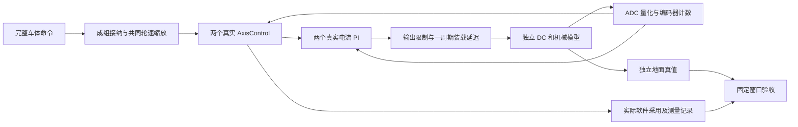

# 双轮差速软件闭环

本工程执行真实 C11 AxisControl、标量电流 PI、编码器展开、运动学和命令准入。
外部 DC 电机／机械模型提供量化 ADC 与模数编码器数据。控制器不读取模型真值；
独立验收器使用真值评价地面位移，另存编码器里程计。

这是有限 **Native SIL**。它不建立 PMSM FOC、功率板、轮地接触或实板性能资格。
当前模型采用理想 DC 电机、恒定参数及显式 Euler，未包含开关纹波、磁饱和或轮胎柔性。



## 执行与数据

`drive.c/.h` 只拥有应用组合。初始化不触碰硬件；同一个执行者串行调用 enable、
accept、1 ms 轴 step 和显式 50 µs 电流 step。周期来自实验调度，不读取主机墙钟。
每条命令保留原接收时间、会话、epoch 和递增 sequence；相同数值的新命令合法，
重复旧帧、延迟解析和心跳不能续期。两轴在独立副本中全部接纳成功后才共同发布。

这是同一执行者的软件数据完整性，不承诺两个物理定时器或 CAN 节点同时采用。
Axis 的 `adopted_at` 只表示本地软件控制采用，电压计划仍通过模型的下个边界才生效。
源退出、机械停稳与控制对象可回收是不同条件。

`sil_model.c/.h` 保存真实电流、位置和速度，控制输入只有量化的传感代码。模型电压
受母线限制，保存 staged 与 active 两个值，显式保留一周期作用延迟。计数取模后由
真实 `nx_encoder_tracker_step` 估计轮速；当前 ADC 转换与编码器口径分别保留。

`sil.c/.h` 是独立、有限实验编排和验收。它不将模型真值传给控制器，也不把命令
目标赋给实际速度。每次调用重新建立模型、控制状态和记录，无隐藏线程、堆或全局时钟。

## 教学配置及判据

主程序采用半径 0.10 m、轮距 0.40 m、轮速上限 10 rad/s。这些都是软件教学值，
不是 Nexus 的电机或安全默认值。上层 10 ms 更新完整目标，30 ms 命令年龄边界包含
等号；失联后用仍有效的本地反馈和电流环执行预定减速，故障不自动重新运行。

每轮固定一秒窗口的 1000 个有效 1 ms 记录，分别要求峰值误差不超过 0.2 rad/s、
RMS 不超过 0.1 rad/s。缺样不填零，不改窗口，不将左右平均后掩盖单轮失败。
40 ms 只评价最后有效命令到两轮采用停车参考的响应，不等于物理停车时间。

主程序还规划 2 m、最高 0.5 m/s、加速度 0.5 m/s² 的梯形运动。轨迹结束 1 s 后
评价终点：纵向 ±0.05 m、横向 ±0.03 m、航向 ±2°；此前固定 0.5 s 的 500 个
模型真值记录须全部满足线速度 ≤0.01 m/s、角速度 ≤0.01 rad/s。它评价有限采样窗口，
不声称连续时间所有瞬间都已被观察。

测试分别执行稳态轮速、缺记录、命令停止更新和地面终点实验。真实半径改成
0.0965 m 而控制／里程计仍用 0.10 m 时，会出现内部里程计接近 2 m、真值约 1.93 m
的反例；内部跟踪通过不能替代真实地面验收。

## 构建与软件验证

使用包含本批 AxisControl 的已验证 Source SDK；主仓的 Gitlink 和依赖锁需匹配。
独立入口复用同一个 `firmware.cmake`，不复制另一套控制实现：

```sh
cmake -S recipes/control/differential_drive -B build/differential-drive \
  -G Ninja -DNexus_DIR=/path/to/sdk/lib/cmake/Nexus
cmake --build build/differential-drive --parallel 2
ctest --test-dir build/differential-drive --output-on-failure --no-tests=error
```

根 Native 工程的 GoogleTest 入口为 `differential_drive_google`，使用实际 C 源码及
本仓锁定的 GoogleTest。当前开发中的 focused 执行只能建立其原始源码和编译上下文
对应的软件证据，不能替代干净 SDK、正式完整门禁或实板结果。

Physical HIL、真实延迟、功耗、堆栈峰值：`not_executed`／`not_measured`。
