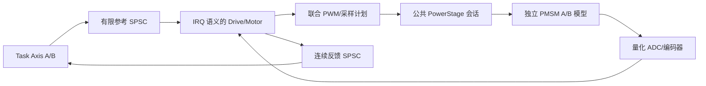

# 双 PMSM 完整软件控制链

本配方运行两个独立的 PMSM 平均电气／机械模型，控制器只读取量化 ADC 与编码器。
实际执行 `Axis → DriveControl → CurrentControl → MotorControl → ModulationControl`
以及公共 PowerStage 会话，支持电流、速度和位置模式。它是 Native 软件参考，
不是两个 DC 电机标量 PI，也不建立 STM32F4 共享 ADC 的物理资格。



## 执行与数据来源

- 模型载波 20 kHz，外环反馈每 20 个实际快环间隔发布一次，即 1 kHz。
- 每周期先以当前实际 duty 积分到采样点，再产生量化测量；控制器返回下一计划。
  剩余区间继续使用旧 duty，到完整载波边界才采用新计划。
- 相电流经独立 PMSM 方程、相变换和 ADC 量化生成。控制器看不到模型 `id/iq`、
  精确速度或目标真值；这些值只用于模型和结果评价。
- 两轴具有不同电阻、惯量、负载与相反速度命令，不共享积分器、队列或标定状态。
- 控制反馈丢失是错误。独立四项遥测满时允许丢弃，不阻塞控制。
- 默认物理 `motor_drive` 仍为 `commissioned=false`；只有本配方的明确模拟输入
  将该字段置真。模型常数不能作为真实功率板的标定数据。

平均模型不包含开关纹波、EMI、器件压降或输出抑制后的二极管网络。软件退出不会
被解释成实物滑行、制动、隔离或机械停止。共享 ADC 由平台独立的真实 C provider
合同验证；本配方的公开端口 shim 不冒充该实现。

## 配置和运行

工作目录为 `nexus-examples`，先准备包含本轮控制组件的 Nexus Source SDK：

```sh
cmake -S recipes/control/dual_motor_drive -B build/dual-pmsm -G Ninja \
  -DNexus_DIR=/path/to/sdk/lib/cmake/Nexus
cmake --build build/dual-pmsm --parallel 2
ctest --test-dir build/dual-pmsm --output-on-failure
```

成功运行输出 `software_only=1`、两轴速度、RMS 速度误差和故障状态，返回零。
默认实验为一秒。修改 `example_dual_motor_experiment_t` 可分别选择 CURRENT、
VELOCITY、POSITION，施加单轴 Task 暂停、ADC 饱和或有限受控停止。

设置 `bus_limits_at_us` 可启用 Task 共母线预算。策略调用真实
`nx_drive_bus_limit()`，分别预留双轴消费和回生，再将对称电流范围提交实际 Axis。
这是保守示例：仅准入 `Id=0`；`power_bound_w_per_a` 是产品必须确认的所选工况
功率上界系数，不是把相电流当作母线电流。两个方向不按相反功率相抵。
默认软件参考 20 W/A 是模型常数，不是电机硬件标定。

资格源每 1 ms 提供原始时间与 5 ms 期限。设置 `bus_source_stop_at_us` 后，来源
停止更新；outer-loop 不能续期，双轴最终按 TIMEOUT 撤回。收紧经有限 FIFO 采用，
截止必须覆盖已发布参考高水位；本策略不提供瞬时能量保护。
报告同时保留软件预留功率上界、实际连续反馈采用电流，以及仅用于评价的模型
双消费、双回生和相反流向计数。后者不会反向进入控制器。

本仓维护者可显式增加 `-DEXAMPLE_CONTROL_TESTS=ON`，使用本仓锁定的
GoogleTest/GoogleMock 执行单轴桥、真实双 PMSM 组合和绝对角度交接合同。
生产示例默认不构建测试框架。

## 故障与退出

Task 失联后，有限快环参考过期，受影响轴停止接纳；另一轴继续自己的完整链。
ADC 饱和不会被转换成有效电流。恢复 Task 时首先观察 provider 原始故障，再处理
可能已经过期的外环反馈，避免次生错误覆盖首个故障。

运行结束或出现错误时，所有已接纳会话必须最终结清，才返回并回收模型和算法存储。
外部控制设备、功率板、真实时序、采样精度和电气保护仍为 `not_executed`。
