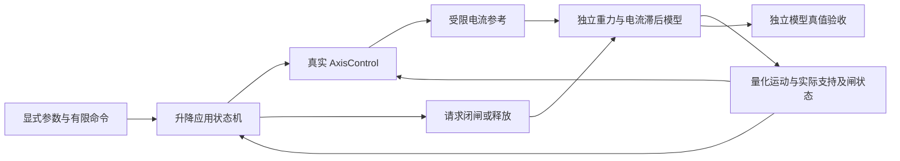

# 升降轴：承重交接与有限回零

本例执行真实 C11 `AxisControl` 和应用状态机，另用独立的重力／电流滞后／机械闸模型
产生反馈。默认只运行 Native 软件实验，不访问功率板、制动闸或 MCU 引脚。
软件参考值不代表任何电机、减速机构或制动器的额定值，也没有完成物理安全认证。



## 责任与使用顺序

`lift_axis.c/.h` 负责应用交接，不包含硬件 owner、隐藏线程、动态内存或固定等待。
初始化绑定显式采用 `NX_AXIS_HOLD_ZERO_VELOCITY` 的 DISABLED Axis。所有 API 由一个
执行者串行调用；输出是请求，实际 provider 的准入、停机和最终借用排空由调用者完成。

启动顺序是 **已确认机械保持 → 建立电机承重 → 独立承重确认 → 请求释放 → 实际释放
确认 → 允许运动**。电流指令不等于实际承重，闸线圈电平不等于机械保持。反馈调用者
必须通过自己的测量／诊断合同提供 `support_confirmed` 和 `brake_valid`；不同来源的
观测时间、clock domain 和 64 位 epoch 均需一致且满足配置年龄上限。

停机继续执行 Axis：实测速度进入容差并保持配置的 dwell 后，Axis 进入 HOLDING，
继续零速调节与显式 `stop_feedforward_a`。收到独立承重确认后才请求闭闸，收到已确认
机械保持后才撤电流并 disable 算法。`nx_axis_disable` 本身不关闭硬件，也不证明
provider 已 SETTLED。HOLDING 不能证明位置保持、可承重、制动功能或断电安全。

`example_lift_move` 保留原始接收与到期时间，不给旧网络命令续期。命令过期会发起
有界的本地受控停车与交接；本地停止预算和网络运动权限独立。初次建支持也是有限
内部零速命令，若释放后一直没有显式 move/home，超时后收闸停机，不无限刷新权限。

`support_feedforward_a` 必须与 Axis 的 `stop_feedforward_a` 一致，以保持交接时
的偏置连续；最终总电流仍由 Axis 限制。它不是称重值，不能代替独立支持证据。
真实接入如需动态电流／功率降额，应先明确完整的下游限制与回算合同。

## 故障与机械边界

反馈丢失、错误时间、硬限位触发或电源失败会锁存故障、拒绝继续运动，输出
`motor_permit=false`，并按显式 `on_feedback_loss`／`on_power_loss` 请求 KEEP 或
CLOSE。KEEP 不新增机械动作；CLOSE 只有在系统已验证该失效策略时才可选。参考配置
显式选 KEEP，没有默认动态制动，也不声称失去驱动力后能够继续托住重物。

故障时只依据新鲜、有效的机械保持确认报告 `support_unconfirmed=false`；旧支持布尔值
不能掩盖未知闸状态。复位要求新鲜已闭闸、实际驱动已撤回和静止反馈；清除后保持
SECURED，必须重新显式 start。真实设备还需要独立硬件安全链、欠压行为、闸额定能力、
反馈诊断及失电分析；本例不会把软件状态当作这些物理事实。

## 有限机械回零

`example_lift_home` 使用显式相位：负向搜索开关 → 正向退回并确认离开 → 慢速负向
接近 → 记录边沿机械 offset → 实测停稳及闭闸交接 → 发布有效参考。

每相位都有最大距离、最大时间，另有整个回零预算和上下限位。超时不续搜索命令，
停止／交接失败不发布有效参考。起始开关已触发则从退回开始。记录的是
`home_coordinate_rad - observed_position_rad`；不改编码器计数，不建立电角零点。
电角对齐属于 MotorControl/实际电机调试，不能从机械原点推导。传动比与直线高度换算
由产品应用提供，当前接口统一使用同一机械轴侧的 rad 和 rad/s。

## 软件模型与验证

`native/model.c/.h` 仅收到复制的电流／闸请求。独立保存实际电流、重力负载、惯量、
阻尼、机械位置和闸转换状态；反馈使用量化位置和相邻采样速度。支持判据来自模型实际
转矩与显式负载误差，不能由电流请求直接置位。控制器从不读模型真值。

模型按 1 ms 离散实验更新，电流使用一阶滞后，机械使用离散积分，闸确认来自模拟
执行器状态变化。该模型中的转换时间是模型参数，生产状态机仍只等待真实输入的确认。
模型未描述弹性、闸滑移、摩擦不确定性、传感器诊断或真实电机电气开关；模型通过
不建立连续时间、实板或安全资格。

主程序执行有限启动、回零和闭闸退出实验，报告 `software_only`、样本数、参考与
机械保持确认。GoogleTest 执行真实应用和 Axis C：支持交接、确认缺失、停机保持、
反馈／失电、有限回零、手动恢复、边界别名与时序、独立机械模型完整链路。

使用包含本批 AxisControl 的已验证 Source SDK 构建；Gitlink 与锁文件需匹配：

```sh
cmake -S recipes/control/lift_axis -B build/lift-axis \
  -G Ninja -DNexus_DIR=/path/to/sdk/lib/cmake/Nexus
cmake --build build/lift-axis --parallel 2
ctest --test-dir build/lift-axis --output-on-failure --no-tests=error
```

根 Native 的 GoogleTest 入口为 `lift_axis_google`。开发中的 focused 编译只验证其
实际源码和继承编译上下文，不替代干净 SDK、正式完整门禁或实板验收。

English scope: finite Native software reference; no hardware actuation, load-holding
qualification, dynamic-braking default, or electrical rotor alignment is claimed.
Physical HIL／真实闸保持／电源切断：`not_executed`。
