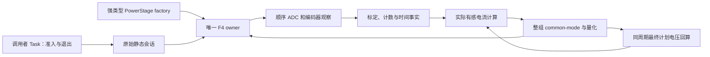

# F407 有感电驱完整消费参考

本工程将生成的强类型 PowerStage factory、真实 MotorControl、编码器展开、ADC
标定、PWM 量化回算和会话退出连成一条 C11 应用路径。它不包含厂商 Handle、私有
寄存器操作、隐藏 worker 或第二个控制器 owner。

默认 `commissioned=false`。主程序完成平台冷态启动和参数校验后，在 PowerStage
准入之前拒绝激励并关闭平台。现有数字只是软件组合参数，不能代替电流校准、功率板
审核和初始转子相位。完整已授权路径由明确的主机 fixture 执行；这不授予实物资格。



## 精确软件范围

本地 `assembly.toml` 与 `board/board.json` 选择 STM32F407ZGT6、TIM8 三对互补输出、
ADC1 的 IN0／1／2／3 四个 injected ranks（前三相电流、第四母线），以及 TIM4
PD12／PD13 的 16-bit x4 计数。完整硅片路线和资料来源在 Board JSON 中。

该 Board **没有已审核的物理 PCB**。当前模式是 1 kHz、边沿对齐、四 rank 顺序采集；
不能描述为中心对齐、同步多 ADC、20 kHz 电流环或真实采样精度验证。顺序转换跨度
由 provider 声明，并受应用显式的误差预算限制。

`sample_at` 是计划触发代理，`observed_at` 是完整读完的观察，`angle_at` 是计数读取
观察，`planned_apply_at` 是下一次计划更新。应用原样传递这些事实，允许角度在
采样之后但在计算可知时有界回投影；不会把时间字段改写成虚构的硬件锁存时刻。

## 接入与运行

外部应用提供完整 `example_motor_drive_config_t`：

- 三相零点、增益、相序、方向与母线比例。
- 精确编码器 counts-per-turn、安装方向、最大单步位移。
- 已知初始机械相位与电角偏置，以及其有效参考条件。
- 电流、母线、调制、scan 跨度、计算周期与角度年龄限制。
- 显式运行期限、启动预算和 commissioning 授权。

配置中的运行 epoch 不作猜测；首个真实 provider sample 将实际非零 epoch 绑定到
MotorControl。首个计数观察仅建立参考，输出实际 duty 窗口中心的零线电压计划。
第二个有界观察建立速度之后才执行完整电流计算；无效跨度、丢期、角度或 epoch
变化会返回错误并由唯一 owner 抑制输出。

计数先以精确整圈数取模，再转成浮点机械相位，避免长期累计计数转换后丢失细分辨率。
速度来自原始观察间隔，不把软件采样时间解释成编码器边沿 aperture。

数学调制的对称窗口按 provider 可用跨度进一步约束，然后将整组三相共同平移到实际
非对称 duty 窗口。必要时只作共同矢量缩放，不逐相截断。整组量化后使用同一周期
输出角重建计划 dq 电压，并调用一次 `nx_motor_track_voltage`。这是计划估计，
不是相电压实测，也不证明硬件已采用。

## 连续观测与有界丢失

`drive.observations` 是借用 context 以外的固定四项 SPSC 通道。唯一 ADC IRQ
producer 在完成计算后仅复制原始 sample、完整下一组 tick 计划和计算结果；失败记录
的计划无效并清零。原始 sequence、64-bit epoch 和各时间字段原样保留，计划不是
硬件采用回执。通道满时丢弃本条观测、累加饱和 drop 计数，控制计算和停机不等待
观察者。单条记录不是无损控制历史。

实现复用公共 `nexus/arch/atomic.h` 的 32-bit acquire/release load/store，并在
编译期要求这些字长始终 lock-free。写完整 slot 后 release 发布 head；Task acquire
head、复制后完成 sink，再 release tail。计数器按无符号模数回绕，距离始终不超过
四；drop 到达 `UINT32_MAX` 表示至少该数量。无 heap、锁循环或隐藏线程。

同一个 Task 调用 `example_motor_observation_drain`，每次最多执行显式 budget
次 sink；空返回 `EMPTY`，累计 dropped 即使在最终没有新记录时也可取得。sink
成功必须完整接受一个记录；`BUSY` 或错误保留该条，下一轮重试，不自动丢弃。
若连接 RTT/UART 的字节接口，Task adapter 自行保存短写偏移，完整写完才返回
SUCCESS；不得把短写当作完整记录，不得保留临时 record 指针。这是本地 C 类型，
跨设备传输应由 Task adapter 显式编码字段，不能把结构 padding 当作稳定协议。

`main.c` 给出实际固定二进制快照 sink：每次接收完整记录到独立 `s_latest`，并保存
累计 `s_dropped`；运行期间每轮有限 drain，SETTLED 后再完整排空。默认没有 RTT
依赖或打印。需要调试传输时可在 Task 组合现有 diagnostics 配方和
`nx_rtt_log_sink`，IRQ 路径不变；调试链路忙只影响观测丢失。

即使通道暂时为空，provider 尚未 SETTLED 时也不能 reset/reinitialize。只有借用
解除、通道完整 drain，且唯一外部 consumer 已 join，才能重新初始化；初始化会
检查未借用和空通道，外部 consumer join 仍是调用者责任。

## 停止、故障与回收

同一个 privileged Task 调用 initialize、start、step 和 stop。算法与编码器 context
在准入后由 IRQ 独占借用；Task 不读取或改写其字段。运行目标期限与启动 deadline
分开，PowerStage 会话本身保留到明确退出。

`step` 在固定目标期限之前一个 PWM 周期或 provider 错误时开始撤回，避免正常退出
碰到最后一个计划作用边界。它不会延长目标授权；Task 迟到仍由内核期限拒绝后续输出。
失败保留原 session、context 和
`borrowed` 标志，继续使用同一个对象重试；不能重新初始化消除借用。只有 acquire
观察 SETTLED 后才消费结果并解除本层借用。已经结清的真实结果不会被后续无意义的
stop 错误覆盖。外部观察者 join 和 Platform 冷态关闭仍需分别完成。

清理长期失败时，主程序保留静态存储，不在 callback 仍可访问时返回 main。它不选择
机械制动、抱闸或自动重新使能策略。

## 编译与测试

先准备包含 MotorControl／IOPowerStage 的已验证 SDK，再选择其 ARM 工具链：

```sh
cmake -S recipes/control/motor_drive -B build/motor-drive -G Ninja \
  -DCMAKE_TOOLCHAIN_FILE=/path/to/sdk/share/nexus/src/cmake/toolchains/arm-gcc.cmake \
  -DNexus_DIR=/path/to/sdk/lib/cmake/Nexus
cmake --build build/motor-drive --parallel 2
```

根 Native 测试入口 `motor_drive_google` 执行实际控制桥、MotorControl 和公共
PowerStage API，仅替代外部硬件 port。覆盖 commissioning 拒绝、预热、时间事实、
量化回算、窄窗口、长期相位、失效扫描、停止隔离与重试，以及满通道下真实控制
仍推进、最终丢失、时间保真、回绕、忙 sink 和结清后排空。fixture 明确提供软件校准，
不能把这些数字复制到未经核验的电机。

实板电气、控制稳定性、实际 WCET、死区、break 反应及保护保持 `not_executed`。
