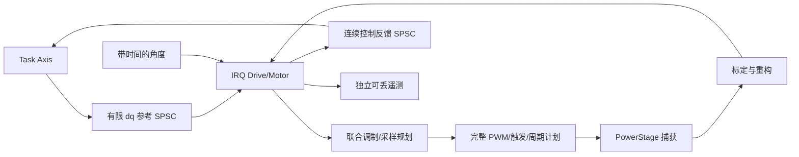

# PMSM 电流与轴控制组合

本配方通过强类型 factory 获取 PowerStage，显式连接实际 Axis、DriveControl、
CurrentControl、MotorControl 和 ModulationControl。应用拥有参数、参考与反馈存储、
外环执行和退出；平台 provider 独占选定 PWM、ADC、触发和 IRQ。

默认 `example_motor_drive_reference()` 返回 `commissioned=false`。主程序完成平台
冷态启动与配置检查后，在 PowerStage 会话准入前拒绝激励。数值示例不是功率板
标定、相序或电角对齐证明。



## 单一配置与执行者

`example_motor_drive_config_t` 保存不变的电机、Axis、调制、标定、角度与期限配置。
配置位于 IRQ 借用 context 外；Task 和 IRQ 只读它，运行期间不得逐字段修改。
初始化后的 owner、port、配置关联队列与其存储不得搬移；全部存活到会话结清。
算法、编码器与 feedback sampler 由 IRQ 独占；Task 只操作自己拥有的 Axis、队列、
`last_feedback` 和 `axis_output`，不会读取 IRQ 算法状态。

启动先取得 PowerStage 的真实 `clock_epoch`，初始化静态参考／反馈队列，再接纳
会话。第一个编码器样本只建立观察；真实 Drive 输出建立反馈锚点，完整区间到达
Task 后才 enable Axis。下一条连续反馈运行外环，发布目标供后续 IRQ 明确采用。
启动等待有期限，不用合成速度或伪造反馈序号完成预热。

`example_motor_drive_accept()` 接纳完整有限 Axis 命令，保留原始 receipt、sequence
和 valid-until。它在首个连续反馈前返回 BUSY；接纳不是 IRQ 采用或物理运动。
初始 CURRENT／VELOCITY／POSITION 由配置选择，外部新命令经过同一实际 Axis。
模式切换遵守 Axis 的 READY 条件。

## 测量、规划和时效

- 原始 phase mask 与 count 决定独立测量相位，两相时由 CurrentControl 重构第三相。
  三相和诊断只用于三路独立测量，不能由重构恒等式证明传感一致性。
- 顺序采样跨度与标定偏斜预算显式保留，不描述为同时采样孔径。
- 调制使用 provider 的完整载波、duty 范围、alignment 和 capture 槽；生成 pulse
  start/width、触发、phase mask 和周期序号，随后做一次最终计划电压 tracking。
- 当前普通消费者选择 phase-shunt 规划，不将单分流计划静默映射到不支持的硬件。
- 缺少母线来源会拒绝。角度可由选定 provider 的有效编码器观察，或显式配置的
  `example_rotor_queue_t` 提供；`encoder_valid=false` 不会被解释成零角度。
- 绝对角度的 Task reader 使用独立 `as5047p_rotor.h` 与
  `example_as5047p_rotor`。IRQ 只从有界 handoff 取得或复用未过期快照，不执行 SPI。
- 没有母线 ADC 路线时，可显式提供 `bus.h` 的带来源、epoch 和原始期限的快照。
  普通 `example_motor_bus` 无 I2C 依赖；可选 `bus_ina226.h` 仅在 Task 执行真实
  one-shot begin/poll，转换起点是保守来源时间，不是实测孔径。轮询不刷新期限，
  快照必须覆盖 planned-apply。每个快环使用自己的 SPSC，不能共享消费游标。

`last_feedback` 是 Task 从连续队列实际取得的记录。控制反馈与可丢遥测具有不同
合同；不能用最新遥测重编连续序号。反馈中的参考 generation 对应真实快环采用，
最终 PWM 的 staged/applied 事实仍属于 provider。

## 授权与退出

运动命令期限、快环参考期限、启动预算和会话借用分别维护。Task 每次只发布有限
参考；过期的原始命令不会被排队刷新。正常停车由 Axis 在本地有限会话内计算；
Task 失联或快环参考过期由快环拒绝并交由 provider 抑制、撤回。
普通 RUNNING 参考不超过原命令截止；外环提前保留最大 Task 间隔及一个快周期
进入真实 STOPPING。只有本地停车参考使用独立有限停车授权。默认快环参考
期限 4 ms，不意味着已经实测 MCU 最坏执行时间。

`example_motor_drive_set_limits()` 在 Task 接纳完整有限电流范围，先进入实际 Axis
计算与抗饱和，再发布参考。新预算截止必须覆盖已发布非 bootstrap 参考的截止
高水位；不清空活 FIFO。收紧有有界采用延迟，不能作为瞬时硬件能量保护。
预算到期即使没有新反馈也停止准入，后续参考不能延长原预算。

本地编码器位移采用明确有限运行窗口；最坏累计 count 超过保守 f32 精度范围时
初始化拒绝。电角换相先对每转计数取模，不能以失去多圈精度的绝对浮点位移替代。

同一 Task 调用 start、accept、step 和 stop。`step` 先观察 provider 故障，再处理
外环反馈，保留最先发生的实际错误。输出关闭不结束借用；失败保留原 session 和
context，继续推进退出。只有 acquire 观察 SETTLED，才解除本层借用。

独立四项遥测通道满时丢新记录并累计 dropped，不影响控制。consumer 的 BUSY
保留整条记录；跨设备编码由 Task 适配器负责，结构 padding 不是稳定协议。
重新初始化要求会话结清、遥测排空、双方执行者与外部观察者全部 join。

## 精确范围与验证

本地 `assembly.toml` 仍是 STM32F407ZGT6、TIM8、ADC1 与 TIM4 的 1 kHz 边沿对齐
软件路线，没有已审核的物理功率 PCB。它不建立 20 kHz、采样精度或真实电机运行资格。
相分流与单分流的选定引脚、校准身份、BKIN 和活动链路验收记录见 [工装清单](station.md)。

`motor_drive_google` 执行真实公共组合，覆盖动态 Axis 目标、标定身份、完整计划、
有限期限、停机失败借用、遥测拥堵与退出。相邻 `dual_motor_drive` 配方用两个独立
PMSM 模型执行完整电流／速度／位置链；这是软件模型证据。

真实电气、控制稳定性、WCET、死区与保护测试保持 `not_executed`。

## 显式单分流软件路线

默认入口静态链接 `phase_path.c`，不会引用 bus-shunt planner。配置独立构建目录并
传 `-DEXAMPLE_MOTOR_CURRENT_PATH=single`，会选择本目录唯一 `single.toml`、
`single_shunt.c` 和显式 bootstrap 软件参考。未知选择直接报错；不会同时装入两个
实现相同符号的叶。`example_motor_drive_single` 可由外部应用单独消费。

```sh
cmake -S recipes/control/motor_drive -B build/motor-single -G Ninja \
  -DNexus_DIR=/path/to/sdk/lib/cmake/Nexus \
  -DCMAKE_TOOLCHAIN_FILE=/path/to/sdk/share/nexus/src/cmake/toolchains/arm-gcc.cmake \
  -DEXAMPLE_MOTOR_CURRENT_PATH=single
cmake --build build/motor-single --target motor_drive_single_reference
```

如显式传入 `NEXUS_ASSEMBLY_FILE`，必须精确匹配所选模式；冲突直接拒绝。
更细的来源与限制见 [单分流合同](single_shunt.md)。

此路线只有 DC-link ADC，必须显式提供合格的母线和转子观察；没有这些来源或
commissioning 资格时不会准入。初始 bus 电压是产品事先确认的投入配置，不能
冒充后续真实母线测量。default main 仍为 `commissioned=false`。

单分流需要两个独立 active-vector 窗口。产品必须明确授权有限 bootstrap 的非零
alpha/beta 电压；只有 bootstrap generation 可使用该显式电压，后续最终平均电压
仍进入实际 Motor tracking。当前 F4 edge mapper 不移动脉冲、不暗中注入电压；
正常运行的零电压或扇区退化没有两个窗口时返回 `UNSUPPORTED` 并撤回。
它不是任意零速、全电压范围的单分流闭环支持。

两个相电流不能当作同时孔径：DC descriptor 保留触发、向量和计划序号，重构保留
两个触发及转换范围的偏斜上界。descriptor 位于完整借用 context 内，当前 ARM
ABI 为 12 字节；该全拓扑示例的 owner 存储另含队列与控制对象，不代表整机 RAM。

## Task 遥测与显式 RTT

`observation.c` 在 IRQ 只发布四项有界值快照。`sample.dc` 和 `plan.dc` 不跨 IRQ
保存；选定 single 库通过公开编译要求 `EXAMPLE_MOTOR_DC_OBSERVATION` 为各槽保留
独立 DC capture／plan 值。普通 phase 库没有这份扩展存储，两库继续按镜像互斥选择。
两叶公开不同的 `EXAMPLE_MOTOR_CURRENT_PATH` compatible-interface 值；CMake 在同一
消费者链接两叶时拒绝生成，不能依靠静态 archive 的同名符号检查布局冲突。
观察可以按值复制，不能在 Task 解引用原始 callback 或算法 context 的指针。

本轮 ARM ABI 的 phase record 为 152 B、single record 为 192 B：只有 single 的
四槽 channel 增加 160 B，main 最近快照再增加 40 B。phase 应用状态保持 3072 B；
single 为 3232 B。可选 telemetry 状态为 160 B，未引用该叶时不进入镜像。完整
上述对象布局不含栈和 RTT 上游存储；完整资源报告 `bin/*.resources.json` 已包含
所选镜像的栈预留和实际链接存储，以报告总数为准，不能重复加 MSP。静态布局不是
栈峰值、MCU WCET 或物理性能测量。

默认 main 仍只保留最近观察，不激励未 commissioning 的功率级。显式配置
`-DEXAMPLE_MOTOR_RTT=ON` 才链接并初始化 SEGGER RTT 通道 1：512 B uplink、16 B
downlink，名称与 ring 均为 image-lifetime 静态存储。没有 debugger 时不等待，
RTT SKIP 拒绝完整帧，观察通道满则丢新记录并累计损失；快环继续遵守自己的合同。

`telemetry.c` 的 Task sink 每次最多调用一次同步 copy port。短写／BUSY／错误保留
已提交 offset 和原 channel head，重试不重放前缀；整个 frame 被接受后才释放记录。
port 不得保留 bytes；异步 UART／DMA 必须先由自己的 settled 适配器结束借用。
RTT adapter 通过既有 `nx_rtt_log_sink` 写入，SUCCESS 才报告整帧长度。诊断背压
不延长运动参考，不使 Task 或 IRQ 等待输出。

wire version 1 固定为 116 字节，各整数按 little-endian 独立编码，不传输 C struct
或 padding。它是诊断摘要，不是完整控制命令、机械状态证明或认证协议。

| offset／字节数 | 字段与单位 |
| --- | --- |
| 0／4，4／1，5／1，6／2 | `NXMT`、version、flags、总长度 |
| 8／4，12／4 | 同版本 Nexus result 数值；Task 最近观察到的累计 dropped，饱和值表示至少这么多 |
| 16／8，24／8 | 采样 sequence、Core clock epoch |
| 32／8，40／8，48／8 | 计划采样参考、软件观察、计划输出边界，单位 µs；均不是实测物理孔径／采用回执 |
| 56／4，60／6，66／2 | 原始 encoder count、A／B／C ADC codes、母线 ADC code |
| 68／12，80／4，84／8 | 计划 A／B／C duty ticks、trigger ticks、plan sequence |
| 92／4，96／4，100／8，108／2 | scan span µs、两路 DC codes、两次计划采集 ticks、两个开关矢量 |
| 110／1，111／1，112／4 | 实测相数、phase mask、所选 carrier tick Hz |

flags bit 0 表示计划有效，bit 1／2 分别授权母线／encoder 字段，bit 3 授权 DC
字段；其他 bit 为零。phase mask 只授权真正测量相；原始 code 仍需产品标定。
失败记录不编码有效计划；无效可选字段编码零。dropped 在一个 pending frame 中
冻结，新观察值只进入下一帧。消费、传输接纳、debugger 收到和持久化是不同事实。

## 真实 provider C 的软件集成

`tests/apps/motor_control/provider.cmake` 只在显式
`EXAMPLE_MOTOR_PROVIDER_MODEL=ON` 时接入源码 checkout 的生产 F407 provider C。
模型只替换 MMIO、IRQ、CPU 和时间叶，不复制控制算法，不进入 SDK 或 ARM image。
业务 `control.c` 继续只使用公共接口，测试组合才可以引用 package 私有类型。

```sh
cmake -S . -B build/motor-provider -G Ninja \
  -DNEXUS_SOURCE=/path/to/nexus-checkout \
  -DNEXUS_ASSEMBLY_FILE="$PWD/configs/native.toml" \
  -DNEXUS_TEST_SUPPORT=ON -DNEXUS_ENABLE_SANITIZERS=OFF \
  -DEXAMPLE_MOTOR_PROVIDER_MODEL=ON
cmake --build build/motor-provider --target motor_provider_test
ctest --test-dir build/motor-provider -R '^motor_provider_google$' \
  --output-on-failure --no-tests=error
```

该场景执行六个有限周期：真实 ADC 取数、Current／Motor／Modulation、Axis 参考交接、
完整 CCR 提交及最终撤回；另验证非法电流和拒绝输出撤回后的 QUARANTINED／重试。
模型必须产生载波 wrap 的真实 UEV 证据，不能跳过 provider 的相位检查。主动 stop
结束的 session 结果为 CANCELLED，SETTLED 才归还原借用；这和停止操作本身成功不同。
该源码开发测试不授予封存 SDK、真实采样孔径、MCU WCET 或实板资格。
