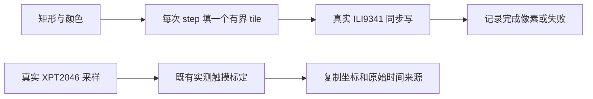

# 有界显示与触摸组合

`display_reference.c` 由已有应用任务调用真实 ILI9341 与 XPT2046 组件；显示与触摸
使用相同串行执行者，应用提供 device、精确 Board 装配、标定和 tile scratch。
factory 只取得静态接口；本组合不启动平台或创建 GUI task。

`example_ui_fill_begin` 仅检查逻辑 viewport 和矩形；`example_ui_fill_step` 每次最多
提交一个 tile。容量至少一整行，调用方据总线预算选择行数。例如 240 像素、RGB565
单个 20 行 tile 为 9,600 字节，两个为 19,200 字节；本同步路径通常只需一个。
它不分配 153,600 字节的全屏 framebuffer。实际设备方向必须与 viewport 相同。

全部 tile bus 命令共用本次有限绝对 deadline。ILI9341 的 parallel16 endpoint 是
settled 同步接口，任何返回后均已结束像素访问，scratch 可以复用；不能将此规则
照搬到未来 DMA/GUI flush。BUSY 表示矩形还有未画行，不表示本 tile 仍被借用。
错误保留完成像素前缀并关闭 drawing；物理面板可能部分更新，调用方先处理原
ILI9341 的 UNCERTAIN binding，再决定重绘，示例不会盲目重发。

`example_ui_touch` 使用实际 XPT2046 sample 后调用已有
`recipes/control/touch_reference.c`。标定必须实测并匹配方向；pen-up、viewport
之外和失败均不覆盖上一输出，不添加 clipping、gesture、debounce 或时间精度承诺。

停止顺序为关闭输入／绘图准入、join 调用者、成功停止 XPT2046 和 ILI9341，再由原
owner 撤回 SPI／parallel16／GPIO／Platform。显示 stop 不自动关闭外部供电或背光。
启明核心板与 V4.1 已有各自 `display-touch` 软件装配；其他 PCB 不能继承接线。

`terminal_reference_google` 直接执行真实 C 器件和映射路径，外部模型只提供 bus、pen、
clock 和持久介质。Native 检查不建立 LCD 光学、SPI／FSMC 电气或物理 HIL 资格。
